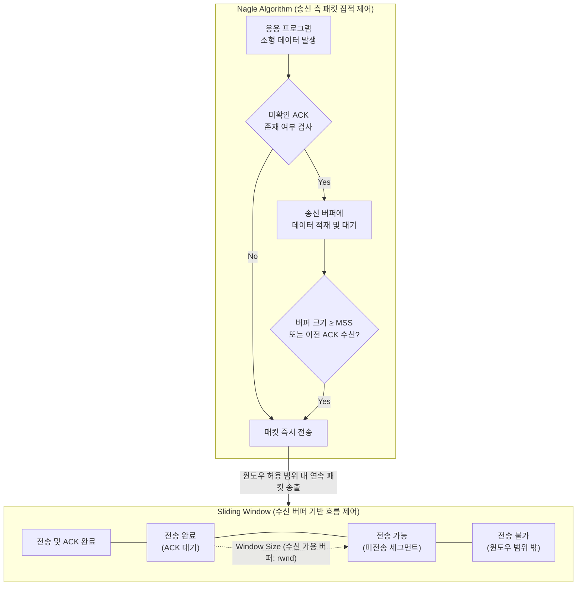

# Sliding Window 및 네이글(Nagle's) 알고리즘

---

## I. TCP 통신 효율성 극대화를 위한, Sliding Window와 Nagle 알고리즘 개요

수신 버퍼 크기 내에서 확인 응답(ACK) 없이 연속적으로 패킷을 전송하는 흐름 제어 기법(Sliding Window)과 소형 패킷의 과도한 전송을 억제하여 네트워크 대역폭 낭비를 방지하는 혼잡 제어 메커니즘(Nagle 알고리즘)이다.

| 구분 | 주요 내용 |
| --- | --- |
| **개념** | 수신 측 가용 버퍼(rwnd)를 기반으로 동적으로 윈도우 크기를 이동시키는 흐름 제어와, 패킷을 일정 크기(MSS)까지 모아서 전송하는 알고리즘의 결합 |
| **등장 배경** | Stop-and-Wait 방식의 낮은 전송 효율 극복, 1바이트 전송에 40바이트 헤더가 붙는 Tinygram 문제 및 Silly Window Syndrome 완화 필요 |
| **핵심 특징** | Sliding Window는 처리량(Throughput) 극대화, Nagle은 헤더 오버헤드 최소화 담당, 두 기법이 상호 보완적으로 작동하여 TCP 성능 최적화 달성 |

---

## II. Sliding Window와 Nagle 알고리즘의 동작 원리 및 핵심 기술 요소

### 가. Sliding Window와 Nagle 알고리즘의 동작 메커니즘

송신 측은 Nagle 알고리즘을 통해 자잘한 데이터를 하나의 최대 세그먼트(MSS) 단위로 모으거나 ACK를 대기하며, Sliding Window 메커니즘을 통해 수신 측 버퍼 허용치(rwnd)만큼 ACK 수신 전이라도 연속적으로 패킷을 방출한다.

### 나. 핵심 기술 요소 및 파라미터

| 분류 | 요소기술 (키워드) | 세부 설명 |
| --- | --- | --- |
| **Sliding Window** | 수신 윈도우 (rwnd) | 수신 측 소켓 버퍼의 여유 공간 크기로, 수신된 TCP 헤더의 Window 필드를 통해 송신 측에 통보 |
| **Sliding Window** | 혼잡 윈도우 (cwnd) | 네트워크 혼잡 상태를 감지하여 송신 측이 독자적으로 산정하는 전송 가능 윈도우 크기 |
| **Sliding Window** | 윈도우 슬라이딩 | 유효한 누적 ACK를 수신할 때마다 윈도우의 좌측 경계가 오른쪽으로 전진하며 새로운 데이터 전송 허용 |
| **Nagle 알고리즘** | MSS (Max Segment Size) | TCP 계층에서 분할 없이 단일 패킷으로 실어 보낼 수 있는 최대 데이터 페이로드 크기 (MTU - 40B) |
| **Nagle 알고리즘** | Tinygram 억제 | 페이로드 크기보다 TCP/IP 헤더 크기(40B)가 더 커서 발생하는 대역폭 낭비와 네트워크 혼잡 원천 차단 |
| **Nagle 알고리즘** | 조건부 버퍼링 | 확인되지 않은 이전 패킷이 네트워크 상에 존재할 경우, MSS에 도달할 때까지 추가 데이터를 버퍼에 적재 |
| **상호작용 이슈** | Delayed ACK | 수신 측이 패킷마다 ACK를 보내지 않고 최대 200~500ms 지연 후 응답하는 수신 최적화 기법 |
| **소켓 제어** | `TCP_NODELAY` | Nagle 알고리즘을 강제 비활성화하여 데이터 발생 즉시 세그먼트를 전송하도록 하는 소켓 옵션 |

---

## III. Nagle 알고리즘의 이슈 비교 및 최신 동향

### 가. Nagle 알고리즘과 Delayed ACK 간 상호작용 이슈 (일시적 교착 상태)

| 비교 항목 | 송신 측 (Nagle 활성화) | 수신 측 (Delayed ACK 활성화) |
| --- | --- | --- |
| **동작 상태** | 이전 패킷의 ACK가 올 때까지 버퍼에 소형 데이터를 모음 | 바로 ACK를 보내지 않고 반환 데이터와 피기배킹 대기 |
| **발생 문제** | 수신 측 ACK가 도착하지 않아 다음 패킷 송신 중단 | 송신 측의 후속 데이터가 오지 않아 ACK 타이머 만료까지 대기 |
| **성능 영향** | 약 200~500ms 수준의 인위적 응답 지연(Latency Penalty) 발생 | 상호 대기 상태로 인한 처리 지연 |
| **해결 방안** | 소켓 레벨에서 **`TCP_NODELAY` 옵션 설정(Nagle 끄기)** | 애플리케이션 레벨의 버퍼 플러시 또는 타이머 단축 |

### 나. 최신 기술 동향 및 발전 방향

* **실시간 인터랙티브 환경의 Nagle 비활성화**: 클라우드 게임, 금융 초단타 매매(HFT), gRPC/REST 기반 [[MSA (Micro Service Architecture)|MSA]] 통신 환경에서는 1ms 미만의 극초저지연을 달성하기 위해 `TCP_NODELAY`를 기본 활성화하는 표준이 정착됨.
* **QUIC 기반 스트림 흐름 제어**: HTTP/3의 기반인 QUIC 프로토콜은 단일 TCP 연결 내에서의 HoL(Head-of-Line) 블로킹을 해소하고, 독립적인 스트림별 개별 슬라이딩 윈도우 흐름 제어를 지원하여 패킷 손실 시에도 전체 전송 지연을 방지함.

---

### 🔗 연관 토픽

- **소속 도메인**: [[00_네트워크_MOC|🌐 네트워크]]
- **세부 분류**: `3. 전송 계층 & 트래픽 / 혼잡 제어 (L4)`
- **핵심 연관 토픽**:
  - [[TCP]]
  - [[TCP 혼잡제어]]
  - [[QoS]]
  - [[알고리즘]]
