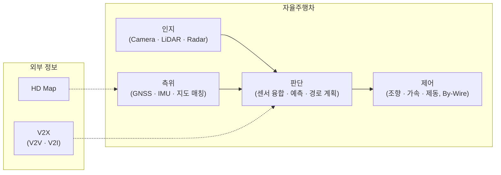

# Smart Car (자율주행)

---

## I. 인지·판단·제어를 차량이 스스로, 자율주행의 개요

### 가. 정의

- 센서·AI·통신·정밀지도를 융합하여 **주행 환경을 인지하고 경로를 판단해 조향·가감속을 스스로 제어**하는 차량 (SAE J3016 기준 Level 0~5)

### 나. 필요성 및 특징

| 구분 | 내용 |
| --- | --- |
| 안전성 | 교통사고 주원인인 인적 오류 감소 |
| 효율성 | 운전 부담 해소, 교통 흐름 최적화, 로보택시·물류 등 모빌리티 서비스 |
| 기술 융합 | 센서·AI·V2X·HD Map·고성능 컴퓨팅 결합 |
| 과제 | 예외 상황(Edge Case) 대응, 사고 책임, 사이버보안, 사회적 수용성 |

---

## II. 구조 및 기술요소

### 가. 구조

- 센서·V2X·지도로 주변과 자기 위치를 인지하고, 융합된 정보로 주행 경로를 계획한 뒤 By-Wire 구동계를 제어

### 나. 기술요소

| 구분 | 요소 | 설명 |
| --- | --- | --- |
| 인지 | Camera | 차선·신호등·표지판·보행자 등 객체 인식 |
| | LiDAR / Radar | 레이저 기반 3D 거리 측정 / 전파 기반 거리·속도 측정(악천후에 강함) |
| 측위 | GNSS · IMU · HD Map | 지도 매칭으로 차로 수준 위치 추정 ([[측위기술]]) |
| 판단 | Sensor Fusion | 이종 센서 결과를 결합해 각 센서 한계 보완 |
| | 경로 계획 · 행동 예측 | [[딥러닝]] 기반 주변 객체 궤적 예측, 경로 생성·충돌 회피 |
| | End-to-End 모델 | 센서 입력에서 주행 출력까지 단일 신경망으로 학습 |
| 제어 | By-Wire | 기계 연결 대신 전기 신호로 조향·제동 제어 |
| 인프라 | V2X | 차량-차량·인프라·보행자 통신 ([[C-ITS]]) |
| 플랫폼 | OTA | 자율주행 SW·AI 모델 원격 업데이트 |

---

## III. 비교 및 동향

### 가. SAE 자율주행 단계 (J3016)

| 레벨 | 명칭 | 주행 주체 | 운전자 역할 |
| --- | --- | --- | --- |
| Level 0 | 비자동화 | 운전자 | 경고 등 보조만 존재, 운전자가 모든 운전 |
| Level 1 | 운전자 보조 | 운전자 | 조향 또는 가감속 중 하나 지원 (ACC, LKA) |
| Level 2 | 부분 자동화 | 운전자 | 조향·가감속 동시 지원, 운전자 상시 감시 |
| Level 3 | 조건부 자동화 | 시스템 (ODD 내) | 시스템 요청 시 운전자가 개입 (Take-over) |
| Level 4 | 고도 자동화 | 시스템 (ODD 내) | ODD 내 개입 불필요, 시스템이 최소 위험 상태로 대응 |
| Level 5 | 완전 자동화 | 시스템 | 모든 도로·조건에서 운전자 불필요 |

### 나. 동향

- **SDV 전환**: 도메인·중앙 집중형 E/E 아키텍처와 OTA로 출고 후에도 기능 개선
- **상용화 현황**: 미국·중국에서 Level 4 로보택시 유상 운행 확대(Waymo, Baidu Apollo Go), 국내는 Level 3 안전기준(2019)·Level 4 성능인증 제도 도입
- **안전 · 보안 규제**: [[ISO 26262]]·SOTIF·UNECE R155(사이버보안)·R156(SW 업데이트) 준수가 형식승인 요건

---

### 🔗 연관 토픽

- **소속 도메인**: [[00_디지털서비스_MOC|🚀 디지털서비스]]
- **세부 분류**: `3. 사물인터넷 (IoT) & 스마트 플랫폼 · 메타버스`
- **핵심 연관 토픽**:
  - [[C-ITS|C-ITS (Cooperative-Intelligent Transport Systems)]]
  - [[ISO 26262]]
  - [[ASIL|ASIL (Automotive Safety Integrity Level)]]
  - [[측위기술|측위기술 (LDT Location Determination Technology)]]
  - [[Physical AI|물리적 AI]]
