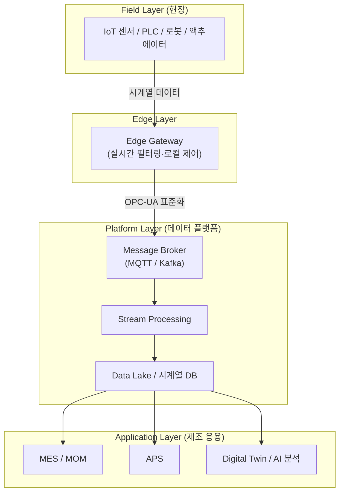

# Smart Factory (스마트 팩토리)

---

## I. 데이터 기반 지능형 생산 체계, 스마트 팩토리의 개요

### 가. 스마트 팩토리의 정의

- 기획·설계·생산·유통 등 제조 전 과정에 IIoT, AI, 빅데이터, [[디지털 트윈]] 등 ICT를 융합하여 **데이터를 기반으로 공정을 스스로 제어·최적화하는 지능형 공장**
- [[인더스트리 4.0 5.0|인더스트리 4.0]]의 핵심 구현체이며, [[CPS]]를 통해 물리 설비와 가상 모델을 실시간 동기화

### 나. 등장 배경 및 특징

| 구분 | 내용 |
| --- | --- |
| 다품종 소량생산 | 개인화 수요에 대응하는 유연 생산 체계 필요 |
| OT·IT 융합 | 현장 제어(OT)와 정보시스템(IT)을 결합하여 실시간 가시성 확보 |
| 자율 운영 | 사람 개입을 줄이고 AI·데이터로 스스로 판단하는 자율 공장 지향 |

---

## II. 스마트 팩토리 아키텍처 및 핵심 기술

### 가. 계층별 아키텍처 및 데이터 흐름

- 현장 데이터가 엣지·브로커·스트림 처리를 거쳐 [[MES]]와 디지털 트윈으로 전달되고, 분석 결과가 다시 현장 제어로 돌아가는 **폐루프(Closed-loop) 최적화** 구조

### 나. 핵심 기술 요소

| 구분 | 요소 | 설명 |
| --- | --- | --- |
| 연결·수집 | IIoT / 센서 | 온도·진동·전류 등 설비 상태를 실시간 수집 |
| | 이음5G ([[5G 특화망]]) | 로봇·AMR 간 초저지연·고보안 사내 무선망 |
| 통신 표준 | OPC-UA / [[MQTT (Message Queuing Telemetry Transport)\|MQTT]] | 이기종 설비 간 상호운용성 확보 |
| 처리·분석 | [[EDGE\|Edge]] Computing | 현장에서 즉시 분석하여 실시간 제어·대역폭 절감 |
| | PdM (예지보전) | 진동·소음 데이터를 AI로 분석해 고장 시점과 잔여 수명(RUL) 예측 |
| 제조 응용 | MES / APS | 생산·품질 관리(MES), 제약 기반 생산 계획([[스케줄링]]) 최적화(APS) |
| 가상화·제어 | CPS / 디지털 트윈 | 물리 설비와 가상 모델을 동기화하여 사전 시뮬레이션 |
| 보안 | OT 보안 ([[제로 트러스트 보안모델\|Zero Trust]]) | IT/OT 망 분리, 네트워크 세분화 |

---

## III. 공장자동화와의 비교 및 발전 동향

### 가. 공장자동화(FA) vs 스마트 팩토리

| 비교 항목 | 공장자동화 (FA) | 스마트 팩토리 |
| --- | --- | --- |
| 목표 | 생산성 향상, 무인화 | 데이터 기반 자율 최적화, 유연 생산 |
| 제어 방식 | 하드코딩된 PLC, 개별 자동화 | IIoT·클라우드·AI 기반 통합 제어 |
| 데이터 활용 | 제한적, 사후 분석 | 실시간 분석 및 예측 제어 |
| 유연성 | 대량생산 최적화, 공정 변경 곤란 | 디지털 트윈·APS로 공정 변경 신속 대응 |
| 시스템 연계 | 설비별 사일로(Silo) | [[SCM (Supply Chain Management)\|SCM]]·ERP와 실시간 연동 |

### 나. 최신 동향

- **산업용 생성형 AI**: 제조 특화 [[sLLM (Smaller Large Language Model)\|sLLM]] 기반 코파일럿이 정비 이력·매뉴얼을 근거로 조치 방법 제시, PLC 코드 생성 지원
- **SDM (Software-Defined Manufacturing)**: 장비 교체 없이 SW 업데이트로 공정을 재구성하고, AMR로 고정 컨베이어 의존도 축소
- **휴머노이드·VLM 융합**: [[Physical AI]] 기반 로봇이 복잡한 수작업 공정까지 자동화 범위 확대
- **그린 팩토리**: 탄소 규제 대응을 위해 EMS와 디지털 트윈으로 에너지·탄소 배출을 실시간 추적·최적화

---

### 🔗 연관 토픽

- **소속 도메인**: [[00_디지털서비스_MOC|🚀 디지털서비스]]
- **세부 분류**: `3. 사물인터넷 (IoT) & 스마트 플랫폼 · 메타버스`
- **핵심 연관 토픽**:
  - [[인더스트리 4.0 5.0|인더스트리 4.0 5.0 (Industry 4.0 5.0)]]
  - [[5G 특화망]]
  - [[CPS]]
  - [[디지털 트윈|디지털 트윈 (Digital Twin)]]
  - [[스마트팩토리 보안취약점 및 대응방안]]
