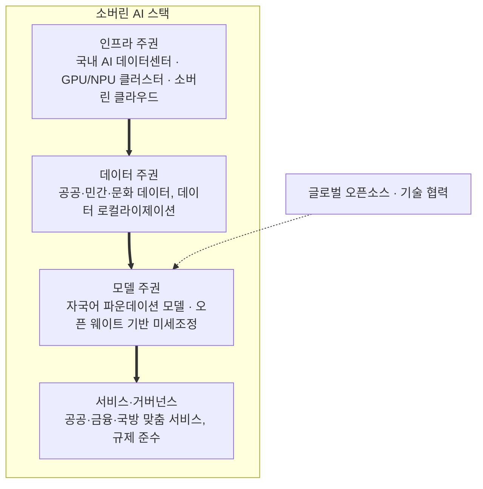

# Sovereign AI (소버린 AI)

---

## I. 국가·기업의 AI 주권 확보, 소버린 AI의 개요

### 가. 정의

- 국가나 기업이 **자체 인프라·데이터·[[파운데이션 모델]]·운영 역량**을 바탕으로 해외 기술 종속에서 벗어나 물리적·법적으로 통제할 수 있는 [[인공지능]] 체계

### 나. 등장 배경 및 특징

| 구분 | 내용 |
| --- | --- |
| 기술 종속 우려 | 글로벌 빅테크의 모델·클라우드 독점에 따른 문화·안보 종속 |
| 데이터 주권 | 공공·국방·기업 기밀 데이터의 해외 유출 방지, 현지 법규 준수 |
| 문화·언어 반영 | 자국의 언어·역사·가치관을 이해하는 모델 필요 |
| 규제 강화 | EU AI Act, [[AI 기본법]] 등 국가별 AI 규제와 데이터 보호주의 |

---

## II. 아키텍처 및 핵심 기술

### 가. 계층별 아키텍처

### 나. 핵심 기술 요소

| 구분 | 기술 | 설명 |
| --- | --- | --- |
| 인프라 | AI 데이터센터·HPC | 국내 GPU 클러스터로 연산 자원 자주권 확보 |
| | 소버린 클라우드 | 자국 법규를 준수하는 로컬 클라우드 |
| | AI 반도체 | 특정 [[GPU]] 벤더 종속을 줄이기 위한 국산 [[NPU]] |
| 데이터 | 데이터 로컬라이제이션 | 저장 위치를 자국 내로 한정, 학습 파이프라인 보안 통제 |
| 모델 | 로컬 파운데이션 모델 | 자국 언어·문화로 사전학습한 모델 |
| | 오픈 웨이트 + [[PEFT]]/[[LoRA(Low-rank adaptation)\|LoRA]] | 오픈 모델을 자국 데이터로 [[Fine-Tuning\|미세조정]]해 비용 효율적으로 주권 확보 |
| 보안 | 온프레미스·폐쇄망 | 외부망과 분리된 환경에서 운영 |
| | [[연합 학습]], RAG | 원본 데이터 이동 없이 학습, 기밀 데이터를 모델 밖에 두고 활용 |
| 거버넌스 | 레드팀·안전성 검증 | 자국 윤리 기준과 문화적 [[편향]] 검증 ([[AI 거버넌스]]) |

---

## III. 비교 및 동향

### 가. 소버린 AI vs 글로벌 범용 AI

| 비교 항목 | 소버린 AI | 글로벌 범용 AI |
| --- | --- | --- |
| 주도 | 국가·로컬 대표 기업 | 글로벌 빅테크 |
| 목적 | 데이터 주권, 문화·가치 독립 | 범용 지능, 글로벌 시장 |
| 데이터 | 자국어·로컬·민감 데이터 | 전 세계 웹 데이터 (영어 중심) |
| 인프라 | 로컬 데이터센터, 망분리 | 하이퍼스케일 글로벌 클라우드 |
| 규제 | 자국 규제 완전 준수 | 범용 가이드라인 (현지 규제와 충돌 가능) |
| 사례 | 하이퍼클로바X(한국), Mistral(프랑스), SEA-LION(동남아) | GPT, Gemini, Claude |

### 나. 동향

- **AI 인프라의 국가 전략화**: 칩 벤더의 국가별 'AI 팩토리' 지원 등 컴퓨팅 확보가 국가 경쟁력의 핵심
- **하이브리드 소버린 클라우드**: 핵심 데이터·모델은 로컬, 확장 연산은 신뢰 가능한 클라우드와 연동
- **버티컬 [[sLLM (Smaller Large Language Model)\|sLLM]]**: 행정·국방·금융·법률 등 분야별 온프레미스 소형 모델 시장 확대
- **지오패트리에이션**: 데이터·인프라를 국가별로 현지화하는 흐름과 연계 ([[가트너 2026 전략 기술]])

---

### 🔗 연관 토픽

- **소속 도메인**: [[00_인공지능_MOC|🤖 인공지능]]
- **세부 분류**: `6. 설명가능한 AI (XAI) & AI 윤리 · 거버넌스`
- **핵심 연관 토픽**:
  - [[AI 기본법]]
  - [[AI 거버넌스]]
  - [[sLLM (Smaller Large Language Model)]]
  - [[초거대 언어 모델|초거대 언어 모델(Large Language Model)]]
  - [[파운데이션 모델]]
