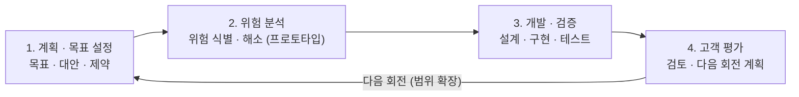

# 나선형 모델 (Spiral Model)

---

## I. 위험 분석을 축으로 한 반복 개발, 나선형 모델의 개요

### 가. 정의

- **폭포수의 체계성과 프로토타이핑의 반복성을 결합하고, 매 회전마다 위험 분석으로 위험을 제거하며 점진적으로 시스템을 완성**하는 위험 주도형 [[SDLC]] 모델 (B. Boehm, 1988)

### 나. 특징

| 구분 | 내용 |
| --- | --- |
| 위험 주도 | 회전마다 가장 큰 위험을 식별·해소한 뒤 다음 단계 진행 |
| 점진적 확장 | 중심에서 바깥으로 회전할수록 범위·완성도·누적 비용 증가 |
| 프로토타입 활용 | 불확실한 요구·기술을 시제품으로 검증 |
| 한계 | 위험 분석 전문성 필요, 관리 복잡, 소규모 사업에는 과도 |

---

## II. 회전 구조 및 구성요소

### 가. 4개 사분면 회전 구조

- 계획→위험 분석→개발→평가를 한 바퀴로 하여, 회전할수록 개념 → 요구 → 설계 → 구현으로 산출물이 구체화

### 나. 구성요소

| 구분 | 요소 | 설명 |
| --- | --- | --- |
| 사분면 | 계획 수립 | 해당 회전의 목표, 대안, 제약 조건 정의 |
| | 위험 분석 | 대안 평가, 기술·비용·일정 위험 식별과 해소 방안 결정 |
| | 개발 · 검증 | 해당 단계 산출물 설계·구현·[[통합 테스트\|테스트]] |
| | 고객 평가 | 결과 검토, 다음 회전 진행 여부 승인 |
| 핵심 기법 | 위험 주도 접근 | 실패 가능성과 영향이 큰 요소부터 해결 |
| | [[프로토타이핑 모델\|프로토타이핑]] | 위험 해소 수단으로 시제품 제작 |
| 관리 기법 | 앵커 포인트 마일스톤 | LCO(생명주기 목표)·LCA(아키텍처)·IOC(초기 운영 능력)로 진척 점검 |
| 적용 대상 | 대규모 · 고위험 사업 | 국방·항공우주 등 신기술·고비용 시스템 |

---

## III. 비교 및 동향

### 가. 나선형 vs 폭포수 vs 애자일

| 비교 항목 | 나선형 | [[워터폴\|폭포수]] | [[Agile\|애자일]] |
| --- | --- | --- | --- |
| 개발 방식 | 위험 분석 중심 반복 | 단계별 순차 | 짧은 주기 반복·협업 |
| 위험 관리 | 회전마다 공식 위험 분석 | 후반 발견, 사후 대응 | 스프린트 피드백으로 조기 대응 |
| 요구 변경 | 회전 단위로 수용 | 수용 곤란 | 상시 수용 |
| 문서화 | 상세 | 매우 엄격 | 최소화 |
| 적합 사업 | 대규모·고위험 | 요구 명확·안정 | 불확실성 높은 신규 서비스 |

### 나. 동향

- 나선형을 발전시킨 ICSM(Incremental Commitment Spiral Model)이 위험 기반 의사결정을 대형 시스템 공학에 적용
- 대형 국방·공공 사업에서 단계 관문 통제와 애자일 반복을 결합한 하이브리드 방식으로 계승

---

### 🔗 연관 토픽

- **소속 도메인**: [[00_소프트웨어공학_MOC|🏗️ 소프트웨어공학]]
- **세부 분류**: `1. 소프트웨어 개발 생명주기(SDLC) & 방법론`
- **핵심 연관 토픽**:
  - [[SDLC]]
  - [[워터폴|폭포수 모델]]
  - [[프로토타이핑 모델]]
  - [[위험 기반 테스트]]
  - [[소프트웨어 개발 방법론]]
