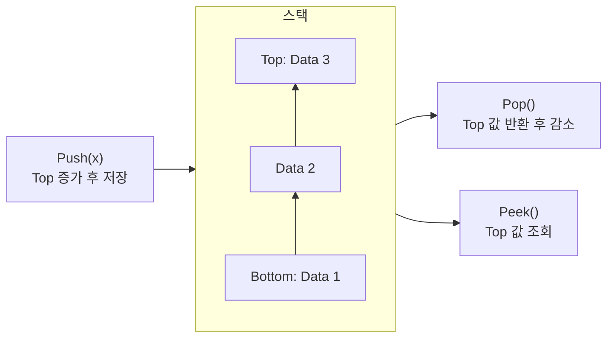

# 스택 (Stack)

---

## I. 나중에 넣은 것을 먼저 꺼내는, 스택의 개요

### 가. 정의

- 한쪽 끝(Top)에서만 삽입(Push)·삭제(Pop)가 일어나는 **후입선출(LIFO, Last In First Out)** 선형 자료구조

### 나. 특징

| 구분 | 내용 |
| --- | --- |
| LIFO | 마지막에 넣은 원소가 가장 먼저 나옴 |
| O(1) 연산 | Push·Pop·Peek 모두 상수 시간 |
| 역순·되돌리기 | 함수 호출 복귀, 수식 계산, Undo, 백트래킹에 적합 |
| 시스템 기반 | [[프로세스]]의 호출 스택이 지역 변수·복귀 주소 보관 |

---

## II. 구조 및 구성요소

### 가. 연산 구조

- 예: Push 1, 2, 3 후 Pop 하면 3, 2, 1 순서로 나옴

### 나. 구성요소

| 구분 | 요소 | 설명 |
| --- | --- | --- |
| 연산 | Push / Pop | Top에 삽입 / Top에서 제거 |
| | Peek / IsEmpty / IsFull | Top 조회, 공백·포화 검사 |
| 오류 | 오버플로우 / 언더플로우 | 가득 찬 스택에 Push / 빈 스택에서 Pop |
| 구현 | [[배열]] 기반 | 인덱스로 Top 관리, 크기 고정(또는 재할당) |
| | [[링크드 리스트\|연결 리스트]] 기반 | 헤드에서 삽입·삭제, 크기 제한 없음, 포인터 오버헤드 |
| 시스템 | 호출 스택 (Call Stack) | 함수마다 스택 프레임(매개변수·지역 변수·복귀 주소) 생성 |
| | 스택 포인터 (SP) | [[CPU]] 레지스터가 스택 최상단 주소를 가리킴 |
| 응용 | DFS·백트래킹 | [[그래프 순회]]에서 다음 탐색 정점 관리 |
| | 수식 처리 | 괄호 검사, 중위→후위 변환, 후위 표기 계산 |

---

## III. 비교 및 동향

### 가. 스택 vs 큐

| 비교 항목 | 스택 | [[Queue]] |
| --- | --- | --- |
| 원리 | LIFO | [[FIFO]] |
| 입출력 위치 | Top 한쪽 | 삽입 Rear, 삭제 Front |
| 활용 | 함수 호출, 괄호 검사, DFS, Undo | 작업 대기열, BFS, 버퍼 |
| 구현 | 배열, 연결 리스트 | 원형 큐, 연결 리스트 |

### 나. 동향

- **Shadow Stack**: 복귀 주소를 별도 보호 스택에 복사해 ROP 공격 차단 (Intel CET, ARM GCS, Windows 하드웨어 강제 스택 보호)
- **스택 보호 기법**: 스택 카나리, 실행 금지(NX), ASLR로 스택 버퍼 오버플로우 대응

---

### 🔗 연관 토픽

- **소속 도메인**: [[00_컴퓨터구조_MOC|💻 컴퓨터구조]]
- **세부 분류**: `2. 캐시 & 메모리 계층 구조 · 스토리지`
- **핵심 연관 토픽**:
  - [[Queue]]
  - [[선형 자료구조와 비선형 자료구조]]
  - [[그래프 순회|그래프 순회 (Graph Traversal)]]
  - [[메모리 관리]]
  - [[링크드 리스트|링크드 리스트(Linked List)]]
