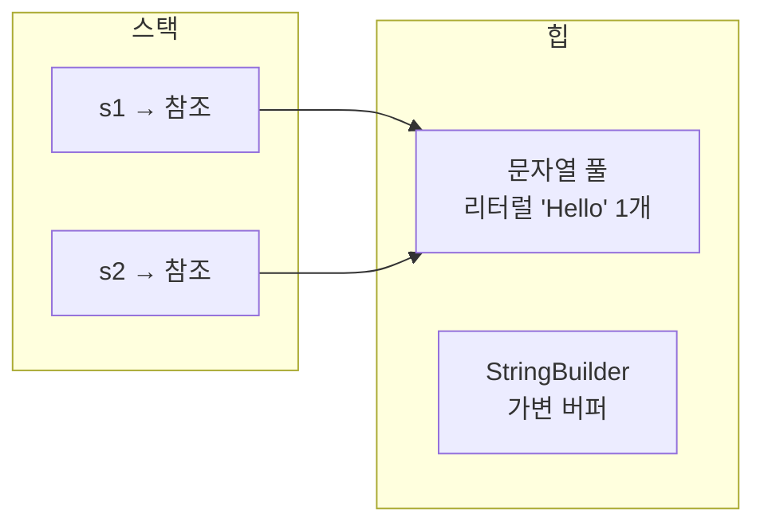

# String Type (문자열 타입)

---

## I. 문자의 나열을 다루는, 문자열 타입의 개요

### 가. 정의

- **문자들의 순서 있는 나열을 표현하는 자료형**으로, 언어에 따라 문자 배열(C의 NULL 종료 char 배열) 또는 문자열 객체(Java·Python의 String)로 구현

### 나. 특징

| 구분 | 내용 |
| --- | --- |
| 인코딩 의존 | 저장 시 문자 집합·인코딩(ASCII, UTF-8, UTF-16)에 따라 바이트로 변환 |
| 불변성 | Java·Python·C# 등은 불변 객체, 수정 시 새 문자열 생성 |
| 길이 표현 | NULL 종료(C) 또는 길이 필드 저장(대부분의 현대 언어) |
| 보안 민감 | 입력 문자열이 명령·쿼리로 해석되는 인젝션 취약점의 주 경로 |

---

## II. 구조 및 구성요소

### 가. 메모리 구조 (Java 예)

- 같은 리터럴은 풀의 객체 하나를 공유(Interning), 반복 연결은 가변 버퍼(StringBuilder)로 처리

### 나. 구성요소

| 구분 | 요소 | 설명 |
| --- | --- | --- |
| 표현 | C 문자열 | 끝에 '\0'을 둔 char 배열, 길이 계산 O(n), 경계 검사 없음 |
| | 문자열 객체 | 길이·문자 배열(byte[]/char[])을 가진 객체 |
| 인코딩 | UTF-8 | 1~4바이트 가변, ASCII 호환, 웹 표준 |
| | UTF-16 | 2바이트 또는 4바이트(서로게이트 쌍), Java·JavaScript·Windows 내부 표현 |
| 메모리 최적화 | String Interning | 같은 문자열을 한 객체로 공유 |
| | Compact Strings (Java 9+) | Latin-1로 표현 가능하면 문자당 1바이트로 저장 |
| 가변 버퍼 | StringBuilder / StringBuffer | 내부 버퍼를 늘려가며 수정 (Buffer는 동기화) |
| 처리 | 정규 표현식 | 패턴 검색·추출·치환 |
| 보안 | 포맷 문자열·[[SQL(Structured Query Language)\|SQL]] 인젝션 | 입력값을 형식 지정자·쿼리로 해석해 발생, 매개변수화로 방어 |
| DB 타입 | CHAR / VARCHAR / TEXT·CLOB | 고정 길이 / 가변 길이 / 대용량 텍스트 ([[Char Type]]) |

---

## III. 비교 및 동향

### 가. 불변 문자열 vs 가변 문자열

| 비교 항목 | 불변 (String) | 가변 (StringBuilder) |
| --- | --- | --- |
| 상태 | 생성 후 변경 불가 | 버퍼 안에서 수정·추가 |
| 반복 연결 | 매번 새 객체 생성, GC 부담 | 버퍼 재사용, 효율적 |
| 스레드 안전 | 안전 (공유해도 변하지 않음) | 안전하지 않음 (StringBuffer는 동기화) |
| 활용 | 맵의 키, 상수, 설정값 | 반복 조립, 동적 쿼리, 로그 생성 |

### 나. 동향

- **복사 없는 문자열 뷰**: C++ std::string_view, Rust &str, Go 슬라이스처럼 원본을 공유하는 참조로 복사 비용 제거
- **UTF-8 기본화**: Java 18부터 기본 문자셋 UTF-8, Python 3 str은 Unicode 기본
- **메모리 안전**: C 문자열 함수(strcpy 등)의 버퍼 오버플로우를 피하려 경계 검사 함수와 메모리 안전 언어 사용 확대

---

### 🔗 연관 토픽

- **소속 도메인**: [[00_컴퓨터구조_MOC|💻 컴퓨터구조]]
- **세부 분류**: `2. 캐시 & 메모리 계층 구조 · 스토리지`
- **핵심 연관 토픽**:
  - [[Char Type]]
  - [[Data Type]]
  - [[배열]]
  - [[SQL(Structured Query Language)]]
  - [[변수]]
