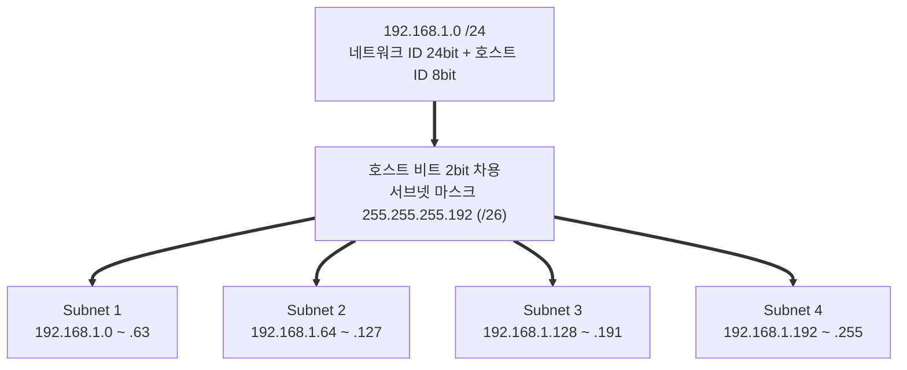

# 서브네팅 (Subnetting)

---

## I. IP 주소 공간의 논리적 분할, 서브네팅의 개요

### 가. 정의

- **호스트 ID의 일부 비트를 서브넷 ID로 차용(Borrowing)** 하여 하나의 네트워크를 여러 개의 독립된 하위 네트워크(Subnet)로 나누는 주소 설계 기법

### 나. 필요성 및 특징

| 구분 | 내용 |
| --- | --- |
| 주소 효율 | [[IPv4]] 주소 공간을 필요한 규모에 맞게 배분해 낭비 최소화 |
| 성능 | 브로드캐스트 도메인 축소로 불필요한 트래픽 감소 |
| 보안·관리 | 부서·용도별 논리적 망 분리, 서브넷 간 ACL 통제 |
| 라우팅 최적화 | 경로 요약(Route Summarization)으로 [[라우터]] 테이블 축소 |

---

## II. 서브네팅 원리 및 핵심 요소

### 가. 비트 차용 개념도 (192.168.1.0/24 → /26)

- 차용 비트 $s$개 → 서브넷 $2^s$개, 남은 호스트 비트 $h$개 → 서브넷당 가용 호스트 $2^h - 2$개 (예: /26은 4개 서브넷, 각 62대)
- IP 주소와 서브넷 마스크를 **AND 연산**하면 소속 네트워크 주소가 나옴

### 나. 핵심 요소

| 구분 | 요소 | 설명 |
| --- | --- | --- |
| 주소 체계 | 서브넷 마스크 | 네트워크·호스트 영역을 구분하는 32비트 값 |
| 표기 | CIDR | `/` 뒤에 프리픽스 길이를 적는 클래스 없는 표기 |
| 식별 주소 | 네트워크 주소 | 호스트 비트가 모두 0 (호스트에 할당 불가) |
| | 브로드캐스트 주소 | 호스트 비트가 모두 1 (점대점 링크는 /31로 두 주소 모두 사용 가능, RFC 3021) |
| 가변 분할 | VLSM | 서브넷마다 다른 길이의 마스크 적용 |
| 주소 변환 | NAT / PAT | 사설 IP(RFC 1918)와 공인 IP 변환 |
| 클라우드 | VPC Subnet | 퍼블릭·프라이빗 서브넷, NAT Gateway, NACL·Security Group |
| 차세대 | [[IPv6]] | 서브넷 ID 16bit, 인터페이스 ID 64bit 구조의 계층적 설계 |

---

## III. 분할 기법 비교 및 동향

### 가. FLSM vs VLSM

| 비교 항목 | FLSM (고정 길이) | VLSM (가변 길이) |
| --- | --- | --- |
| 분할 방식 | 모든 서브넷 동일 크기 | 필요 호스트 수에 맞춰 크기 조정 |
| 주소 활용 | 낭비 큼 | 낭비 최소화 |
| 설계 | 평면 구조 | 계층 구조, 경로 요약에 유리 |
| 라우팅 프로토콜 | Classful (RIPv1, IGRP) | Classless (RIPv2, OSPF, EIGRP, [[BGP]]) |

### 나. 온프레미스 vs 클라우드 VPC 서브네팅

| 비교 항목 | 온프레미스 | 클라우드 VPC |
| --- | --- | --- |
| 구현 | 장비별 [[라우터]]·[[스위치]] 설정 | 콘솔·API 기반 소프트웨어 정의 ([[SDN(Software Defined Network)\|SDN]]) |
| 유연성 | 물리 제약으로 변경 공수 큼 | 서브넷 생성·확장 실시간 |
| 격리 | VLAN, 물리 [[방화벽]] | 퍼블릭/프라이빗 티어, 보안 그룹 |

### 다. 동향

- **클라우드 설계의 기본 단위**: 여러 가용 영역(AZ)에 서브넷을 분산 배치해 [[HA(High Availability)|고가용성]] 확보, 웹·DB 티어 분리로 [[제로 트러스트 보안모델|Zero Trust]] 구현
- **IaC·AI 자동화**: [[멀티클라우드]] 환경에서 CIDR 충돌 검사와 서브넷 설계 자동화
- **IPv6 전환**: 주소 부족은 해소되지만 보안 구역·관리 편의를 위해 서브넷 설계는 계속 필요

---

### 🔗 연관 토픽

- **소속 도메인**: [[00_네트워크_MOC|🌐 네트워크]]
- **세부 분류**: `2. 네트워크 계층 & 라우팅 프로토콜 (L3)`
- **핵심 연관 토픽**:
  - [[IPv4]]
  - [[IPv6]]
  - [[IP]]
  - [[라우터]]
  - [[네트워크 계층|네트워크 계층 (Network Layer)]]
