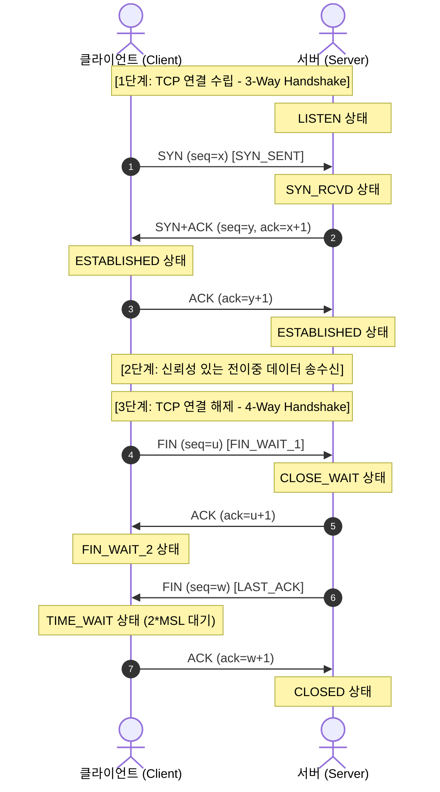

# TCP 연결의 설정 및 해제 (TCP Connection Establishment and Termination)

---

## I. 신뢰성 있는 세션 수립과 자원 정리를 위한 연결 제어 메커니즘, TCP 핸드셰이킹의 개요

TCP 통신 시 종단 간(End-to-End) 신뢰성 있는 전이중 데이터 전송 경로를 확립하기 위해 3단계로 세션을 수립(3-Way Handshake)하고, 데이터 송수신 완료 후 안전하게 소켓 자원을 회수하기 위해 4단계로 세션을 종료(4-Way Handshake)하는 제어 절차이다.

| 구분 | 주요 내용 |
| --- | --- |
| **개념** | 클라이언트와 서버 간 순서 번호(Sequence Number)를 동기화하여 연결을 맺고, 버퍼 내 잔여 데이터를 안전하게 처리한 뒤 정상 종료하는 프로토콜 제어 절차 |
| **등장 배경** | 비연결형 IP 네트워크 환경에서 패킷 유실, 역전, 중복 수신 방지 및 양방향 통신 채널의 신뢰성·무결성 보장 필요 |
| **핵심 특징** | RFC 9293 표준 준수, 세션 상태 전이 관리(LISTEN, ESTABLISHED, TIME_WAIT 등), 양방향 독립적 종료 지원 |

---

## II. TCP 연결 설정 및 해제의 아키텍처 및 핵심 구성요소

### 가. TCP 3-Way 및 4-Way Handshake 프로세스

3-Way Handshake를 통해 상호 시퀀스 번호를 동기화하여 연결을 수립하고, 4-Way Handshake를 통해 양방향 연결을 각각 독립적으로 해제하여 지연 패킷 소멸을 보장한다.

### 나. TCP 핸드셰이킹의 핵심 기술 및 구성 요소

| 분류 | 요소기술 (키워드) | 세부 설명 |
| --- | --- | --- |
| **연결 설정** | SYN / ISN | 세션 동기화를 알리는 제어 플래그와 보안 강화를 위한 무작위 초기 순서 번호(Initial Sequence Number) |
| **연결 설정** | SYN+ACK / ACK | 서버의 연결 수락 및 클라이언트의 최종 확인 응답을 통해 상호 가용성 검증 완료 |
| **연결 해제** | FIN 플래그 | 송신 측에서 더 이상 전송할 데이터가 없음을 통보하는 연결 종료 제어 플래그 |
| **연결 해제** | TIME_WAIT | 마지막 ACK 유실로 인한 재전송 FIN 수신 및 잔류 지연 패킷 소멸을 대기하는 상태 (2*MSL 시간 유지) |
| **연결 최적화** | TCP Fast Open (TFO) | TFO 쿠키를 활용하여 초기 3-Way Handshake의 SYN 패킷 내에 실제 데이터를 실어 보내 지연 감소 |
| **예외 처리** | RST (Reset) 패킷 | 비정상적인 세션 단절, 닫힌 포트로의 접근, 심각한 오류 발생 시 즉시 연결을 강제 초기화 |
| **표준 통합** | RFC 9293 (STD 7) | RFC 793을 비롯하여 수십 년간 파편화되었던 TCP 표준 명세들을 공식적으로 집대성한 최신 표준 |

---

## III. 전통적 TCP 핸드셰이크 vs 최신 QUIC 연결 설정 비교 및 최신 동향

### 가. 전통적 TCP/TLS vs 최신 QUIC 연결 설정 비교

| 비교 항목 | 전통적 TCP + TLS 1.3 핸드셰이크 | 최신 QUIC 연결 설정 (HTTP/3) |
| --- | --- | --- |
| **왕복 지연 (RTT)** | **최소 2-RTT 필요** (TCP 1-RTT + TLS 1-RTT) | **1-RTT 또는 0-RTT** (전송 계층과 보안 암호화 계층 통합) |
| **연결 식별자** | IP 주소 및 포트 번호 4-Tuple 기반 바인딩 | 64비트 Connection ID 기반 (IP 변경 시에도 세션 유지) |
| **연결 마이그레이션** | Wi-Fi ➔ LTE 전환 시 세션 단절 (재연결 필요) | 네트워크 IP가 바뀌어도 끊김 없이 무중단 통신 지속 |
| **HoL 블로킹** | 단일 패킷 유실 시 모든 스트림 대기 발생 | 멀티 스트림 독립 처리로 유실된 특정 스트림만 재전송 대기 |

### 나. 최신 기술 동향 및 발전 방향

* **QUIC 프로토콜의 표준화 및 상용화**: 웹 브라우징(HTTP/3)과 모바일 앱 트래픽에서 TCP 핸드셰이크의 RTT 지연 문제를 극복하기 위해 UDP 기반 QUIC 0-RTT 연결 메커니즘 채택이 보편화됨.
* **TCP Fast Open과 BBR 혼잡 제어의 보급**: 기존 TCP 인프라를 유지하면서도 모바일 환경의 지연 시간을 줄이기 위해 TFO 적용과 Google BBR 알고리즘 결합이 클라우드 CDN 전반에 확산됨.

---

### 🔗 연관 토픽

- **소속 도메인**: [[00_네트워크_MOC|🌐 네트워크]]
- **세부 분류**: `3. 전송 계층 & 트래픽 / 혼잡 제어 (L4)`
- **핵심 연관 토픽**:
  - [[TCP]]
  - [[무결성]]
  - [[End-to-End]]
  - [[신뢰성]]
  - [[세션]]
