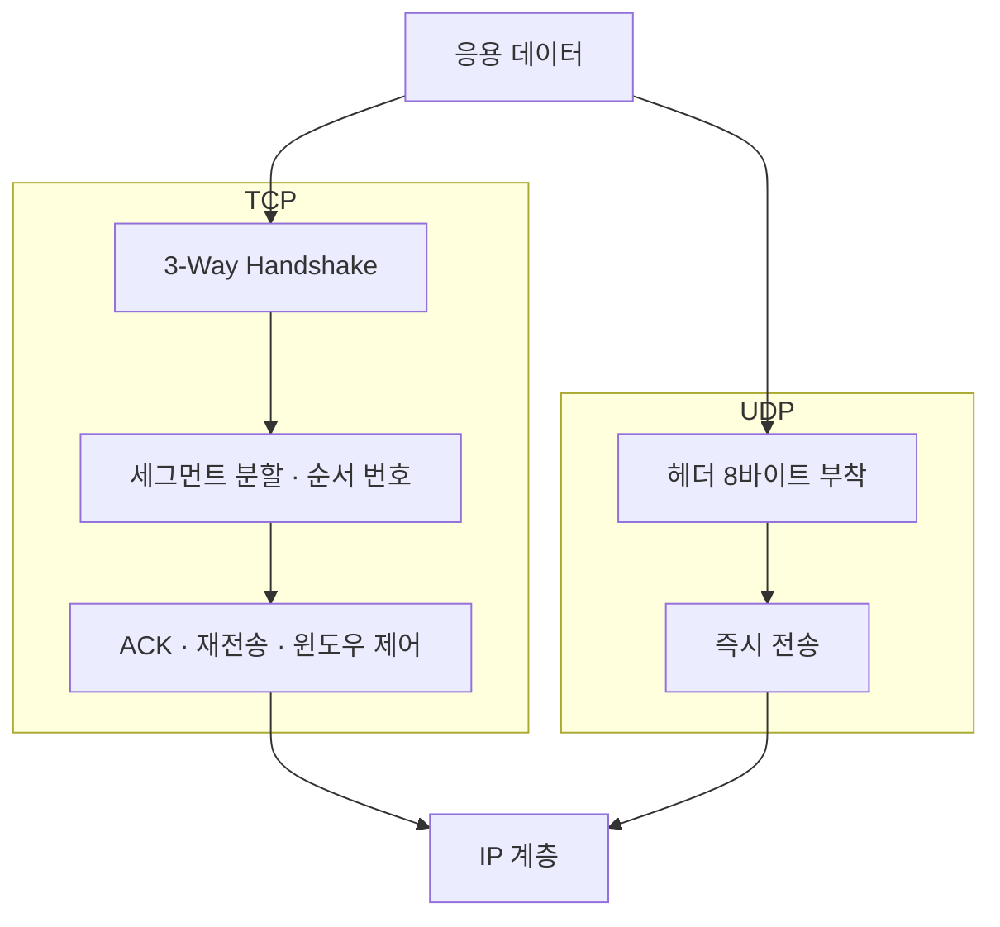

# TCP와 UDP 비교

---

## I. 신뢰냐 속도냐, TCP와 UDP의 개요

### 가. 정의

- 전송 계층의 두 대표 [[프로토콜]]로, **[[TCP]]는 연결을 맺고 신뢰성·순서를 보장하는 바이트 스트림, UDP는 연결 없이 데이터그램을 그대로 보내는 최소 기능 전송**

### 나. 특징

| 구분 | 내용 |
| --- | --- |
| TCP | 연결 설정, 재전송, 순서 보장, 흐름·[[TCP 혼잡제어\|혼잡 제어]] |
| UDP | 연결·재전송·순서·혼잡 제어 없음, 8바이트 헤더 (RFC 768) |
| 선택 기준 | 데이터 무결성이 중요하면 TCP, 지연·실시간성이 중요하면 UDP |
| UDP의 장점 | 연결 지연 없음, 브로드캐스트·멀티캐스트 가능, 응용이 제어 방식을 직접 설계 |
| 융합 | QUIC은 UDP 위에서 TCP 수준 신뢰성과 TLS를 구현 |

---

## II. 구조 및 구성요소

### 가. 전송 경로 비교

- TCP는 연결 상태를 유지하며 송신량을 조절하고, UDP는 상태 없이 데이터그램 단위로 IP에 넘김

### 나. 구성요소

| 구분 | 요소 | 설명 |
| --- | --- | --- |
| TCP 헤더 | 순서 번호 · ACK · 윈도우 · 플래그 | 기본 20바이트, 옵션 포함 최대 60바이트 |
| UDP 헤더 | 출발·목적 포트, 길이, 체크섬 | 8바이트 고정 (IPv4에서 체크섬 선택, IPv6에서 필수) |
| 연결 | TCP [[TCP 연결의 설정 및 해제\|3-Way / 4-Way Handshake]] | UDP는 없음 |
| 신뢰성 | TCP 재전송 · SACK | UDP는 응용이 필요 시 구현 (예: QUIC, RTP+FEC) |
| 흐름 제어 | TCP 슬라이딩 윈도우 | UDP 없음 |
| 혼잡 제어 | TCP cwnd (CUBIC, BBR) | UDP 없음 → 응용이 구현하지 않으면 망 혼잡 유발 가능 |
| 전송 방식 | TCP 유니캐스트만 | UDP 브로드캐스트·멀티캐스트 가능 |

---

## III. 비교 및 동향

### 가. TCP vs UDP

| 비교 항목 | TCP | UDP |
| --- | --- | --- |
| 연결 | 연결형 | 비연결형 |
| 신뢰성·순서 | 보장 | 보장 안 함 |
| 데이터 단위 | 바이트 스트림 (경계 없음) | 데이터그램 (경계 보존) |
| 헤더 | 20~60바이트 | 8바이트 |
| 흐름·혼잡 제어 | 있음 | 없음 |
| 상태 | 연결 상태 유지 | 무상태 |
| 활용 | 웹(HTTP/1.1·2), 파일 전송, 이메일, SSH | [[DNS(Domain Name System)\|DNS]], DHCP, VoIP, 스트리밍, 게임 |

### 나. 동향

- **QUIC·[[HTTP 3|HTTP/3]]**: UDP 위에서 스트림 다중화·암호화·연결 이동을 구현해 웹 전송의 대안으로 확산 (RFC 9000)
- **UDP 기반 응용 프로토콜 증가**: WebRTC, 게임, VPN(WireGuard)이 UDP 위에 자체 신뢰성·혼잡 제어 구현
- **[[SCTP (Stream Control Transmission Protocol)|SCTP]]**: 메시지 지향 + 신뢰성 + 멀티호밍의 제3의 선택지, 통신사 신호망 중심

---

### 🔗 연관 토픽

- **소속 도메인**: [[00_네트워크_MOC|🌐 네트워크]]
- **세부 분류**: `1. OSI 7계층 & 데이터링크 계층 (L1/L2)`
- **핵심 연관 토픽**:
  - [[TCP]]
  - [[전송 계층|전송 계층 (Transport Layer)]]
  - [[HTTP 3|HTTP/3]]
  - [[SCTP (Stream Control Transmission Protocol)]]
  - [[TCP 혼잡제어|혼잡 제어]]
