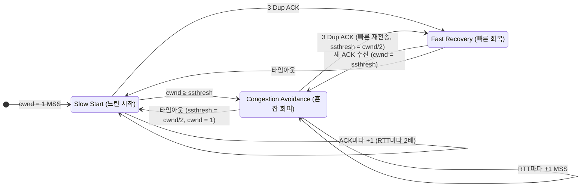

# TCP 혼잡제어 (TCP Congestion Control)

---

## I. 네트워크 붕괴 방지와 공정한 대역폭 분배, TCP 혼잡제어의 개요

### 가. 정의

- 라우터·링크의 과부하로 인한 패킷 손실을 막기 위해 **송신 측이 네트워크 상태를 추정하여 혼잡 윈도우(cwnd)로 전송량을 동적으로 조절**하는 [[TCP]]의 전송 제어 기법

### 나. 등장 배경 및 특징

| 구분 | 내용 |
| --- | --- |
| 등장 배경 | 1986년 인터넷 혼잡 붕괴(Congestion Collapse): 손실 → 무분별한 재전송 → 혼잡 악화의 악순환 |
| 송신 측 주도 | 송신 측이 ACK·타임아웃으로 혼잡을 추정 ([[End-to-End]] 제어) |
| 실제 전송량 | $\min(cwnd, rwnd)$, 혼잡 윈도우와 수신 윈도우 중 작은 값 |
| AIMD | 정상 시 선형 증가(Additive Increase), 손실 시 절반 감소(Multiplicative Decrease)로 공정성 확보 |

---

## II. 동작 원리 및 핵심 요소

### 가. 상태 전이 (TCP Reno 기준)

- 3 Dup ACK는 일부 패킷이 도착하고 있다는 신호이므로 가벼운 혼잡으로 보고 절반만 줄이며, 타임아웃은 심각한 혼잡으로 보고 cwnd를 1로 초기화

### 나. 핵심 요소

| 구분 | 요소 | 설명 |
| --- | --- | --- |
| 제어 변수 | cwnd | 송신 측이 ACK 없이 보낼 수 있는 데이터 양 |
| | ssthresh | 느린 시작에서 혼잡 회피로 전환하는 임계값 |
| 알고리즘 | Slow Start | ACK마다 cwnd +1 MSS, RTT마다 2배 증가 |
| | Congestion Avoidance | RTT마다 cwnd +1 MSS 선형 증가 |
| | Fast Retransmit | 3 Dup ACK 수신 시 타임아웃 전에 즉시 재전송 |
| | Fast Recovery | cwnd를 1이 아닌 절반으로 줄이고 혼잡 회피로 복귀 (Reno) |
| 버전 | Tahoe → Reno → NewReno → CUBIC | Tahoe는 손실 시 항상 cwnd = 1, CUBIC은 3차 함수로 증가해 리눅스 기본 |
| | BBR | 병목 대역폭과 최소 RTT를 측정해 전송률 결정 (모델 기반) |
| 네트워크 지원 | ECN | 라우터가 손실 전에 IP 헤더에 혼잡을 표시해 송신 측이 미리 감속 |
| | AQM (RED, CoDel) | 큐가 차기 전에 확률적으로 폐기해 버퍼블로트 완화 |

---

## III. 비교 및 동향

### 가. 혼잡제어 vs 흐름제어

| 비교 항목 | 혼잡제어 | 흐름제어 |
| --- | --- | --- |
| 목적 | 네트워크(라우터) 과부하 방지 | 수신 측 버퍼 오버플로 방지 |
| 병목 지점 | 라우터 큐, 링크 | 수신 호스트 버퍼 |
| 판단 주체 | 송신 측이 추정 | 수신 측이 rwnd 통보 |
| 기준 변수 | cwnd | rwnd |
| 기법 | Slow Start, AIMD, Fast Recovery | [[Sliding Window & 네이글(Nagle's) 알고리즘\|Sliding Window]], Stop-and-Wait |

### 나. 손실 기반 vs 모델 기반

| 비교 항목 | 손실 기반 (Reno, CUBIC) | 모델 기반 (BBR) |
| --- | --- | --- |
| 혼잡 신호 | 패킷 손실, 타임아웃 | 병목 대역폭, 최소 RTT 측정 |
| 큐 상태 | 버퍼를 가득 채워 버퍼블로트 유발 | 큐를 비운 상태 유지, 지연 최소화 |
| 고대역폭·장거리망 | 손실 한 번에 속도 급감 | 손실이 있어도 높은 처리량 유지 |
| 한계 | 무선 비혼잡 손실에 오판 | 다른 알고리즘과 공존 시 공정성 문제 (BBRv2·v3에서 개선) |

### 다. 동향

- **BBR 확산**: Google·CDN·클라우드에서 BBRv3 적용, QUIC 스택에도 탑재
- **데이터센터 혼잡제어**: ECN 기반 DCTCP, 지연 기반 Swift 등 초저지연 환경 특화
- **학습 기반 제어**: [[강화학습]]으로 망 상태 변화에 맞춰 전송률을 조절하는 연구

---

### 🔗 연관 토픽

- **소속 도메인**: [[00_네트워크_MOC|🌐 네트워크]]
- **세부 분류**: `3. 전송 계층 & 트래픽 / 혼잡 제어 (L4)`
- **핵심 연관 토픽**:
  - [[TCP]]
  - [[전송 계층]]
  - [[Sliding Window & 네이글(Nagle's) 알고리즘]]
  - [[Traffic Shaping (트래픽 쉐이핑)]]
  - [[QoS|QoS (Quality of Service)]]
