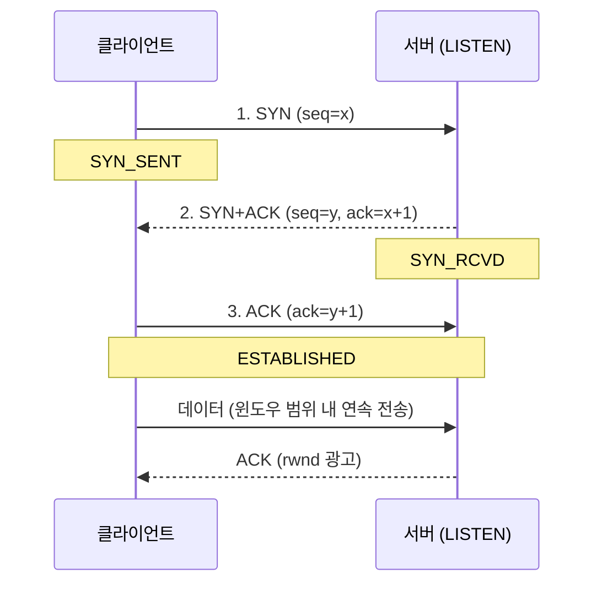

# TCP (Transmission Control Protocol)

---

## I. 순서대로, 빠짐없이 전달하는, TCP의 개요

### 가. 정의

- 종단 간([[End-to-End]]) **연결을 설정하고 순서 번호·확인응답·재전송으로 신뢰성 있고 순서가 보장된 바이트 스트림을 제공**하는 연결형 [[전송 계층]] [[프로토콜]] (RFC 9293, STD 7)

### 나. 특징

| 구분 | 내용 |
| --- | --- |
| 연결형 | 3-Way Handshake로 연결 설정, 4-Way로 종료 |
| [[신뢰성]] | 순서 번호, 누적 ACK, 타임아웃·중복 ACK 기반 재전송 |
| 바이트 스트림 | 메시지 경계 없음, 응용이 경계를 정해야 함 |
| 흐름 제어 | 수신 윈도우(rwnd)로 수신 버퍼 넘침 방지 |
| 혼잡 제어 | 혼잡 윈도우(cwnd)로 망 과부하 방지 |
| 전이중 | 한 연결에서 양방향 동시 전송 |

---

## II. 구조 및 구성요소

### 가. 연결 설정과 데이터 전송

- 초기 순서 번호를 교환해 연결을 맺은 뒤, 송신량은 min(rwnd, cwnd) 범위에서 결정

### 나. 구성요소

| 구분 | 요소 | 설명 |
| --- | --- | --- |
| 헤더 | 포트 · 순서 번호 · ACK 번호 | 프로세스 식별, 바이트 위치, 다음 기대 바이트 |
| | 플래그 | SYN, ACK, FIN, RST, PSH, URG (+ ECE, CWR) |
| | 윈도우 · 체크섬 | 수신 가능량 광고, 오류 검출 (헤더 기본 20바이트) |
| 연결 관리 | [[TCP 연결의 설정 및 해제\|3-Way / 4-Way Handshake]] | 연결 설정·종료, TIME_WAIT로 지연 패킷 정리 |
| 신뢰성 | 재전송 | RTO 타임아웃, 3중복 ACK에 의한 빠른 재전송 |
| | SACK | 받은 구간을 선택적으로 알려 필요한 부분만 재전송 |
| 흐름 제어 | [[Sliding Window & 네이글(Nagle's) 알고리즘\|슬라이딩 윈도우]] | rwnd 범위에서 확인 없이 연속 전송, Window Scale로 확장 |
| [[TCP 혼잡제어\|혼잡 제어]] | Slow Start · 혼잡 회피 · 빠른 회복 | cwnd 조절 (Reno, CUBIC, BBR) |
| 혼잡 통지 | ECN · AccECN | 손실 전에 혼잡을 표시받아 대응, AccECN은 피드백 정밀화 |

---

## III. 비교 및 동향

### 가. TCP vs UDP

| 비교 항목 | TCP | UDP |
| --- | --- | --- |
| 연결 | 연결형 | 비연결형 |
| 신뢰성 | ACK·재전송으로 보장 | 없음 (Best-Effort) |
| 순서 | 보장 | 보장 안 함 |
| 헤더 | 20~60바이트 | 8바이트 |
| 흐름·혼잡 제어 | 있음 | 없음 (응용이 필요 시 구현) |
| 활용 | 웹(HTTP/1.1·2), 파일 전송, 이메일 | DNS, VoIP, 스트리밍, 게임, QUIC 기반 |

### 나. 동향

- **표준 정리**: RFC 793과 수정 사항을 RFC 9293(2022)으로 통합
- **혼잡 제어 발전**: 리눅스 기본 CUBIC, 구글 BBR(v2·v3는 실험 단계), 느린 시작 탈출 개선 HyStart++(RFC 9406)
- **QUIC 확산**: 웹 트래픽 일부가 UDP 기반 QUIC로 이동, TCP는 여전히 대부분 서비스의 기반

---

### 🔗 연관 토픽

- **소속 도메인**: [[00_네트워크_MOC|🌐 네트워크]]
- **세부 분류**: `1. OSI 7계층 & 데이터링크 계층 (L1/L2)`
- **핵심 연관 토픽**:
  - [[TCP 와 UDP 비교]]
  - [[TCP 연결의 설정 및 해제]]
  - [[TCP 혼잡제어|혼잡 제어]]
  - [[Sliding Window & 네이글(Nagle's) 알고리즘]]
  - [[전송 계층|전송 계층 (Transport Layer)]]
