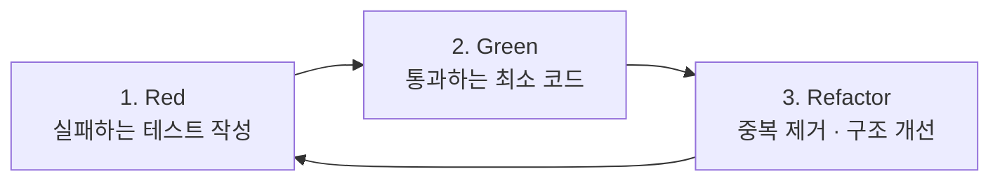

# TDD (Test-Driven Development, 테스트 주도 개발)

---

## I. 테스트를 먼저 쓰는 개발, TDD의 개요

### 가. 정의

- **실패하는 테스트를 먼저 작성하고, 이를 통과하는 최소 코드를 구현한 뒤 리팩토링하는 짧은 주기를 반복**하는 개발 방식 (Kent Beck, XP 실천법)

### 나. 특징

| 구분 | 내용 |
| --- | --- |
| 설계 도구 | 테스트를 먼저 쓰며 인터페이스·책임을 설계, 테스트하기 쉬운 [[모듈화]] 유도 |
| 안전망 | 축적된 테스트로 리팩토링·변경 시 회귀 결함 방지 |
| 실행 가능한 명세 | 테스트 코드가 기능 사용법과 기대 동작을 문서화 |
| 한계 | 초기 생산성 저하, UI·레거시 코드 적용 곤란, 테스트 유지보수 부담 |

---

## II. 수행 사이클 및 구성요소

### 가. Red-Green-Refactor 사이클

- 작은 요구 하나를 테스트로 표현해 실패를 확인하고, 가장 단순한 구현으로 통과시킨 뒤 테스트를 유지한 채 구조를 개선

### 나. 구성요소

| 구분 | 요소 | 설명 |
| --- | --- | --- |
| 사이클 | Red-Green-Refactor | 실패 → 통과 → 개선의 짧은 반복 |
| 도구 | xUnit 프레임워크 | JUnit, PyTest, Jest 등 [[단위 테스트]] [[프레임워크]] |
| 격리 | Test Double | Mock·Stub으로 DB·API 등 외부 의존 분리 |
| 테스트 원칙 | FIRST | Fast, Independent, Repeatable, Self-validating, Timely |
| 구현 전략 | Fake It · 삼각측량 | 가짜 구현으로 통과 후 예제를 늘려 일반화 |
| 품질 지표 | [[코드 커버리지]] | 높은 커버리지가 자연스럽게 따라오나 목표 자체는 아님 |
| 자동화 | CI 연계 | 커밋마다 전체 테스트 자동 실행 |

---

## III. 비교 및 동향

### 가. TDD vs BDD vs ATDD

| 비교 항목 | TDD | BDD | ATDD |
| --- | --- | --- | --- |
| 초점 | 코드 단위 동작 | 사용자 관점 행위 | 인수 기준 충족 |
| 작성자 | 개발자 | 개발자·QA·현업 협업 | 고객·QA·개발자 |
| 표현 | 단위 테스트 코드 | Given-When-Then 시나리오 (Gherkin) | 인수 테스트 |
| 도구 | JUnit, PyTest | Cucumber, SpecFlow | FitNesse, Robot Framework |
| 레벨 | 단위 | 기능·시스템 | 시스템·[[인수 테스트\|인수]] |

### 나. 동향

- LLM이 테스트 케이스·Mock을 제안해 Red 단계 작성 부담을 줄이되, 테스트 의도 검토는 개발자 몫
- AI 코딩 에이전트에게 테스트를 먼저 주고 구현을 맡기는 테스트 우선 방식이 생성 코드 검증 수단으로 부각
- [[뮤테이션 테스트]]로 TDD 테스트의 검출력 점검

---

### 🔗 연관 토픽

- **소속 도메인**: [[00_소프트웨어공학_MOC|🏗️ 소프트웨어공학]]
- **세부 분류**: `2. 애자일(Agile) & 지속적 통합/배포(CI/CD)`
- **핵심 연관 토픽**:
  - [[단위 테스트]]
  - [[소프트웨어 리팩토링]]
  - [[Agile]]
  - [[테스트 하네스]]
  - [[뮤테이션 테스트]]
