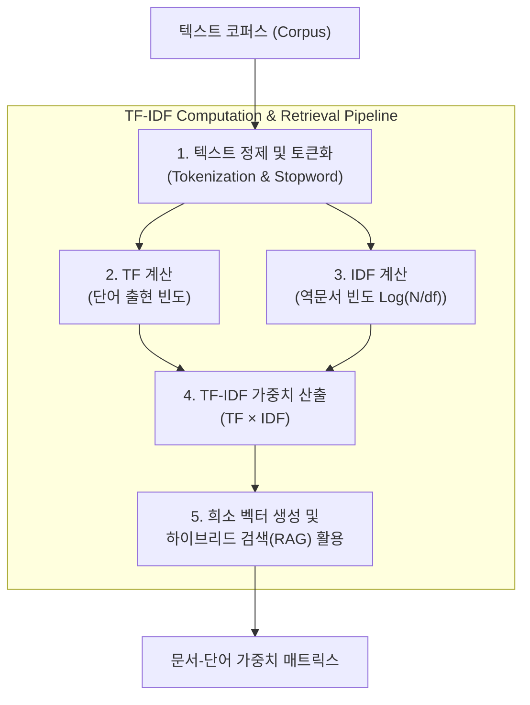

# TF-IDF (Term Frequency - Inverse Document Frequency)

---

## I. 문서 내 키워드 중요도 산정을 위한 통계적 가중치 모델, TF-IDF의 개요

### 가. TF-IDF의 정의
- 특정 문서 내 단어의 출현 빈도(TF)와 전체 문서군에서 해당 단어가 나타나는 문서 빈도의 역수(IDF)를 곱하여, 코퍼스 내에서 특정 단어가 가지는 변별력과 상대적 중요도를 수치화하는 텍스트 마이닝 통계 가중치 기법이다.

### 나. TF-IDF의 등장 배경 및 주요 특징

| 구분 | 주요 내용 |
| --- | --- |
| 불용어 가중치 감쇄 | '은/는/이/가', 'the/is' 등 빈도는 높으나 의미 변별력이 없는 불용어(Stopwords) 가중치 자동 억제 |
| 핵심 키워드 부각 | 특정 문서에만 집중적으로 등장하는 고유 전문 용어 및 핵심 주제어의 상대적 중요도 극대화 |
| 희소 벡터화 | 텍스트 코퍼스를 수치화된 고차원 희소 벡터(Sparse Vector)로 변환하여 검색 및 군집화 모델에 제공 |
| 하이브리드 검색 기반 | 최신 RAG 시스템에서 딥러닝 밀집 임베딩(Dense)과 상호 보완하는 키워드 매칭(Sparse)의 핵심 기반 |

---

## II. TF-IDF의 개념도 및 핵심 기술 요소

### 가. TF-IDF 산정 프로세스 및 동작 원리

* 원본 텍스트를 토큰화한 후 개별 문서 내 빈도(TF)와 전체 문서에서의 희소성(IDF)을 산출하여 두 값을 곱한 최종 TF-IDF 가중치 벡터를 생성하는 구조

### 나. TF-IDF의 핵심 기술 및 구성 요소

| 분류 | 요소기술(키워드) | 세부 설명 |
| --- | --- | --- |
| 빈도 지표 | 단어 빈도 (TF, Term Frequency) | 특정 문서 내에서 특정 단어가 등장하는 횟수 (정규화 적용 가능) |
| 희소성 지표 | 역문서 빈도 (IDF, Inverse Document Frequency) | 전체 문서 수($N$)를 해당 단어가 포함된 문서 수($df$)로 나눈 값의 로그($\log(N/df)$) |
| 가중치 산출 | TF-IDF 결합 가중치 | TF와 IDF 값을 곱하여 자주 나오지만 변별력이 낮은 단어의 가중치 하향 조정 |
| 벡터 표현 | 희소 벡터 (Sparse Vector) | 고차원의 단어 사전 기반으로 문서 내 단어의 중요도 점수를 배열 형태로 표현 |
| 발전 [[알고리즘]] | BM25 (Best Matching 25) | TF의 포화(Saturation) 문제와 문서 길이 정규화를 개선한 확장 검색 모델 |
| 검색 결합 | 하이브리드 검색 (Hybrid Search) | [[딥러닝]] 임베딩(Dense)과 TF-IDF/BM25(Sparse)를 결합하여 검색 정확도 극대화 |
| 활용 영역 | 키워드 추출 및 문서 분류 | 텍스트 요약, [[유사도]] 측정, 문서 군집화 및 스팸 필터링 등에 활용 |
| 구현 도구 | Scikit-learn / Lucene | Python의 scikit-learn TfidfVectorizer 및 아파치 루신(Lucene) 기반 인덱싱 |

---

## III. 전통적 Sparse Retrieval vs 최신 Dense Retrieval 비교 및 최신 동향

### 가. 희소 검색(Sparse) vs 밀집 검색(Dense) 비교

| 비교 항목 | 전통적 Sparse Retrieval (TF-IDF / BM25) | 최신 Dense Retrieval (Vector Embedding) |
| --- | --- | --- |
| **작동 원리** | 정확한 키워드 매칭 및 통계적 빈도 가중치 산정 | 신경망(Transformer 등) 기반 의미(Semantic) 벡터 공간 매칭 |
| **핵심 장점** | 고유명사, 코드 번호, 전문 용어의 정확한 어휘 매칭에 탁월 | 동의어, 유의어 처리 및 전반적인 문맥적 의미 파악 우수 |
| **주요 한계** | 단어 불일치(Vocabulary Mismatch) 및 문맥 이해 불가 | 희귀 어휘 매칭 누락 발생 및 고성능 임베딩 연산 자원 소요 |
| **표현 형태** | 고차원 희소 벡터 (대부분의 원소가 0) | 저차원 밀집 벡터 (통상 768 ~ 1536 차원 실수형) |

### 나. 한계 극복 및 최신 발전 동향
- **BM25 알고리즘 고도화**: 단어 빈도의 무한 증가를 억제하는 포화 매개변수($k_1$)와 문서 길이 정규화 가중치($b$)를 적용한 BM25가 키워드 검색의 글로벌 표준으로 안착
- **하이브리드 검색(Hybrid Search) 융합**: RAG 환경에서 희소 검색(BM25/TF-IDF)과 밀집 검색(Vector DB) 결과를 상호 순위 융합(RRF, Reciprocal Rank Fusion)하여 검색 재현율과 정확도 극대화
- **재순위화(Re-ranking) 파이프라인 연계**: 1차 하이브리드 검색 결과를 경량화된 Cross-Encoder 기반 리랭커로 재정렬하여 최종 LLM 생성 프롬프트의 맥락 품질을 비약적으로 향상

---

### 🔗 연관 토픽

- **소속 도메인**: [[00_인공지능_MOC|🤖 인공지능]]
- **세부 분류**: `1. 수학 · 통계학 & 데이터 전처리`
- **핵심 연관 토픽**:
  - [[유사도|유사도(Similarity)]]
  - [[자연어처리|자연어처리 (NLP)]]
  - [[표현 학습]]
  - [[딥러닝]]
  - [[초거대 언어 모델|초거대 언어 모델(Large Language Model)]]
