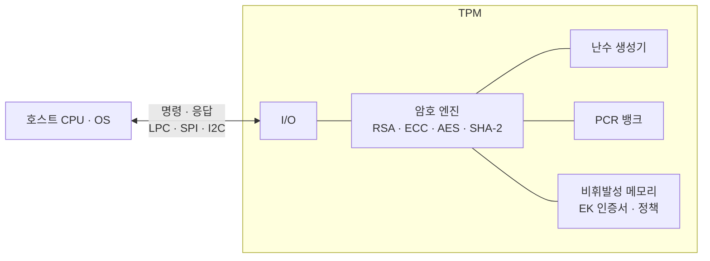

# TPM (Trusted Platform Module)

---

## I. 하드웨어 신뢰 기점, TPM의 개요

### 가. 정의

- TCG(Trusted Computing Group)가 규격화한 **보안 암호 프로세서로, 키를 안전하게 생성·보관하고 부팅 과정을 측정하여 플랫폼 무결성을 증명**하는 하드웨어 신뢰 기점 (TPM 2.0, ISO/IEC 11889)

### 나. 특징

| 구분 | 내용 |
| --- | --- |
| 키 보호 | 개인키가 칩 밖으로 나가지 않는 구조 |
| 측정 부팅 | 부팅 구성요소 해시를 PCR에 누적 기록 |
| 원격 증명 | PCR 값을 서명해 외부 검증자에게 플랫폼 상태 증명 |
| 봉인 (Sealing) | 특정 PCR 상태에서만 키·데이터 복원 (BitLocker 등) |
| 보급 | Windows 11 필수 요건으로 PC에 일반화 |

---

## II. 구조 및 구성요소

### 가. 내부 구조

- 호스트는 버스를 통해 TPM에 명령을 보내고, TPM 내부에서 키 생성·서명·봉인 연산을 수행해 결과만 돌려줌

### 나. 구성요소

| 구분 | 요소 | 설명 |
| --- | --- | --- |
| 측정 | PCR | `PCR_new = Hash(PCR_old ∥ 측정값)` 확장 방식으로 부팅 단계 기록 |
| 키 계층 | EK (Endorsement Key) | 칩 고유 식별, 제조사 인증서로 보증 |
| | SRK (Storage Root Key) | 저장 키 계층의 루트 |
| | AK (Attestation Key) | PCR 인용(Quote) 서명용 (TPM 1.2의 AIK) |
| 연산 | 암호 엔진 | RSA, ECC, AES, SHA-2 |
| | 난수 생성기 | 키 생성용 난수 |
| 저장 | NV 메모리 | 인증서, 카운터, 정책 데이터 |
| 기능 | 봉인·원격 증명 | 무결성 상태에 키를 묶고 상태를 외부에 증명 |
| 구현 형태 | dTPM / fTPM / vTPM | 별도 칩 / CPU 보안 영역 펌웨어(AMD fTPM, Intel PTT) / 가상 머신용 소프트웨어 TPM |

---

## III. 비교 및 동향

### 가. dTPM vs fTPM vs TEE·SE

| 비교 항목 | dTPM | fTPM | TEE / SE |
| --- | --- | --- | --- |
| 구현 | 메인보드의 독립 칩 | CPU 보안 영역 펌웨어 | SoC 격리 영역(TrustZone) / 보안 칩 |
| 강점 | 물리적 분리, 변조 저항 인증 | 추가 비용 없음 | 범용 보안 연산 / 결제·키 보관 |
| 약점 | 버스 스니핑 공격 (암호화 세션 미사용 시) | CPU 취약점 영향 (예: faulTPM) | 표준화 수준 상이 |
| 적용 | 기업 PC·서버 | 일반 소비자 PC | 스마트폰, 결제 단말 |

### 나. 동향

- **버스 보호**: TPM 2.0 파라미터 암호화 세션과 PIN 결합으로 버스 스니핑을 통한 디스크 키 탈취 방어
- **기밀 컴퓨팅 증명**: 클라우드 VM의 vTPM과 측정 부팅으로 워크로드 무결성 증명 ([[기밀컴퓨팅]])
- **PQC 대응**: TCG에서 양자내성 알고리즘 지원을 위한 TPM 규격 개정 작업 진행

---

### 🔗 연관 토픽

- **소속 도메인**: [[00_보안_MOC|🛡️ 보안]]
- **세부 분류**: `1. 정보보안 원칙 & 거버넌스 · 인증`
- **핵심 연관 토픽**:
  - [[기밀컴퓨팅|기밀컴퓨팅(Confidential Computing)]]
  - [[루트킷|루트킷(Rootkit)]]
  - [[부채널 공격|부채널 공격(Side Channel Attack)]]
  - [[RSA (Rivest Shamir Adleman)]]
  - [[ECC|ECC(Elliptic Curve Cryptography)]]
