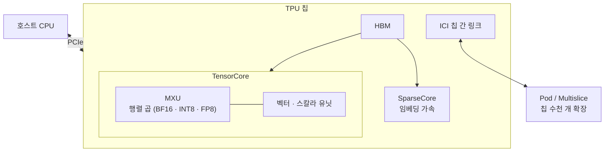

# TPU (Tensor Processing Unit)

---

## I. 구글의 딥러닝 전용 ASIC, TPU의 개요

### 가. 정의

- 구글이 신경망의 **행렬 곱셈을 [[시스톨릭 어레이]] 기반 행렬 연산 유닛(MXU)으로 가속하도록 설계한 [[인공지능]] 전용 ASIC** (2015년 사내 도입, 2016년 공개)

### 나. 특징

| 구분 | 내용 |
| --- | --- |
| MXU 중심 | 대형 시스톨릭 어레이(v1 256×256, v2~v5 128×128, v6e 256×256)로 행렬 곱 처리 |
| 전력 효율 | 범용 [[CPU]]·[[GPU]] 대비 신경망 연산의 와트당 성능 우수 |
| Pod 확장 | 칩 간 전용 링크(ICI)로 수천 개 칩을 하나의 Pod로 연결 |
| 클라우드 제공 | Google Cloud로만 제공, JAX·TensorFlow·PyTorch/XLA 지원 |

---

## II. 구조 및 구성요소

### 가. 칩 구조

- XLA 컴파일러가 연산 그래프를 MXU·벡터 유닛 명령으로 변환, 대형 모델은 ICI로 여러 칩에 분산

### 나. 구성요소

| 구분 | 요소 | 설명 |
| --- | --- | --- |
| 연산 | MXU | 시스톨릭 어레이로 구성된 행렬 곱-누산([[MAC 배열\|MAC]]) 유닛 |
| | 벡터·스칼라 유닛 | 활성화 함수, 정규화, 제어 흐름 |
| | SparseCore | 추천 모델 임베딩 조회 등 희소·비정형 접근 가속 (v4~) |
| 메모리 | [[HBM\|HBM (High Bandwidth Memory)]] | 파라미터·활성값을 담는 고대역폭 메모리 |
| 연결 | ICI (Inter-Chip Interconnect) | 칩 간 직접 연결, 2D·3D 토러스 구성 |
| | OCS (광 회로 스위치) | v4부터 Pod 토폴로지를 광 스위치로 재구성 |
| 확장 | Multislice | 여러 Pod(슬라이스)를 데이터센터 네트워크로 묶어 학습 |
| SW | XLA, JAX, TensorFlow | 그래프 컴파일과 분산 학습 지원 |

---

## III. 비교 및 동향

### 가. TPU vs GPU

| 비교 항목 | TPU | [[GPU]] |
| --- | --- | --- |
| 설계 | 신경망 전용 ASIC | 그래픽·범용 병렬 프로세서 |
| 연산 유닛 | MXU (시스톨릭) | CUDA 코어 + Tensor 코어 |
| 확장 | ICI·OCS 기반 Pod | NVLink·NVSwitch + InfiniBand·Ethernet |
| 생태계 | Google Cloud, JAX·XLA 중심 | CUDA 기반, 온프레미스·전 클라우드 |
| 강점 | 대규모 학습·추론의 전력·비용 효율 | 범용성, 소프트웨어 생태계 |

### 나. 동향

- **세대 진화**: v4(2021, OCS) → v5e·v5p(2023) → v6e Trillium(2024, v5e 대비 칩당 최대 성능 약 4.7배) → v7 Ironwood(2025, 추론 중심, Pod당 최대 9,216칩)
- **외부 고객 확대**: Gemini 학습·서빙 외에 Anthropic 등 외부 AI 기업의 대규모 TPU 사용으로 GPU 대안으로 부상

---

### 🔗 연관 토픽

- **소속 도메인**: [[00_컴퓨터구조_MOC|💻 컴퓨터구조]]
- **세부 분류**: `1. CPU 프로세서 & 마이크로아키텍처`
- **핵심 연관 토픽**:
  - [[시스톨릭 어레이]]
  - [[NPU|NPU(Neural Processing Unit)]]
  - [[GPU]]
  - [[PE|PE(Processing Element)]]
  - [[딥러닝]]
