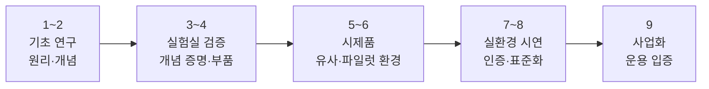

# TRL (Technology Readiness Level, 기술성숙도)

---

## I. 기술 완성도를 9단계로 재는, TRL의 개요

### 가. 정의

- 기술이 **기초 원리 발견(1단계)부터 실제 운용 입증(9단계)까지** 어느 수준에 도달했는지를 단계별로 평가하는 기술성숙도 척도 (NASA 1970년대 도입, 1990년대 9단계 정립)

### 나. 필요성 및 특징

| 구분 | 내용 |
| --- | --- |
| 필요성 | R&D 진도 관리, 기술 도입·투자 위험의 객관적 판단 |
| 공통 언어 | 연구자·투자자·발주자가 같은 척도로 성숙도 소통 |
| 단계 게이트 | 단계별 진입·종료 기준으로 과제 지속 여부 판단 |
| 유형별 적용 | 국내 R&D에서는 HW·SW·소재 등 기술 유형별 세부 기준 적용 |

---

## II. TRL의 단계 및 구성요소

### 가. 9단계 흐름

- 기초 연구 → 실험실 검증 → 시제품 → 실환경 검증 → 사업화로 갈수록 시험 환경이 실제 운용 환경에 가까워짐

### 나. 단계별 내용

| 구분 | 요소 | 설명 |
| --- | --- | --- |
| 기초 연구 | TRL 1 | 기본 원리 발견 |
| | TRL 2 | 기술 개념·적용 분야 정립 |
| 실험 | TRL 3 | 분석·실험으로 개념 증명 |
| | TRL 4 | 실험실 환경 부품·시스템 성능 검증 |
| 시제품 | TRL 5 | 유사 환경에서 확정된 부품·시스템 검증 |
| | TRL 6 | 파일럿 규모 시제품의 유사 환경 시연 |
| 실환경 | TRL 7 | 실제 환경에서 시제품 성능 검증 |
| | TRL 8 | 상용 제품 완성, 인증·표준화 |
| 사업화 | TRL 9 | 실제 운용·양산으로 성능 입증 |

---

## III. 연계 지표 비교 및 동향

### 가. TRL vs MRL vs CRL

| 구분 | TRL (기술성숙도) | MRL (제조성숙도) | CRL (사업화성숙도) |
| --- | --- | --- | --- |
| 평가 대상 | 기술 기능·성능 | 양산 공정·공급망 준비 | 시장·고객·비즈니스 모델 준비 |
| 단계 | 1~9 | 1~10 (미 국방부) | 기관별 정의 |
| 한계 보완 | 기술만으로 사업화 판단 어려움 | 양산 위험 반영 | 시장 수용성 반영 |

### 나. 동향

- **다중 지표 결합**: 기술 완성도만으로 사업화 성공을 보장하지 못해 TRL·MRL·CRL을 함께 평가하는 추세
- **SW·AI 적용 한계**: 반복 개발되는 SW·AI는 선형 단계 구분이 맞지 않아 별도 기준이나 데이터·모델 성숙도 지표 보완 필요
- **국가 R&D 관리**: 과제 선정·단계 평가 시 목표 TRL을 제시하고 [[기술 가치 평가]]와 연계

---

### 🔗 연관 토픽

- **소속 도메인**: [[00_경영전략_MOC|📈 경영전략]]
- **세부 분류**: `2. IT 거버넌스 & 엔터프라이즈 아키텍처 (EA/ISP)`
- **핵심 연관 토픽**:
  - [[기술 가치 평가]]
  - [[기술수용 주기|기술수용 주기(Technology Adoption Life Cycle)]]
  - [[딥테크|딥테크 (Deep Tech)]]
  - [[가트너 2026 전략 기술]]
  - [[환경분석]]
