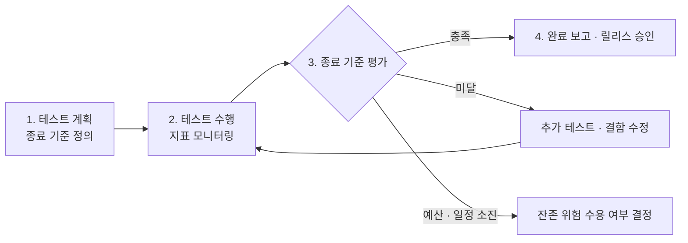

# 테스트 종료 조건 (Test Exit Criteria)

---

## I. 언제 테스트를 멈출 것인가, 테스트 종료 조건의 개요

### 가. 정의

- 테스트 레벨이나 활동을 **완료로 판정하기 위해 테스트 계획 단계에서 미리 합의한 정량·정성 기준** (ISTQB의 Exit Criteria, Definition of Done과 유사)

### 나. 필요성

| 구분 | 내용 |
| --- | --- |
| 객관적 판단 | 릴리스·다음 단계 진입 여부를 수치로 결정 |
| 무한 테스트 방지 | 완벽한 테스트가 불가능하므로 합리적 중단 기준 필요 |
| 위험 통제 | 치명 결함 잔존 상태의 출시 차단 |
| 자동화 연계 | CI/CD 품질 게이트로 자동 판정 |

---

## II. 판정 절차 및 구성요소

### 가. 판정 절차

- 계획 단계에서 기준을 정하고, 수행 중 지표로 평가해 충족 시 완료하며, 미달이면 추가 테스트하거나 잔존 위험을 이해관계자가 결정

### 나. 구성요소

| 구분 | 요소 | 설명 |
| --- | --- | --- |
| 수행 지표 | 테스트 수행률 | 계획된 케이스 중 실행 비율 (예: 100%) |
| | 테스트 통과율 | 실행 케이스 중 통과 비율 (핵심 기능은 전부 통과) |
| 결함 지표 | 잔존 결함 | 치명·중대 결함 미해결 0건 등 심각도별 기준 |
| | 결함 발견 추이 | 신규 결함 발견율이 수렴(감소)했는지 확인 |
| 커버리지 | 요구사항 · [[코드 커버리지]] | 요구사항 추적 100%, 분기 커버리지 기준 충족 |
| 위험 | 잔존 위험 평가 | 미해결 결함의 운영 영향 평가·수용 |
| 소진 기준 | 일정 · 예산 | 시간·비용 한도 도달 시 위험 수용 결정 |
| 자동화 | 품질 게이트 | SonarQube 등으로 빌드·배포 단계 자동 차단 |

---

## III. 비교 및 동향

### 가. 진입 조건 vs 종료 조건

| 비교 항목 | 진입 조건 (Entry Criteria) | 종료 조건 (Exit Criteria) |
| --- | --- | --- |
| 목적 | 테스트를 시작할 준비가 되었는지 판단 | 테스트를 끝내도 되는지 판단 |
| 판정 시점 | 테스트 레벨 시작 전 | 테스트 레벨 종료 시 |
| 예 | 테스트 환경·데이터 준비, 이전 레벨 통과, 빌드 안정 | 수행률·통과율·결함·커버리지 기준 충족 |
| 애자일 대응 | Definition of Ready | Definition of Done |

### 나. 동향

- 마일스톤 시점 수동 판정에서 커밋·빌드마다 자동 평가하는 CI/CD 품질 게이트로 전환
- 운영 지표(오류율·SLO)를 배포 후 판정 기준으로 쓰는 카나리 분석 등 배포 단계 게이트 확산

---

### 🔗 연관 토픽

- **소속 도메인**: [[00_소프트웨어공학_MOC|🏗️ 소프트웨어공학]]
- **세부 분류**: `2. 애자일(Agile) & 지속적 통합/배포(CI/CD)`
- **핵심 연관 토픽**:
  - [[Test Process]]
  - [[소프트웨어 테스트|소프트웨어 테스트 (Software Test)]]
  - [[코드 커버리지|코드 커버리지(Code Coverage)]]
  - [[위험 기반 테스트]]
  - [[CI, CD (Continuous Integration, Continuous Delivery)]]
