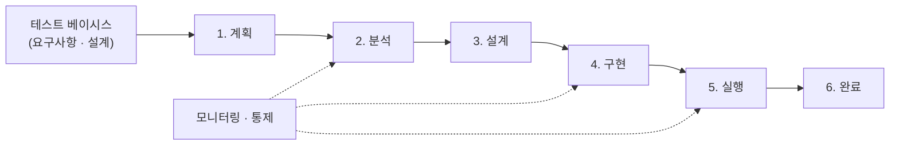

# 소프트웨어 테스트 프로세스 (Software Test Process)

---

## I. 계획부터 완료까지의 테스트 절차, 테스트 프로세스의 개요

### 가. 정의

- 테스트 **계획·분석·설계·구현·실행·완료와 이를 관리하는 모니터링·통제로 구성된 체계적 테스트 활동 절차** (ISTQB, [[ISO 29119|ISO/IEC/IEEE 29119]])

### 나. 특징

| 구분 | 내용 |
| --- | --- |
| 체계성 | 정형화된 단계와 산출물로 테스트 품질 확보 |
| 추적성 | 테스트 베이시스(요구사항)→조건→케이스→결과 추적 |
| 객관적 판단 | 종료 기준(Exit Criteria)으로 릴리스 여부 결정 |
| 반복 적용 | 애자일·CI/CD에서는 짧은 주기로 반복 수행 |

---

## II. 프로세스 단계 및 활동

### 가. 테스트 프로세스 (ISTQB 기준)

- 계획에 따라 무엇을(분석)·어떻게(설계) 테스트할지 정하고 실행 준비(구현) 후 실행하며, 모니터링·통제가 전 단계를 감시

### 나. 단계별 활동

| 구분 | 요소 | 설명 |
| --- | --- | --- |
| 관리 | 계획 | 목표·범위·접근법·일정·자원·종료 기준 수립 |
| | 모니터링 · 통제 | 진척·결함 지표 측정, 계획 대비 편차 조치 |
| 개발 | 분석 | 테스트 베이시스에서 테스트 조건(무엇을) 식별 |
| | 설계 | 동등 분할·경계값 분석 등으로 테스트 케이스(어떻게) 도출 ([[블랙박스 테스트]]) |
| | 구현 | 테스트 절차·스위트·데이터·환경·자동화 스크립트 준비 |
| 수행 | 실행 | 케이스 실행, 기대 결과와 비교, 결함 보고·재테스트 |
| 종료 | 완료 | [[Test Exit Criteria\|종료 기준]] 확인, 결과 보고, 테스트웨어 보관·교훈 정리 |

---

## III. 비교 및 동향

### 가. 순차형 vs 지속적 테스트 프로세스

| 비교 항목 | 순차형 (V-모델) | 지속적 테스트 (애자일 · CI/CD) |
| --- | --- | --- |
| 수행 시점 | 개발 단계 완료 후 마일스톤별 | 커밋·빌드마다 자동 수행 |
| 변경 대응 | 계획·설계 문서 재작성 필요 | 스프린트마다 케이스 갱신 |
| 자동화 | 수동 비중 높음 | 단위·통합·E2E 자동화 |
| 결함 발견 | 후반부 집중 | 초기 발견 (Shift-Left) |

### 나. 동향

- CI/CD 파이프라인에 테스트 단계를 품질 게이트로 내장하는 Continuous Testing
- LLM 기반 테스트 케이스 생성, UI 변경에 따른 스크립트 자가 치유(Self-Healing)

---

### 🔗 연관 토픽

- **소속 도메인**: [[00_소프트웨어공학_MOC|🏗️ 소프트웨어공학]]
- **세부 분류**: `1. 소프트웨어 개발 생명주기(SDLC) & 방법론`
- **핵심 연관 토픽**:
  - [[ISO 29119]]
  - [[소프트웨어 테스트|소프트웨어 테스트 (Software Test)]]
  - [[Test Exit Criteria]]
  - [[테스트 오라클]]
  - [[SDLC]]
