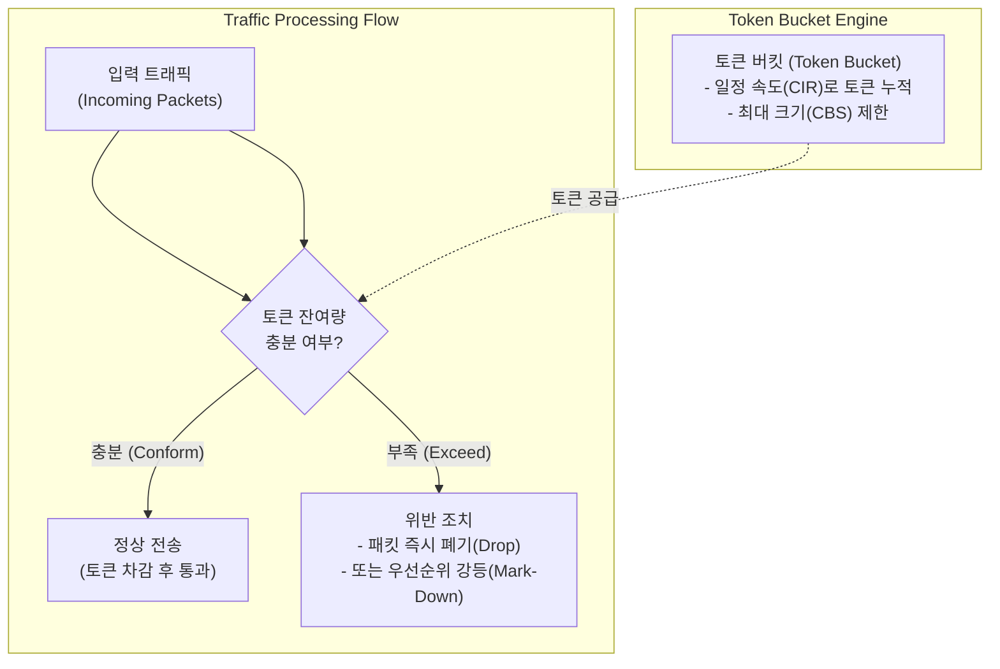

# 트래픽 폴리싱 (Traffic Policing)

---

## I. 네트워크 대역폭 제어 및 규격 준수를 위한 트래픽 관리 기법, 트래픽 폴리싱의 개요

네트워크로 유입되는 트래픽이 사전에 합의된 약정 대역폭(CIR)을 초과하는지 실시간 감시하여, 기준을 위반한 패킷을 즉시 폐기(Drop)하거나 서비스 우선순위를 강등(Mark-Down)시키는 트래픽 통제 기술이다.

| 구분 | 주요 내용 |
| --- | --- |
| **개념** | 토큰 버킷(Token Bucket) 메커니즘을 기반으로 정해진 전송률을 초과하는 패킷에 대해 즉각적인 폐기 또는 DSCP 재마킹을 수행하는 속도 제한 기법 |
| **등장 배경** | SLA(Service Level Agreement) 대역폭 준수 강제, 백본망 과부하 방지, 악의적 대량 트래픽 및 버스트 유입 차단 필요 |
| **핵심 특징** | 패킷을 버퍼에 대기시키지 않아 지연(Delay)이 발생하지 않음, 초과 패킷 즉각 폐기로 패킷 손실률이 발생할 수 있음, 주로 인입(Ingress) 단에서 수행 |

---

## II. 트래픽 폴리싱의 아키텍처 및 핵심 기술 요소

### 가. 트래픽 폴리싱(Token Bucket 기반)의 동작 원리

일정 속도(CIR)로 버킷에 충전되는 토큰을 패킷 유입 시 패킷 크기만큼 차감하며, 버킷 내 잔여 토큰이 충분하면 즉시 통과시키고 부족하면 규격 위반으로 판단하여 즉시 폐기하거나 우선순위를 강등한다.

### 나. 트래픽 폴리싱의 핵심 기술 및 구성 요소

| 분류 | 요소기술 (키워드) | 세부 설명 |
| --- | --- | --- |
| **알고리즘** | 토큰 버킷 (Token Bucket) | 정해진 충전율에 따라 토큰을 누적하고 패킷 크기(Byte)만큼 토큰을 소비하여 속도를 판별 |
| **대역폭 기준** | CIR (Committed Information Rate) | 고객 및 서비스와 약정한 보장 전송 속도로, 토큰이 버킷에 지속 충전되는 기준 속도 |
| **버스트 수용** | CBS (Committed Burst Size) | 토큰 버킷의 최대 저장 용량으로, 순간적으로 유입되는 단기 버스트 트래픽의 수용 한계치 |
| **피크 대역폭** | PIR / PBS | Peak Information Rate 및 Peak Burst Size로, 이중 토큰 버킷(trTCM)에서 최대 허용 한계 규정 |
| **위반 조치** | 드롭 (Drop) / 마킹 (Mark-Down) | 규격을 초과한 트래픽을 즉시 버리거나, IP 헤더 내 [[DiffServ (Differentiated Services)|DiffServ]] DSCP 값을 낮춰 후속 처리 |
| **다색 마커** | srTCM / trTCM | 단일/이중 속도 토큰 버킷을 통해 트래픽을 Green(적합), Yellow(초과), Red(위반) 3색으로 분류 |
| **품질 연계** | [[QoS]] 아키텍처 | 전체 네트워크 QoS 프레임워크 내에서 트래픽 분류기(Classifier) 및 측정기(Meter)와 연계 동작 |

---

## III. 트래픽 폴리싱 vs 트래픽 셰이핑 비교 및 최신 동향

### 가. 트래픽 폴리싱 vs 트래픽 셰이핑 비교

| 비교 항목 | 트래픽 폴리싱 (Traffic Policing) | 트래픽 셰이핑 (Traffic Shaping) |
| --- | --- | --- |
| **초과 패킷 처리** | 규격 초과 패킷을 **즉시 폐기(Drop)** 또는 마킹 | 초과 패킷을 **버퍼([[Queue]])에 임시 대기** 후 순차 송출 |
| **지연 시간 (Latency)** | 대기 큐가 없어 **지연 시간이 발생하지 않음** | 버퍼 대기 시간으로 인한 전송 지연(Delay) 발생 가능 |
| **패킷 손실률** | 순간적인 버스트 발생 시 패킷 유실률이 높음 | 버퍼 용량 내에서 패킷 유실을 최소화함 |
| **주요 적용 위치** | 네트워크 인입(Ingress) 인터페이스, ISP 경계 | 네트워크 출력(Egress) 인터페이스, WAN 구간 |
| **주요 목적** | 약정 대역폭 엄격 준수, 망 과부하 즉각 차단 | 트래픽 파형을 평탄화(Smoothing)하여 링크 효율 극대화 |

### 나. 최신 기술 동향 및 발전 방향

* **AI 기반 동적 QoS 폴리싱**: 5G 및 클라우드 네트워크 환경에서 고정된 CIR/CBS 파라미터 대신 트래픽 수요와 애플리케이션 특성(초저지연, 대용량 비디오 등)에 맞춰 실시간으로 임계치를 조절하는 지능형 폴리싱 기술이 적용됨.
* **프로그래머블 데이터 플레인(P4) 연계**: SDN 환경에서 P4 기반 스위치를 활용하여 하드웨어 파이프라인 레벨에서 패킷 단위 초정밀 토큰 버킷 폴리싱을 마이크로초 단위로 유연하게 처리함.

---

### 🔗 연관 토픽

- **소속 도메인**: [[00_네트워크_MOC|🌐 네트워크]]
- **세부 분류**: `3. 전송 계층 & 트래픽 / 혼잡 제어 (L4)`
- **핵심 연관 토픽**:
  - [[Traffic Shaping (트래픽 쉐이핑)]]
  - [[QoS]]
  - [[DiffServ (Differentiated Services)]]
  - [[Wi-Fi 7]]
  - [[라우터]]
