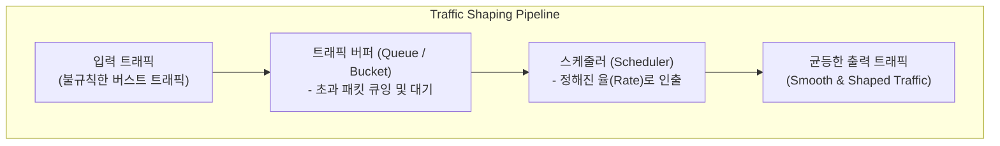

# 트래픽 쉐이핑 (Traffic Shaping)

---

## I. 트래픽 흐름 평탄화 및 패킷 손실 최소화를 위한 대역폭 제어 기술, 트래픽 쉐이핑의 개요

네트워크 대역폭을 초과하는 불규칙한 버스트 트래픽을 버퍼(Queue)에 임시 저장한 후, 사전에 정의된 규격화된 속도와 전송 패턴으로 지연 송출하여 트래픽 흐름을 평탄화(Smoothing)하는 제어 메커니즘이다.

| 구분 | 주요 내용 |
| --- | --- |
| **개념** | 순간적인 트래픽 폭주를 큐에 수용하고 스케줄러를 통해 균등한 속도로 내보냄으로써 하류 네트워크의 혼잡과 패킷 손실을 방지하는 기술 |
| **등장 배경** | 버스트(Burst) 트래픽에 따른 버퍼 오버플로우 및 패킷 드롭 방지, 회선 임대 용량 준수, 통신 서비스 품질([[QoS]]) 안정화 필요 |
| **핵심 특징** | 패킷 폐기 대신 의도적 전송 지연(Delay) 발생, 리키 버킷(Leaky Bucket) 및 토큰 버킷(Token Bucket) 활용, 송신단(Egress) 중심 적용 |

---

## II. 트래픽 쉐이핑의 아키텍처 및 핵심 기술 요소

### 가. 트래픽 쉐이핑의 동작 메커니즘

불규칙하고 급격하게 유입되는 버스트 패킷을 버퍼에 적재한 뒤, 스케줄러가 약정된 전송률(Rate)에 맞추어 일정한 간격으로 패킷을 방출하여 출력 파형을 부드럽게 성형한다.

### 나. 트래픽 쉐이핑의 핵심 기술 및 구성 요소

| 분류 | 요소기술 (키워드) | 세부 설명 |
| --- | --- | --- |
| **제어 알고리즘** | 리키 버킷 (Leaky Bucket) | 바닥에 구멍 뚫린 버킷처럼, 유입량에 무관하게 항상 고정된 일정한 속도로 패킷을 균등 출력 |
| **제어 알고리즘** | 토큰 버킷 (Token Bucket) | 버킷 내 토큰 보유량 범위 내에서 일정 수준의 버스트 전송을 허용하며 장기 평균 속도를 규제 |
| **큐잉 기법** | CBQ (Class-Based Queuing) | 트래픽을 비즈니스 및 서비스 클래스별로 분류하고 클래스마다 대역폭과 큐 용량을 차등 할당 |
| **큐잉 기법** | [[WFQ]] (Weighted Fair Queuing) | 플로우별 대역폭 가중치를 부여하여 고용량 트래픽의 독점을 막고 공정한 전송 및 지연 제어 |
| **지연 특성** | 큐잉 딜레이 (Buffering Delay) | 초과 패킷을 폐기하지 않고 버퍼링하므로 손실은 방지되나 전송 지연 시간이 다소 증가 |
| **적용 인터페이스** | 송신 측 (Egress Interface) | 패킷이 스위치·라우터의 송신 인터페이스를 빠져나가 외부 회선으로 전달되기 직전에 적용 |
| **품질 연계** | [[QoS]] / [[DiffServ (Differentiated Services)|DiffServ]] | DiffServ DSCP 및 MPLS 트래픽 엔지니어링과 연계하여 종단 간 대역폭 SLA 보장 체계 구축 |

---

## III. 트래픽 쉐이핑 vs 트래픽 폴리싱 비교 및 최신 동향

### 가. 트래픽 쉐이핑 vs 트래픽 폴리싱 비교

| 비교 항목 | 트래픽 쉐이핑 (Traffic Shaping) | 트래픽 폴리싱 ([[Traffic Policing (트래픽 정책처리)\|Traffic Policing]]) |
| --- | --- | --- |
| **초과 패킷 처리** | 버퍼에 **대기(Buffering)** 시킨 후 순차 전송 | 규격 초과 패킷을 **즉시 폐기(Drop)** 또는 마킹 |
| **패킷 손실률** | 버퍼 한도 내에서 패킷 손실 없음 (Low Loss) | 초과 트래픽 발생 시 패킷 유실률 높음 |
| **지연 시간 (Latency)** | 버퍼 대기 시간으로 인한 전송 지연 발생 | 지연 시간 없음 (즉각 통과 또는 폐기) |
| **주요 적용 위치** | 송신 측 (Egress) 인터페이스, WAN 출구 | 수신 측 (Ingress) 인터페이스, ISP 망 경계 |
| **적합한 트래픽** | 파일 전송, 비디오 스트리밍 등 손실 민감 트래픽 | 음성(VoIP), 화상회의 등 초저지연 민감 트래픽 |

### 나. 최신 기술 동향 및 발전 방향

* **AI 기반 적응형 트래픽 쉐이핑(Adaptive Shaping)**: 고정된 버퍼 크기와 속도 대신, 머신러닝 모델이 실시간 RTT, 링크 지터 및 대역폭 변동성을 예측하여 쉐이핑 파라미터를 자율 튜닝함.
* **클라우드 네이티브 및 SD-WAN 통합**: 멀티 클라우드 환경 및 SD-WAN 오버레이 경로에서 SaaS 애플리케이션의 중요도에 따라 L7 심층 패킷 분석(DPI)과 결합된 동적 쉐이핑이 널리 적용됨.

---

### 🔗 연관 토픽

- **소속 도메인**: [[00_네트워크_MOC|🌐 네트워크]]
- **세부 분류**: `3. 전송 계층 & 트래픽 / 혼잡 제어 (L4)`
- **핵심 연관 토픽**:
  - [[Traffic Policing (트래픽 정책처리)]]
  - [[QoS]]
  - [[DiffServ (Differentiated Services)]]
  - [[WFQ]]
  - [[Wi-Fi 7]]
