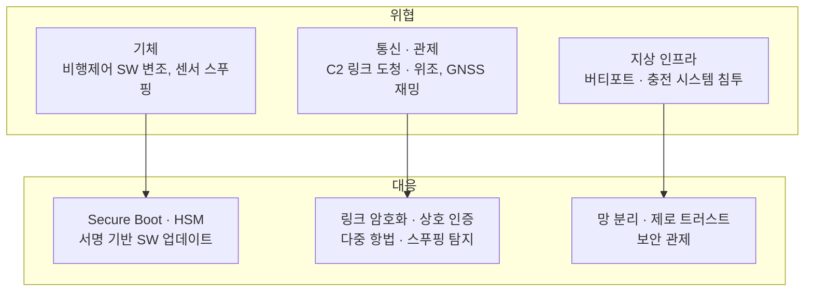

# UAM 취약점 및 대응방안

---

## I. 하늘을 나는 CPS 보호, UAM 보안의 개요

### 가. 정의

- [[UAM|UAM(Urban Air Mobility)]]을 구성하는 **기체(eVTOL), 교통관리(UATM·UTM), 버티포트, 통신망, 서비스 플랫폼 전반의 사이버 위협을 식별하고 비행 안전(Safety)과 보안(Security)을 함께 확보**하는 보호 체계

### 나. 필요성

| 구분 | 내용 |
| --- | --- |
| [[CPS]] 특성 | 사이버 공격이 추락·충돌 등 물리적 사고로 직결 |
| 무선 의존 | C2(지휘·통제) 링크·GNSS·V2X 등 무선 신호 의존 |
| 자율 비행 | 장기적으로 원격·자율 운항 확대로 소프트웨어 공격 표면 증가 |
| 감항 규제 | 항공기 감항 인증에 사이버보안 요건 포함 |

---

## II. 영역별 위협 및 대응

### 가. 위협 구조

- 기체·통신·지상 각 영역의 위협을 계층별 통제로 대응하고, 통합 관제로 이상 징후를 상시 탐지

### 나. 취약점 및 대응

| 구분 | 요소 | 설명 |
| --- | --- | --- |
| 기체 | 비행제어 SW 변조 | Secure Boot, HSM 키 보호, 서명 검증 OTA |
| 센서 | GNSS 스푸핑·재밍 | 다중 위성군·관성항법 융합, 스푸핑 탐지, 항법 [[다중화]] |
| 통신 | C2 링크 도청·위조 | 링크 [[암호화]]·상호 인증, 메시지 [[무결성]] 검증 |
| 교통관리 | 비행계획 위조, 서비스 거부 | API 인증·인가, [[DDOS\|DDoS]] 방어, 데이터 서명 |
| 지상 | 버티포트·충전 시스템 침투 | 망 분리, [[제로 트러스트 보안모델\|제로 트러스트]] 접근 통제 |
| 사용자 | 예약 플랫폼 계정 탈취 | MFA, 이상 로그인 탐지 |
| 공급망 | 부품·오픈소스 취약점 | [[SBOM]], 공급업체 보안 요구 |
| 인증 | 감항 보안 | RTCA DO-326A/ED-202A 감항 보안 프로세스, 모의 해킹 |

---

## III. 비교 및 동향

### 가. 기존 항공 보안 vs UAM 보안

| 비교 항목 | 기존 항공 보안 | UAM 보안 |
| --- | --- | --- |
| 초점 | 공항 물리 보안, 폐쇄형 항공전자 | 개방형 통신망과 연결된 CPS |
| 운항 형태 | 조종사 탑승 | 조종사 탑승에서 원격·자율로 확대 |
| 통신 | 전용 항공 통신 | 이동통신(LTE·5G)·위성 병행 |
| 위협 | 물리적 테러, 내부자 | 원격 사이버 공격, 신호 교란, 공급망 |

### 나. 동향

- **감항 보안 표준**: DO-326A/ED-202A 시리즈를 eVTOL 인증 기준에 적용
- **EU Part-IS**: EASA 항공 정보보안 규정으로 운항자·기관의 정보보안 관리체계 의무화
- **국내 K-UAM**: 실증 사업(K-UAM 그랜드챌린지)과 UAM법(2025 시행)을 바탕으로 통신·보안 요구사항 정비

---

### 🔗 연관 토픽

- **소속 도메인**: [[00_보안_MOC|🛡️ 보안]]
- **세부 분류**: `1. 정보보안 원칙 & 거버넌스 · 인증`
- **핵심 연관 토픽**:
  - [[UAM|UAM(Urban Air Mobility)]]
  - [[드론 취약점 및 대응]]
  - [[CPS]]
  - [[자율주행 자동차 보안취약점 및 대응방안]]
  - [[제로 트러스트 보안모델|제로 트러스트 (Zero Trust) 보안모델]]
