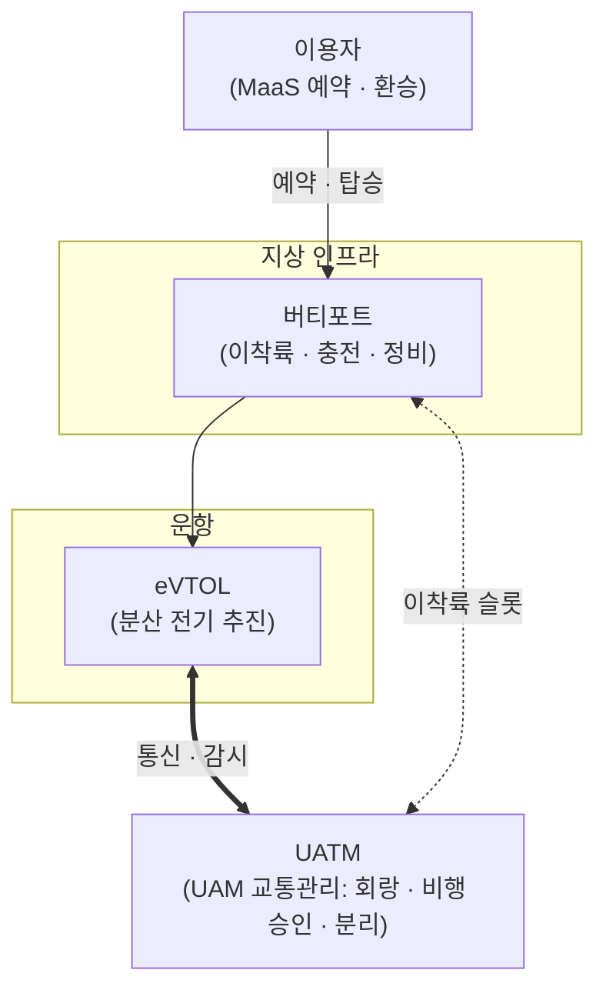

# UAM (Urban Air Mobility, 도심항공교통)

---

## I. 도시의 하늘길, UAM의 개요

### 가. 정의

- 전동 수직이착륙기(eVTOL)를 이용하여 **도심 내·인근 지역을 저고도로 오가며 승객·화물을 수송**하는 항공 교통 체계 (지역 간 항공을 포함하면 AAM)

### 나. 특징

| 구분 | 내용 |
| --- | --- |
| 등장 배경 | 도심 도로 혼잡, 탄소 저감 요구, 전기 추진·배터리 기술 발전 |
| 저소음 · 저탄소 | 전기 분산 추진(DEP)으로 헬기 대비 소음·배출 감소 |
| 인프라 연계 | 버티포트와 지상 교통(MaaS) 환승 연계 |
| 단계적 자율화 | 조종사 탑승 → 원격 조종 → 자율 비행 |
| 과제 | 배터리 에너지 밀도, 감항 인증, 소음·안전 수용성, 운항 비용 |

---

## II. 구조 및 기술요소

### 가. 서비스 구조

- 이용자가 MaaS로 예약해 버티포트에서 탑승하면, eVTOL이 UATM이 관리하는 전용 회랑(Corridor)을 따라 목적지로 이동

### 나. 기술요소

| 구분 | 요소 | 설명 |
| --- | --- | --- |
| 기체 | eVTOL | 수직이착륙과 수평 순항이 가능한 전동 항공기 (멀티콥터, 리프트+크루즈, 틸트로터) |
| | DEP (분산 전기 추진) | 다수 모터 분산 배치로 일부 고장 시에도 비행 유지, 소음 감소 |
| | 배터리 | 고에너지 밀도·고출력 배터리, 수소 연료전지 대안 연구 |
| 운항 관리 | UATM | UAM 회랑 설정, 비행 계획 승인, 기체 간 분리·충돌 방지 |
| | DAA (Detect and Avoid) | 주변 항공기·장애물 탐지·회피 |
| 인프라 | 버티포트 | 이착륙장·충전·정비·승객 처리 터미널 |
| 통신 | 5G · 위성 · 항공 통신 | 운항 데이터 링크, 감시 |
| 인증 | 형식증명 (TC) | FAA·EASA·국토부 등 감항 당국의 안전성 인증 |

---

## III. 비교 및 동향

### 가. 헬리콥터 vs UAM(eVTOL)

| 비교 항목 | 헬리콥터 | UAM (eVTOL) |
| --- | --- | --- |
| 추진 | 가스터빈 엔진, 단일 메인 로터 | 전기 모터 다수 (DEP) |
| 소음 · 배출 | 고소음, 탄소 배출 | 상대적 저소음, 운항 중 직접 배출 없음 |
| 안전 구조 | 주 로터·엔진 고장 시 위험 큼 | 추진 분산으로 고장 허용성 향상 |
| 비용 | 연료·정비비 높음 | 운영비 절감 기대, 대량 운항 시 경제성 |
| 항속 | 길다 | 배터리로 제한 (수십~백여 km) |

### 나. 동향

- **인증 · 상용화**: 중국 EHang EH216-S가 2023년 형식증명 취득 후 운항 허가, 미국 Joby·Archer는 FAA 형식증명 절차 진행
- **국내**: K-UAM 로드맵과 그랜드챌린지 실증 진행, 「도심항공교통 활용 촉진 및 지원에 관한 법률」(2025 시행) 기반 시범운용구역 지정
- **연계 기술**: [[디지털 트윈]] 기반 공역 시뮬레이션, 드론 UTM 기술의 UATM 확장

---

### 🔗 연관 토픽

- **소속 도메인**: [[00_디지털서비스_MOC|🚀 디지털서비스]]
- **세부 분류**: `3. 사물인터넷 (IoT) & 스마트 플랫폼 · 메타버스`
- **핵심 연관 토픽**:
  - [[드론|드론 (Drone; 무인기)]]
  - [[C-ITS|C-ITS (Cooperative-Intelligent Transport Systems)]]
  - [[측위기술|측위기술 (LDT Location Determination Technology)]]
  - [[디지털 트윈|디지털 트윈 (Digital Twin)]]
  - [[저궤도 위성]]
