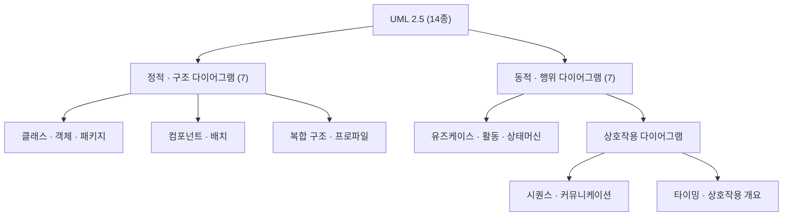

# UML (Unified Modeling Language) - 정적·동적 다이어그램

---

## I. 객체지향 분석·설계의 표준 언어, UML의 개요

### 가. 정의

- [[객체지향]] 시스템의 구조와 행위를 **표준 그래픽 표기법으로 가시화·명세화·문서화**하는 OMG 표준 통합 모델링 언어 (현행 UML 2.5, 14종 다이어그램)

### 나. 특징

| 구분 | 내용 |
| --- | --- |
| 표준성 | Booch·Rumbaugh(OMT)·Jacobson(OOSE) 기법을 통합한 OMG 표준 |
| 이원 분류 | 구조를 다루는 정적(Structural) 다이어그램과 시간에 따른 변화를 다루는 동적(Behavioral) 다이어그램 |
| 의사소통 | 이해관계자 간 공통 언어, 설계 재사용성 확보 |
| 독립성 | 특정 프로그래밍 언어·개발 프로세스에 종속되지 않음 |

---

## II. UML 2.5 다이어그램 분류 및 구성요소

### 가. 다이어그램 분류

### 나. 주요 다이어그램

| 분류 | 다이어그램 | 설명 |
| --- | --- | --- |
| 정적 (구조) | [[클래스 다이어그램]] | [[클래스]]의 속성·메서드와 클래스 간 관계([[UML의 관계\|연관·의존·일반화·실체화]]) 표현 |
| | 객체 다이어그램 | 특정 시점의 인스턴스와 링크 (클래스 다이어그램의 스냅샷) |
| | 컴포넌트 다이어그램 | 소프트웨어 모듈과 인터페이스 간 의존 관계 |
| | 배치 다이어그램 | 하드웨어 노드와 그 위에 배치된 산출물(Artifact)의 물리 구성 |
| | 패키지 다이어그램 | 모델 요소를 그룹화한 패키지 간 의존 관계 |
| | 복합 구조 · 프로파일 | 클래스 내부 구조(Part·Port), UML 확장(스테레오타입) 정의 |
| 동적 (행위) | [[유즈케이스 다이어그램]] | 액터 관점의 기능 요구사항과 시스템 경계 |
| | 시퀀스 다이어그램 | 객체 간 메시지 교환을 시간 순서로 표현 |
| | 커뮤니케이션 다이어그램 | 객체 간 링크 구조와 메시지 번호 중심의 상호작용 |
| | 활동 다이어그램 | 업무·제어 흐름의 분기·병렬 처리 (스윔레인) |
| | 상태머신 다이어그램 | 이벤트에 따른 단일 객체의 상태 전이 |
| | 타이밍 · 상호작용 개요 | 시간 제약에 따른 상태 변화, 상호작용 간 흐름 개괄 |

---

## III. 비교 및 동향

### 가. 정적 vs 동적 다이어그램

| 비교 항목 | 정적 (Structural) | 동적 (Behavioral) |
| --- | --- | --- |
| 관점 | 시스템의 구조와 요소 간 관계 | 시스템의 행위와 시간에 따른 변화 |
| 시간 개념 | 다루지 않음 | 이벤트 순서·시간 축이 핵심 |
| 주요 활용 | 아키텍처 설계, 클래스 모델링, 물리 배포 | 요구사항 분석, 로직 검증, 시나리오 테스트 |
| 대표 | 클래스, 컴포넌트, 배치 | 유즈케이스, 시퀀스, 상태머신 |

### 나. 동향

| 비교 항목 | 그래픽 도구 기반 | 코드 퍼스트 · AI 기반 |
| --- | --- | --- |
| 작성 | GUI 드래그 앤 드롭 | Mermaid, PlantUML 텍스트 |
| [[형상 관리]] | 바이너리 파일, Diff 곤란 | Git으로 버전 관리·Diff |
| 생성 | 사후 수동 문서화 | [[초거대 언어 모델\|LLM]]이 요구사항 문서에서 자동 생성 (Text-to-Diagram) |

- 애자일 환경에서는 무거운 사전 설계 대신 핵심 다이어그램만 경량으로 유지하고, [[DDD (Domain Driven Design)\|DDD]]의 이벤트 스토밍 결과를 보완하는 용도로 활용

---

### 🔗 연관 토픽

- **소속 도메인**: [[00_소프트웨어공학_MOC|🏗️ 소프트웨어공학]]
- **세부 분류**: `3. 요구사항 공학 & UML 객체지향 분석/설계`
- **핵심 연관 토픽**:
  - [[클래스 다이어그램|클래스 다이어그램 (Class Diagram)]]
  - [[유즈케이스 다이어그램]]
  - [[UML의 관계]]
  - [[객체지향]]
  - [[클래스]]
