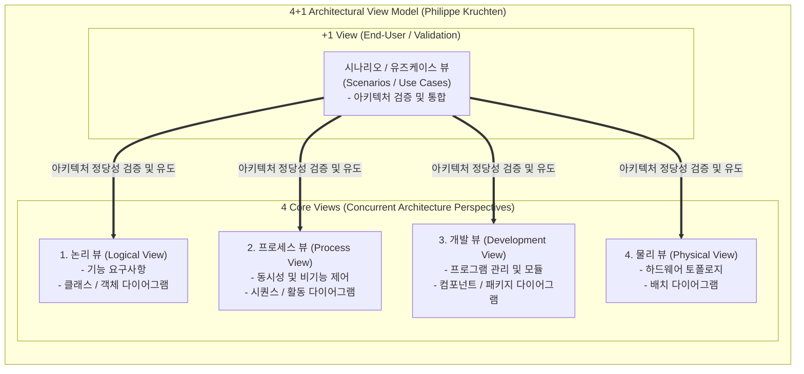

# UML의 4+1 View Model

---

## I. 소프트웨어 아키텍처 다차원 기술 및 이해관계자 관점 통합 프레임워크, 4+1 뷰 모델의 개요

### 가. 정의

- 시스템을 바라보는 4가지 주요 관점(논리, 프로세스, 개발, 물리)과 이를 통합·검증하는 유즈케이스(시나리오) 뷰로 복합 아키텍처를 체계화한 필립 크루텐의 설계 모델

### 나. 목적 및 특징

| 구분 | 내용 |
| --- | --- |
| 관심사의 분리(SoC) | 개발자, 아키텍트, 시스템 엔지니어, 최종 사용자 등 다양한 이해관계자의 시각 분할 수용 |
| 시나리오 중심 검증 | 중앙의 유즈케이스(+1)를 통해 4가지 뷰 간의 일관성 및 요구사항 충족 여부 상시 검증 |
| 다이어그램 매핑 표준화 | [[UML]] 표준 표기법(클래스, 시퀀스, 컴포넌트, 배치 다이어그램 등)을 각 뷰에 최적 매핑 |
| 복잡도 완화 | 대규모 시스템의 기능적·비기능적 요구사항을 독립적 평면으로 투영하여 설계 복잡성 제어 |

---

## II. 4+1 View Model의 아키텍처 및 핵심 구성요소

### 가. 4+1 View Model의 구조 및 다이어그램 매핑

* 시스템의 핵심 구조를 논리, [[프로세스]], 개발, 물리 영역의 4가지 관점으로 분리 기술하고, 사용자 시나리오(유즈케이스)를 통해 이들을 통합·검증하는 구조

### 나. 4+1 View Model의 5가지 핵심 뷰 및 구성 요소

| 뷰 구분 | 주요 이해관계자 | 핵심 관심사 및 설명 | 연계 UML 다이어그램 |
| --- | --- | --- | --- |
| **시나리오 뷰 (+1)** | 최종 사용자, 테스터, 아키텍트 | 다른 4개 뷰를 도출하고 검증하는 기준이 되는 핵심 유즈케이스 및 작업 흐름 | [[유즈케이스 다이어그램]] |
| **논리 뷰 (Logical)** | 최종 사용자, 설계자 | 시스템이 제공하는 기능적 요구사항 및 객체 지향적 구조 분석 | [[클래스]], 객체 다이어그램 |
| **프로세스 뷰 (Process)** | 시스템 엔지니어, 통합자 | 런타임 시 동시성(Concurrency), 성능, [[HA(High Availability)\|가용성]], 스레드 동기화 및 통신 제어 | 시퀀스, 활동, 상태 다이어그램 |
| **개발 뷰 (Development)** | 개발자, 형상 관리자 | 소스코드 구조, 패키지 분할, 컴포넌트 의존성 및 서브시스템 관리 | 컴포넌트, 패키지 다이어그램 |
| **물리 뷰 (Physical)** | 시스템 엔지니어, [[DevOps]] | 하드웨어 노드 배치, 네트워크 토폴로지 및 물리적 컴포넌트 매핑 | 배치(Deployment) 다이어그램 |

---

## III. 전통적 아키텍처 문서화 vs 최신 클라우드 네이티브 4+1 모델 비교 및 동향

| 비교 항목 | 전통적 모놀리식 4+1 모델 | 최신 [[클라우드 네이티브]] / [[MSA (Micro Service Architecture)\|MSA]] 4+1 모델 |
| --- | --- | --- |
| **물리 뷰(Physical)** | 고정된 물리 서버 및 온프레미스 네트워크 토폴로지 중심 | [[쿠버네티스]](K8s) 클러스터, 멀티 클라우드 및 IaC 인프라 구성 반영 |
| **프로세스 뷰(Process)** | 단일 노드 내 스레드 및 프로세스 간 IPC 중심 | 마이크로서비스 간 비동기 메시징, 이벤트 드리븐 및 서비스 머시(Mesh) 구조 |
| **적용 방식** | 문서 중심의 사후 정적 아키텍처 블루프린트 작성 | C4 모델 등과 결합하여 코드와 동기화되는 실시간 아키텍처 가시화 |

### 나. 최신 동향 및 발전 방향

- **C4 모델(Context, Container, Component, Code)과의 결합**: 지나치게 복잡한 정통 UML 다이어그램 대신 개발자와 아키텍트가 직관적으로 소통할 수 있는 계층형 C4 모델로 4+1 뷰 현대화
- **IaC 및 클라우드 네이티브 뷰 확장**: 고정된 하드웨어 물리 뷰 대신 Terraform, Kubernetes 매니페스트 기반의 인프라 코드(IaC) 및 서비스 메시 토폴로지로 물리·프로세스 뷰 동적 형상 관리
- **Architecture as Code 도구 연계**: PlantUML, Mermaid 등을 통해 문서를 코드 저장소(Git)에서 관리하고 CI/CD 파이프라인에서 아키텍처 다이어그램을 자동 빌드·동기화

---

### 🔗 연관 토픽

- **소속 도메인**: [[00_소프트웨어공학_MOC|🏗️ 소프트웨어공학]]
- **세부 분류**: `3. 요구사항 공학 & UML 객체지향 분석/설계`
- **핵심 연관 토픽**:
  - [[유즈케이스 다이어그램]]
  - [[UML|UML (정적, 동적 다이어그램)]]
  - [[클래스]]
  - [[소프트웨어 아키텍처|소프트웨어 아키텍쳐]]
  - [[클라우드 네이티브]]
