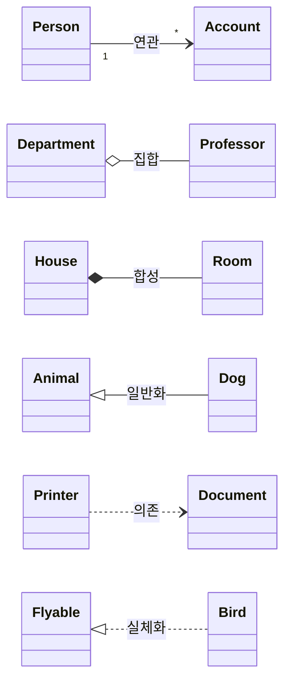

# UML의 관계 (Relationship)

---

## I. 사물 간 의미적 연결의 표현, UML 관계의 개요

### 가. UML 관계의 정의

- [[UML]]에서 클래스·인터페이스·컴포넌트 등 사물(Things) 사이의 **의미적 연결과 결합 강도**를 표현하는 모델 요소
- 시스템의 정적 구조([[클래스 다이어그램]])를 설계할 때 객체 간 책임과 의존 방향을 명시하는 수단

### 나. UML 관계의 특징

| 구분 | 내용 |
| --- | --- |
| 결합 강도 표현 | 의존 < 연관 < 집합 < 합성 순으로 결합이 강해짐 |
| 방향성 | 화살표 방향으로 "누가 누구를 알고(사용하고) 있는가"를 표현 |
| 다중성 | `1`, `0..1`, `*`, `1..*` 등으로 참여 객체 수를 명시 |

---

## II. UML 관계의 유형 및 표기법

### 가. UML 관계 개념도

### 나. UML 관계 유형별 비교

| 관계 | 의미 | 표기 | 예시 |
| --- | --- | --- | --- |
| 연관 (Association) | 객체가 다른 객체를 참조하는 구조적 관계 | 실선 (방향 연관은 화살표) | 사람 – 계좌 |
| 집합 (Aggregation) | 전체–부분 관계, **부분이 독립적으로 존재** 가능 | 빈 마름모 ◇ (전체 쪽) | 학과 – 교수 |
| 합성 (Composition) | 전체–부분 관계, **생명주기를 공유** (전체 소멸 시 부분도 소멸) | 채운 마름모 ◆ (전체 쪽) | 집 – 방 |
| 일반화 (Generalization) | is-a 관계, 상위 클래스의 속성·행위를 상속 | 실선 + 빈 삼각형 △ | 동물 – 개 |
| 의존 (Dependency) | 일시적으로 사용하는 관계(매개변수, 지역변수), 변경 영향 전파 | 점선 화살표 | 프린터 – 문서 |
| 실체화 (Realization) | 인터페이스의 기능을 클래스가 구현 | 점선 + 빈 삼각형 △ | Flyable – Bird |

---

## III. 관계 설계 시 고려사항

### 가. 집합과 합성의 구분

| 비교 항목 | 집합 (Aggregation) | 합성 (Composition) |
| --- | --- | --- |
| 생명주기 | 전체와 부분이 독립 | 전체가 부분의 생명주기 관리 |
| 공유 여부 | 부분을 여러 전체가 공유 가능 | 부분은 하나의 전체에만 소속 |
| 구현 예 | 외부에서 생성한 객체를 주입 | 생성자 내부에서 부분 객체 생성 |

### 나. 설계 시 고려사항

- **낮은 [[결합도]] 지향**: 강한 관계(합성·상속)는 꼭 필요한 곳에만 쓰고, 가능하면 인터페이스 기반의 실체화·의존으로 대체
- **상속보다 위임**: 일반화 남용은 취약한 기반 클래스 문제를 일으키므로 "Composition over Inheritance" 원칙 적용
- **양방향 연관 최소화**: 순환 참조를 줄이고 단방향 연관으로 의존 방향을 명확히 관리

---

### 🔗 연관 토픽

- **소속 도메인**: [[00_소프트웨어공학_MOC|🏗️ 소프트웨어공학]]
- **세부 분류**: `3. 요구사항 공학 & UML 객체지향 분석/설계`
- **핵심 연관 토픽**:
  - [[UML|UML (정적, 동적 다이어그램)]]
  - [[클래스 다이어그램]]
  - [[UML의 4+1 View Model]]
  - [[객체지향 설계 원리]]
  - [[결합도]]
