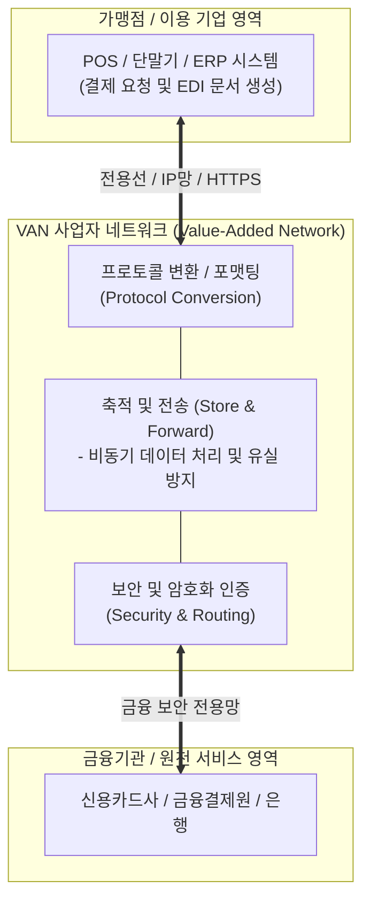

# VAN (Value-Added Network, 부가가치통신망)

---

## I. 고속·안전한 데이터 유통과 전용 부가서비스를 제공하는 통신망, VAN의 개요

공중 전기통신사업자로부터 통신 회선을 임차하여 단순 전송 이상의 데이터 축적, 가공, 변환, 중계 등 고도의 부가가치 통신 서비스를 제공하는 정보통신망이다.

| 구분 | 주요 내용 |
| --- | --- |
| **개념** | 통신 회선에 컴퓨터 제어 기능을 결합하여, 이기종 시스템 간 프로토콜 변환, 데이터 포맷 변환 및 메시지 교환을 중계하는 부가 가치 네트워크 |
| **등장 배경** | 기업 간 전자문서교환([[EDI]]) 활성화, 신용카드 결제 조회 및 승인 대행 수요 급증, 상이한 시스템 규격 통합 및 거래 신뢰성 확보 필요 |
| **핵심 특징** | 프로토콜 및 데이터 포맷 변환 지원, 축적 전송(Store and Forward) 방식의 신뢰성 보장, 금융 승인 및 결제망 연계 |

---

## II. VAN의 아키텍처 및 핵심 기술 요소

### 가. VAN 서비스 처리 프로세스 및 아키텍처

가맹점 단말이나 기업 ERP에서 발생한 트랜잭션 데이터를 수신하여, VAN 센터에서 프로토콜과 데이터 구조를 변환한 뒤 축적 전송(Store & Forward) 방식을 통해 카드사나 금융망으로 안전하게 전달한다.

### 나. VAN의 핵심 구성 요소 및 기술 요소

| 분류 | 요소기술 (키워드) | 세부 설명 |
| --- | --- | --- |
| **통신 제어** | 프로토콜 변환 | 서로 다른 통신 프로토콜(TCP/IP, X.25, 독자 규격 등)을 사용하는 시스템 간 상호 통신 중계 |
| **데이터 처리** | 축적 전송 (Store & Forward) | 수신 데이터를 메모리/디스크에 일시 보관 후 수신 측 준비 상태에 맞춰 전송하여 데이터 유실 방지 |
| **결제 중계** | 신용카드 승인 중계 | 오프라인 가맹점의 POS/CAT 단말기로부터 결제 승인 요청을 받아 해당 카드사로 실시간 전달·처리 |
| **기업 연동** | EDI (전자문서교환) | 발주서, 송장, 선적 서류 등 기업 간 정형 비즈니스 문서를 국제 표준 형식으로 자동 변환·교환 |
| **보안 통신** | 전용선 및 [[VPN]] [[암호화]] | 금융 거래 데이터의 도청과 변조를 방지하기 위해 가상 사설망(VPN) 및 구간 암호화 프로토콜 적용 |
| **정산 관리** | 거래 대행 및 데이터 검증 | 일일 거래 내역 집계, 가맹점별 수수료 정산 및 원장 대조를 통한 데이터 [[무결성]] 유지 |
| **차세대 연계** | 오픈 API 및 클라우드 VAN | 하드웨어 전용선 중심에서 벗어나 클라우드 REST API 기반의 유연한 결제·물류 연동 체계로 전환 |

---

## III. 전통적 VAN vs 최신 PG·핀테크 비교 및 최신 동향

### 가. 전통적 VAN vs 최신 PG / 핀테크 디지털 결제 인프라 비교

| 비교 항목 | 전통적 VAN (Value-Added Network) | 최신 PG 및 핀테크 플랫폼 |
| --- | --- | --- |
| **주요 영역** | **오프라인 가맹점** 단말기 및 전용선 중계 | **온라인·모바일 커머스** 결제 게이트웨이 |
| **연결 방식** | 물리적 결제 단말기, POS, 전용 패킷망 | 웹/앱 SDK, RESTful API, 클라우드 서버 연동 |
| **수익 모델** | 승인 건당 정액 중계 수수료, 단말기 관리비 | 결제 대금 비례 수수료, 정산 및 부가 금융 서비스 |
| **데이터 역할** | 단순 트랜잭션 전송 및 결제 승인 중계 | 결제 데이터 분석, 마케팅 연계, 종합 금융 플랫폼 |

### 나. 최신 기술 동향 및 발전 방향

* **VAN과 PG의 경계 붕괴 및 옴니채널 결제**: 대형 VAN사들이 온라인 PG사를 인수하거나 자체 PG 라이선스를 취득하여, 온·오프라인 결제 데이터를 단일 플랫폼에서 통합 정산하는 옴니채널 페이먼트로 진화함.
* **[[핀테크]] 및 모바일 간편결제 연동 확대**: 애플페이, 삼성페이, 네이버페이, 카카오페이 등 모바일 NFC/QR 간편결제 확산에 맞춰 단말기 규격 고도화(EMV 비접촉 표준)와 클라우드 기반 가상 VAN 기술이 확산됨.

---

### 🔗 연관 토픽

- **소속 도메인**: [[00_네트워크_MOC|🌐 네트워크]]
- **세부 분류**: `5. 통신 인프라 & 차세대 네트워크 기술`
- **핵심 연관 토픽**:
  - [[EDI]]
  - [[게이트웨이]]
  - [[VPN]]
  - [[무결성]]
  - [[핀테크]]
