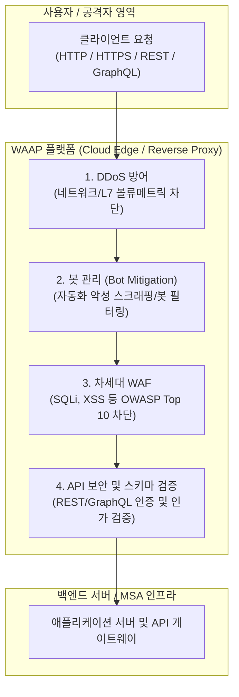

# WAAP (Web Application and API Protection)

---

## I. 웹 애플리케이션 및 API 보안 통합 보호 솔루션, WAAP의 개요

### 가. WAAP의 정의
- 전통적인 웹 방화벽(WAF) 기능에 API 보안, 악성 봇 관리(Bot Mitigation), 계층 7 DDoS 방어 기능을 클라우드 엣지 기반으로 통합 제공하는 웹 보안 솔루션.

### 나. WAAP의 등장 배경 및 주요 특징
| 구분 | 내용 |
| --- | --- |
| 공격 표면 확대 | 마이크로서비스([[MSA (Micro Service Architecture)\|MSA]]), 모바일 앱, 오픈 API 확산으로 기존 HTML 중심 WAF의 한계 직면 |
| 4대 핵심 기능 통합 | 차세대 WAF, API 스키마 검증, 봇 완화(Bot Mitigation), L7 DDoS 방어를 단일 엔진으로 일원화 |
| 클라우드 네이티브 엣지 | 전 세계 분산된 CDN/POP 엣지에서 트래픽을 인라인 검사하여 지연 시간 최소화 및 무제한 탄력성 제공 |
| AI 기반 지능형 탐지 | 정적 룰셋의 오탐 한계를 극복하기 위해 머신러닝 기반 사용자 행위 분석 및 이상 트래픽 자율 차단 |

---

## II. WAAP의 아키텍처 및 핵심 기술 요소

### 가. WAAP의 트래픽 검사 및 보호 아키텍처

* 외부에서 유입되는 모든 HTTP/HTTPS 트래픽이 클라우드 엣지의 WAAP 플랫폼을 거치며, DDoS, 봇, 웹 취약점(WAF), API 악용 순으로 다중 필터링되어 안전한 백엔드로 전달되는 구조

### 나. WAAP의 핵심 구성 요소 및 기술 요소

| 분류 | 요소기술(키워드) | 세부 설명 |
| --- | --- | --- |
| 웹 방호 | 차세대 WAF (NG-WAF) | [[SQL(Structured Query Language)\|SQL]] 인젝션, [[XSS]] 등 OWASP Top 10 및 시그니처/행위 기반 웹 공격 차단 |
| API 보안 | API 디스커버리 및 [[스키마]] 검증 | REST/GraphQL 등 API 엔드포인트 자동 식별 및 [[JSON]]/[[XML]] 스키마 위반 탐지 |
| 봇 통제 | 봇 관리 (Bot Mitigation) | [[인공지능]]/머신러닝 기반으로 정상 사용자, 자동화 스크립트 및 악성 봇 구별 |
| [[HA(High Availability)\|가용성]] 보장 | L7 DDoS 방어 | 애플리케이션 계층의 자원 고갈형 대규모 분산 서비스 거부 공격 실시간 방어 |
| 탐지 기술 | 머신러닝 기반 행위 분석 | 정적 시그니처의 한계를 극복하고 이상 트래픽 및 제로데이(0-day) 공격 탐지 |
| 배포 모델 | 클라우드 엣지 / SaaS 기반 | [[CDN]] 및 클라우드 인프라와 결합하여 전 세계 엣지에서 지연 없이 트래픽 검사 |
| 운영 통합 | 통합 대시보드 및 가시성 | 웹과 API 전반의 보안 이벤트를 단일 창(Single Pane of Glass)으로 모니터링 |
| 최신 트렌드 | AI 기반 자동 정책 튜닝 | 오탐(False Positive)을 줄이고 API 변경 사항을 자동 학습하여 보안 정책 동적 갱신 |

---

## III. 전통적 WAF vs 차세대 WAAP 비교 및 주요 동향

### 가. 전통적 WAF vs 차세대 WAAP 비교

| 비교 항목 | 전통적 웹 방화벽 (Traditional WAF) | 차세대 WAAP (Web App & API Protection) |
| --- | --- | --- |
| **보호 범위** | 전통적인 웹 페이지(HTML 기반 HTTP/HTTPS 트래픽) 중심 | 웹 애플리케이션 + 모바일/IoT용 API(REST, GraphQL 등) 포괄 |
| **탐지 기법** | 주로 정적 시그니처(Signature) 매칭 기반 | 시그니처 + 머신러닝 기반 행위 분석 + 봇/DDoS 통합 방어 |
| **아키텍처** | 온프레미스 하드웨어 장비 또는 가상 어플라이언스 중심 | 클라우드 엣지(Cloud [[EDGE\|Edge]]) 기반 분산 아키텍처 및 SaaS 형태 |

### 나. WAAP의 발전 전망 및 최신 동향
- **미등록 섀도우(Shadow) API 자동 탐지**: 개발자의 잦은 배포로 문서화되지 않은 채 방치된 좀비/섀도우 API를 실시간 자동 식별하고 스키마 변조를 통제하는 API 디스커버리 기능 필수화.
- **클라우드 엣지 CDN 및 SASE 융합**: 글로벌 CDN 및 [[SASE(Secure Access Service Edge)|SASE]] 플랫폼과 일체화되어 전 세계 사용자 트래픽을 지연 없이 분산 검사하고 L7 볼류메트릭 디도스 흡수.
- **AI 기반 자동 룰 튜닝 및 제로데이 방어**: 애플리케이션 변경 사항을 머신러닝 모델이 자율 학습하여 오탐(False Positive)을 최소화하고 시그니처가 없는 제로데이 공격을 능동 격리.

---

### 🔗 연관 토픽

- **소속 도메인**: [[00_보안_MOC|🛡️ 보안]]
- **세부 분류**: `3. 네트워크 & 엔드포인트 · 인프라 보안`
- **핵심 연관 토픽**:
  - [[클라우드 컴퓨팅 취약점 및 대응기술]]
  - [[방화벽]]
  - [[JSON]]
  - [[DDOS]]
  - [[DoS (Denial of Service)]]
