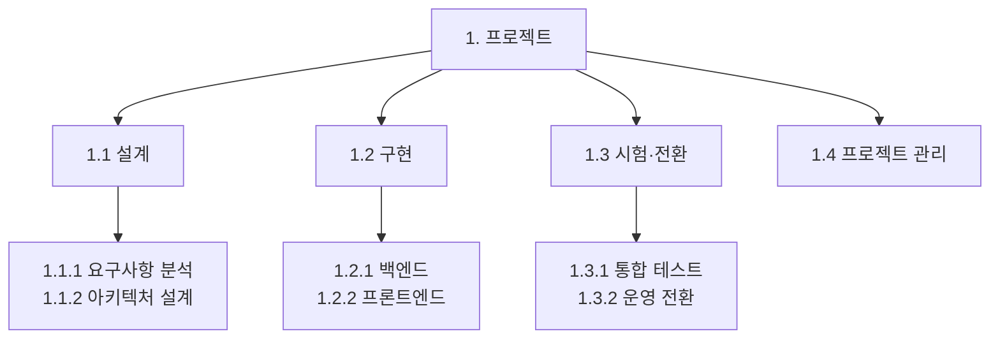

# WBS (Work Breakdown Structure, 작업분류체계)

---

## I. 범위를 관리 가능한 단위로, WBS의 개요

### 가. 정의

- 프로젝트 목표 달성과 인도물 생성에 필요한 **전체 작업 범위를 인도물 중심으로 계층 분해**한 구조 (PMBOK 6판 5.4 WBS 작성의 산출물, 범위 기준선의 구성요소)

### 나. 특징

| 구분 | 내용 |
| --- | --- |
| 100% 규칙 | 하위 요소의 합은 상위 요소의 작업과 정확히 일치, 범위 밖 작업은 포함하지 않음 |
| 인도물 중심 | 활동이 아닌 인도물·결과물 기준 분해 |
| 산정 기준 | 일정·원가·자원 산정과 책임 할당의 기초 |
| 분해 수준 | 작업 패키지까지, 관리 가능성에 따라 깊이 결정 (예: 8~80시간 규칙) |

---

## II. 계층 구조와 구성요소

### 가. 개념도

- 프로젝트 → 주요 인도물(단계) → 작업 패키지 순으로 분해, 프로젝트 관리 작업도 범위에 포함. 작업 패키지는 이후 활동 정의에서 활동으로 분해

### 나. 구성요소

| 구분 | 요소 | 설명 |
| --- | --- | --- |
| 분해 원칙 | 100% 규칙 | 상위 = 하위 합, 누락·중복 방지 |
| | 상호 배타성 | 같은 작업이 두 요소에 중복되지 않음 |
| 최소 단위 | 작업 패키지 | 원가·기간 산정과 책임 할당이 가능한 최하위 단위 |
| 관리 단위 | 통제 계정 (Control Account) | 범위·예산·일정을 통합해 성과를 측정하는 관리 지점, 작업 패키지를 포함 |
| | 계획 패키지 | 작업 내용은 알지만 세부 활동이 미정인 통제 계정 하위 요소 |
| 명세 | WBS 사전 | 요소별 작업 설명, 담당 조직, 마일스톤, 원가, 인수 기준 |
| 식별 | 코드 체계 | 1.2.1 형식의 고유 식별자, 원가 계정 연계 |
| 책임 | OBS·RAM 연계 | 조직 구조와 교차해 [[RACI 매트릭스]] 작성 |

---

## III. 비교 및 동향

### 가. WBS vs 제품 백로그

| 비교 항목 | WBS | 제품 백로그 |
| --- | --- | --- |
| 분해 기준 | 인도물 계층 | 사용자 가치 (에픽 → 스토리) |
| 구조 | 고정 트리, 범위 기준선 | 우선순위 목록, 지속 정제 |
| 변경 | 변경 통제 필요 | PO가 우선순위로 조정 |
| 용도 | 일정·원가 산정, EVM 기준 | 스프린트 계획, 증분 개발 |

### 나. 동향

- **하이브리드**: 상위 WBS로 예산·마일스톤을 통제하고 하위는 에픽·스토리로 관리
- **도구 지원**: 유사 프로젝트 템플릿과 LLM으로 WBS 초안 생성, PMIS에서 WBS-일정-원가 연동

---

### 🔗 연관 토픽

- **소속 도메인**: [[00_프로젝트관리_MOC|📋 프로젝트관리]]
- **세부 분류**: `2. 프로젝트 범위 & 일정 관리 (Scope & Schedule)`
- **핵심 연관 토픽**:
  - [[범위관리]]
  - [[연동계획|연동계획 (Rolling Wave Planning)]]
  - [[RACI 매트릭스]]
  - [[EVM(Earned Value Management, 획득 가치 관리)]]
  - [[프로젝트 일정관리|프로젝트 일정관리(Project Schedule Management)에 대하여 설명하시오]]
