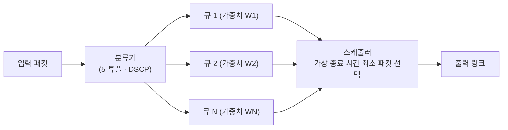

# WFQ (Weighted Fair Queuing, 가중 공정 큐잉)

---

## I. 가중치만큼 공평하게, WFQ의 개요

### 가. 정의

- 플로우(또는 클래스)별 큐를 두고 **가상 종료 시간이 가장 작은 패킷부터 전송해 가중치에 비례한 대역폭을 공정하게 분배**하는 패킷 [[스케줄링]] [[알고리즘]]

### 나. 특징 및 필요성

| 구분 | 내용 |
| --- | --- |
| FIFO의 한계 | 대량 트래픽 플로우가 큐를 점유해 소량·지연 민감 플로우가 지연 ([[FIFO]]) |
| 공정성 | 패킷 크기가 달라도 비트 단위로 공정한 몫 보장 |
| 차등 분배 | 가중치로 [[SLA]]에 따른 대역 비율 지정 |
| 지연 상한 | 토큰 버킷으로 제한된 플로우에 최대 지연 보장 (PGPS 이론) |
| 기원 | 비트 단위 라운드로빈(GPS, 유체 모델)을 패킷 단위로 근사 |

---

## II. 구조 및 구성요소

### 가. 스케줄링 구조

- 패킷 도착 시 F = max(이전 종료 시간, 현재 가상 시간) + 패킷 길이 / 가중치를 계산하고, 스케줄러는 F가 가장 작은 패킷을 먼저 전송

### 나. 구성요소

| 구분 | 요소 | 설명 |
| --- | --- | --- |
| 분류 | 플로우 분류 | 5-튜플 또는 DSCP로 큐 선택 |
| 할당 | 가중치 | 큐별 대역 비율 (Wi / ΣW) |
| 이론 | GPS (유체 모델) | 모든 활성 플로우를 비트 단위로 동시에 서비스하는 이상 모델 |
| 핵심 값 | 가상 시간 · 가상 종료 시간 | GPS에서 해당 패킷이 끝났을 시각을 추정해 전송 순서 결정 |
| 공정성 | 유휴 대역 재분배 | 비활성 큐의 몫을 활성 큐들이 가중치 비율로 나눠 사용 |
| 변형 | CBWFQ · LLQ | 클래스 기반 WFQ, 음성용 엄격 우선 큐(LLQ) 결합 |
| | WF2Q · SCFQ | 공정성 개선, 계산 단순화 |
| 연계 | [[QoS]] · [[DiffServ (Differentiated Services)\|DiffServ]] | AF 클래스 대역 보장에 활용 |

---

## III. 비교 및 동향

### 가. FIFO vs PQ vs WRR vs WFQ

| 비교 항목 | FIFO | PQ (우선순위) | WRR | WFQ |
| --- | --- | --- | --- | --- |
| 방식 | 도착 순서 | 높은 우선 큐부터 | 큐를 돌며 가중치만큼 패킷 수 전송 | 가상 종료 시간 순 |
| 공정성 | 없음 | 낮은 큐 기아 가능 | 패킷 크기 차이에 불공정 | 바이트 단위 공정 |
| 지연 보장 | 없음 | 상위 큐만 | 제한적 | 플로우별 상한 |
| 복잡도 | 매우 낮음 | 낮음 | 낮음 | 높음 (정렬·가상 시간) |

### 나. 동향

- **근사 알고리즘**: 고속 장비에서는 계산이 가벼운 DRR(Deficit Round Robin) 계열이 널리 쓰임
- **하드웨어 스케줄링**: 프로그래머블 스위치·SmartNIC에서 PIFO 등 스케줄러를 하드웨어로 구현하는 연구
- **5G·TSN 연계**: 지연 상한이 필요한 트래픽은 시간 인지 스케줄링(TSN)과 결합

---

### 🔗 연관 토픽

- **소속 도메인**: [[00_네트워크_MOC|🌐 네트워크]]
- **세부 분류**: `2. 네트워크 계층 & 라우팅 프로토콜 (L3)`
- **핵심 연관 토픽**:
  - [[QoS|QoS (Quality of Service)]]
  - [[DiffServ (Differentiated Services)]]
  - [[IntServ (Integrated Services)]]
  - [[Traffic Shaping (트래픽 쉐이핑)]]
  - [[스케줄링]]
