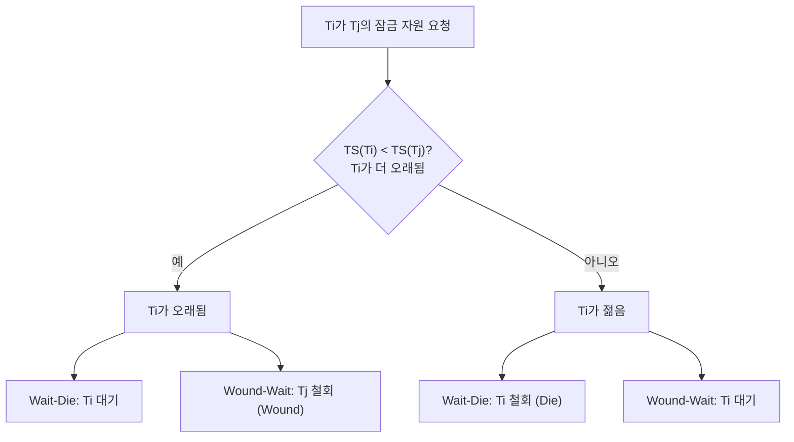

# Wait-Die와 Wound-Wait (타임스탬프 기반 교착상태 예방)

---

## I. 나이로 양보를 정하는, Wait-Die와 Wound-Wait의 개요

### 가. 정의

- [[트랜잭션]]이 다른 트랜잭션이 잠근 자원을 요청할 때 **시작 타임스탬프를 비교해 대기할지 철회(Rollback)할지를 정함으로써 순환 대기를 원천 차단**하는 [[교착상태]] 예방 기법 (Rosenkrantz 외, 1978)

### 나. 특징

| 구분 | 내용 |
| --- | --- |
| 기준 | 타임스탬프가 작을수록 오래된(우선순위 높은) 트랜잭션 |
| 순환 대기 차단 | 대기 방향이 한쪽(오래된 → 젊은 또는 그 반대)으로만 허용되어 사이클 불가 |
| 기아 방지 | 철회된 트랜잭션은 원래 타임스탬프로 재시작 → 결국 가장 오래된 트랜잭션이 됨 |
| 대가 | 실제로 교착이 아닌데도 철회가 발생할 수 있음 |

---

## II. 동작 구조 및 구성요소

### 가. 판정 규칙 (Ti가 Tj가 보유한 자원 요청)

- Wait-Die는 오래된 쪽만 기다릴 수 있고, Wound-Wait는 젊은 쪽만 기다릴 수 있음

### 나. 구성요소

| 구분 | 요소 | 설명 |
| --- | --- | --- |
| 기준 | 타임스탬프 (TS) | 트랜잭션 시작 시 부여, 재시작 후에도 유지 |
| 정책 | Wait-Die (비선점) | 오래된 요청자는 대기, 젊은 요청자는 스스로 철회 |
| | Wound-Wait (선점) | 오래된 요청자는 보유자를 철회시키고 자원 획득, 젊은 요청자는 대기 |
| 처리 | 롤백·재시작 | 철회된 트랜잭션은 같은 타임스탬프로 재시작 |
| 연계 | [[2PL]] | 2PL은 직렬성은 보장하나 교착을 막지 못하므로 함께 사용 |
| 비교 기법 | No-Wait·Timeout | 즉시 철회 또는 일정 시간 대기 후 철회 |

---

## III. 비교 및 동향

### 가. Wait-Die vs Wound-Wait

| 비교 항목 | Wait-Die | Wound-Wait |
| --- | --- | --- |
| 선점 여부 | 비선점 | 선점 |
| 오래된 자가 요청 | 대기 | 보유자(젊은 자) 철회 |
| 젊은 자가 요청 | 자신 철회 | 대기 |
| 대기 방향 | 오래된 → 젊은 | 젊은 → 오래된 |
| 철회 특성 | 젊은 트랜잭션이 같은 자원을 반복 요청하며 여러 번 철회될 수 있음 | 철회 횟수가 상대적으로 적은 편 |

### 나. 동향

- **분산 DB**: Google Spanner는 락 충돌 시 Wound-Wait로 교착 예방, 전역 대기 그래프를 만들지 않아도 됨
- **MVCC·낙관적 제어**: 읽기 충돌을 버전으로 피해 락 대기 자체를 줄이고, 쓰기 충돌만 락·검증으로 처리
- **단일 노드 DBMS**: MySQL InnoDB·PostgreSQL은 예방 대신 대기 그래프 탐지 후 희생자 롤백 방식 사용

---

### 🔗 연관 토픽

- **소속 도메인**: [[00_운영체제_MOC|⚙️ 운영체제]]
- **세부 분류**: `4. 교착상태 (Deadlock) 방지 및 해결`
- **핵심 연관 토픽**:
  - [[교착상태|교착상태 (Deadlock)]]
  - [[2PL|2PL (Two-Phase Locking Protocol)]]
  - [[트랜잭션]]
  - [[자원할당 그래프|자원할당 그래프(Resource Allocation Graph)]]
  - [[DBMS]]
