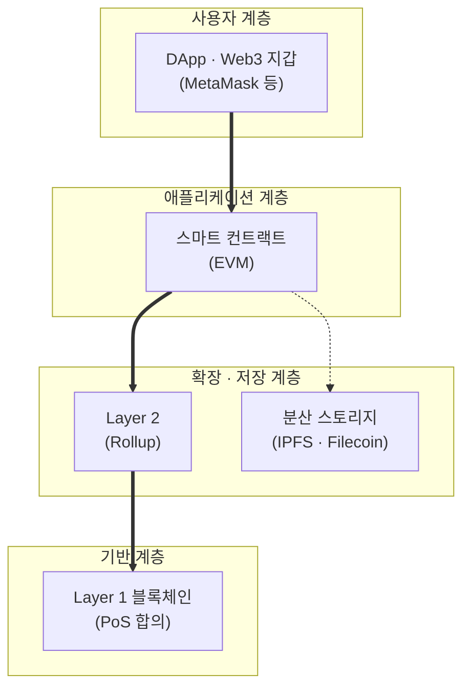

# Web 3.0

---

## I. 읽기·쓰기에서 소유로, Web 3.0의 개요

### 가. 정의

- [[01_IT Tech/블록체인|블록체인]]·스마트 컨트랙트·[[암호화]]를 기반으로 **플랫폼 대신 사용자가 데이터와 디지털 자산을 소유·통제하는 탈중앙화 웹** (2014년 Gavin Wood의 Web3 개념, Read-Write-Own)

### 나. 특징

| 구분 | 내용 |
| --- | --- |
| 등장 배경 | Web 2.0 플랫폼의 데이터 독점·수익 집중, 개인정보 침해 |
| 데이터 소유 | 지갑 기반 신원으로 사용자가 자산·데이터 통제 |
| 무허가성 | 중개자 승인 없이 누구나 서비스 이용·개발 |
| 토큰 경제 | 기여에 대한 토큰 보상, 토큰 기반 거버넌스(DAO) |
| 용어 구분 | Tim Berners-Lee의 시맨틱 웹(Web 3.0)과는 다른 개념, 혼용 주의 |

---

## II. 구조 및 기술요소

### 가. 계층 구조

- 사용자는 지갑으로 서명해 DApp의 스마트 컨트랙트를 호출하고, 실행은 L2·L1 블록체인에서, 대용량 데이터는 분산 스토리지에서 처리

### 나. 기술요소

| 구분 | 요소 | 설명 |
| --- | --- | --- |
| 실행 | 스마트 컨트랙트 | 조건 충족 시 자동 실행되는 온체인 코드 |
| 확장성 | Layer 2 (ZK · Optimistic Rollup) | 오프체인 실행으로 수수료 절감·처리량 향상 |
| 저장 | IPFS / Filecoin | 콘텐츠 주소 기반 분산 저장 |
| 신원 | DID · VC | 분산 식별자와 검증 가능한 증명서로 자기주권 신원 |
| 프라이버시 | [[영지식증명\|ZKP]] | 내용 공개 없이 사실 여부만 증명 |
| 거버넌스 | DAO | 토큰 투표로 운영되는 조직 |
| 자산 | 토큰 · [[NFT (Non Fungible Token)\|NFT]] | 대체 가능/불가능 디지털 자산 |

---

## III. 비교 및 동향

### 가. Web 1.0 vs 2.0 vs 3.0

| 비교 항목 | Web 1.0 | Web 2.0 | Web 3.0 |
| --- | --- | --- | --- |
| 특성 | 읽기 (Read) | 읽기·쓰기 (Read-Write) | 읽기·쓰기·소유 (Read-Write-Own) |
| 데이터 통제 | 사이트 운영자 | 플랫폼 기업 | 사용자 (지갑·키 보유) |
| 수익 구조 | 배너 광고 | 플랫폼 광고·수수료 | 토큰·프로토콜 수수료 |
| 핵심 기술 | HTML, HTTP | [[AJAX\|Ajax]], Open API, [[클라우드 컴퓨팅]], 모바일 | 블록체인, 스마트 컨트랙트, ZKP |

### 나. 동향

- **RWA · 스테이블코인**: 투기 중심에서 실물자산 토큰화·결제용 스테이블코인으로 활용 확대 ([[CBDC]] 참조)
- **DePIN**: 무선망·스토리지·GPU 등 물리 인프라를 토큰 보상으로 분산 구축
- **AI 에이전트 결합**: [[AI Agent|AI 에이전트]]가 지갑을 보유하고 온체인 결제·거래를 수행하는 시도

---

### 🔗 연관 토픽

- **소속 도메인**: [[00_디지털서비스_MOC|🚀 디지털서비스]]
- **세부 분류**: `2. 블록체인 & 분산원장 · Web3`
- **핵심 연관 토픽**:
  - [[01_IT Tech/블록체인|블록체인 (Block Chain)]]
  - [[NFT (Non Fungible Token)]]
  - [[Web 4.0, 5.0|Web 4.0 5.0]]
  - [[영지식증명|영지식증명(Zero Knowledge Proof)]]
  - [[메타버스|메타버스 (Metaverse)]]
