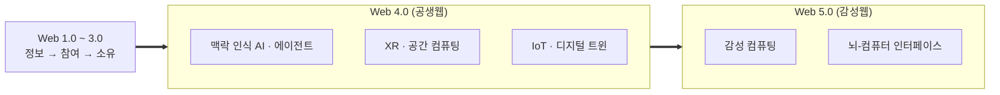

# Web 4.0 및 Web 5.0

---

## I. 지능형 공생웹과 감성웹, Web 4.0·5.0의 개요

### 가. 정의

- **Web 4.0**: AI·IoT·확장현실이 결합되어 웹이 사용자 상황을 이해하고 능동적으로 행동하는 **지능형 공생웹(Symbiotic Web)**
- **Web 5.0**: 감성 컴퓨팅·뇌-컴퓨터 인터페이스(BCI)로 사용자의 감정·인지 상태에 반응하는 **감성웹(Emotional Web)**
- 표준화된 정의가 아닌 학계·업계의 전망적 개념

### 나. 특징

| 구분 | 내용 |
| --- | --- |
| 진화 방향 | 정보(1.0) → 참여(2.0) → 소유(3.0) → 지능·공생(4.0) → 감성·인지(5.0) |
| Web 4.0 | 맥락 인식, 자율 에이전트, 가상·현실 실시간 연동 |
| Web 5.0 | 감정·생체신호 인식, 생각 기반 인터페이스 |
| 용어 구분 | Block(TBD)이 2022년 제안한 'Web5'(DID + 개인 데이터 저장소 기반 탈중앙 신원)와는 다른 개념 |

---

## II. 구조 및 기술요소

### 가. 진화 구조

- Web 3.0의 탈중앙 기반 위에 AI·공간 컴퓨팅이 결합된 4.0을 거쳐, 감정·신경 신호를 다루는 5.0으로 확장된다는 전망

### 나. 기술요소

| 구분 | 요소 | 설명 |
| --- | --- | --- |
| Web 4.0 | 맥락 인식 AI · [[AI Agent\|AI 에이전트]] | 사용자 의도·상황을 파악해 작업을 대신 수행 |
| | [[XR 유형\|XR]] · 공간 컴퓨팅 | 물리 공간과 가상 공간을 3D로 결합한 몰입형 환경 |
| | IoT · [[디지털 트윈]] | 사물 간 자율 연동, 현실 상태의 가상 동기화 |
| | 엣지-클라우드 | 초저지연 처리를 위한 분산 인프라 |
| Web 5.0 | 감성 컴퓨팅 | 표정·음성·생체신호로 감정 인식·반응 |
| | BCI | 뇌 신호로 기기 제어·정보 입력 (Neuralink 등 임상 단계) |
| 공통 | 신뢰 · 보안 | DID 기반 신원, 생체·신경 데이터 프라이버시 보호 |

---

## III. 비교 및 동향

### 가. Web 3.0 vs Web 4.0 vs Web 5.0

| 비교 항목 | [[Web 3.0]] | Web 4.0 | Web 5.0 |
| --- | --- | --- | --- |
| 핵심 | 소유·탈중앙화 | 지능·공생 | 감성·인지 |
| 주요 기술 | 블록체인, 스마트 컨트랙트 | AI 에이전트, XR, IoT | 감성 컴퓨팅, BCI |
| 상호작용 | 지갑 서명 | 음성·제스처·몰입형 3D | 감정·생각 |
| 성숙도 | 상용 서비스 존재 | 부분 구현 중 | 연구·임상 단계 |

### 나. 동향

- **EU Web 4.0 전략**: 유럽연합 집행위원회가 2023년 'Web 4.0 및 가상세계 이니셔티브' 발표, 개방형 가상세계 표준·산업 육성 추진
- **에이전틱 AI**: LLM 기반 에이전트가 웹 서비스를 대신 탐색·실행하는 형태로 Web 4.0 개념이 구체화
- **BCI 임상**: 이식형 BCI 인체 임상이 진행 중이나, 신경 데이터 프라이버시·윤리 규범 정립이 선결 과제

---

### 🔗 연관 토픽

- **소속 도메인**: [[00_디지털서비스_MOC|🚀 디지털서비스]]
- **세부 분류**: `2. 블록체인 & 분산원장 · Web3`
- **핵심 연관 토픽**:
  - [[Web 3.0]]
  - [[AI Agent]]
  - [[메타버스|메타버스 (Metaverse)]]
  - [[디지털 트윈|디지털 트윈 (Digital Twin)]]
  - [[인공지능]]
