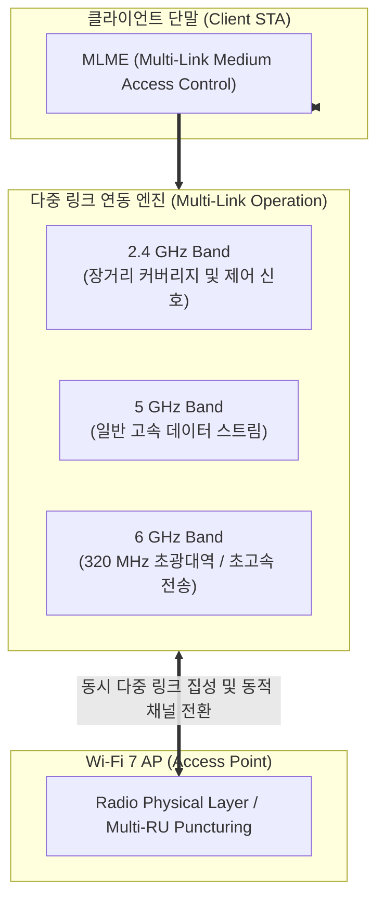

# Wi-Fi 7 (IEEE 802.11be)

---

## I. 초고속·저지연 무선 통신을 위한 차세대 무선랜 표준, Wi-Fi 7의 개요

IEEE 802.11be EHT(Extremely High Throughput) 표준을 기반으로 최대 30~46 Gbps 이상의 초고속 전송 속도와 초저지연, 고신뢰성을 제공하는 차세대 근거리 무선랜(Wi-Fi) 통신 기술이다.

| 구분 | 주요 내용 |
| --- | --- |
| **개념** | 2.4GHz, 5GHz, 6GHz 대역을 활용하여 초광대역폭(320MHz), 고밀도 변조(4096-QAM), 다중 링크 동작(MLO)을 구현한 최신 무선랜 기술 |
| **등장 배경** | 4K/8K 초고화질 스트리밍, 실시간 AR/VR/XR 메타버스, 클라우드 게이밍 및 스마트 팩토리 등 대용량 트래픽의 극초저지연 무선 전송 요구 |
| **핵심 특징** | 320MHz 채널 대역폭, 4K-QAM 변조, MLO(Multi-Link Operation), Multi-RU Puncturing 및 최대 16x16 MU-MIMO 지원 |

---

## II. Wi-Fi 7의 아키텍처 및 핵심 구성요소

### 가. Wi-Fi 7의 MLO 및 채널 다중화 아키텍처

단말과 AP 간에 2.4GHz, 5GHz, 6GHz의 여러 주파수 채널을 동시에 묶어 데이터를 분산 전송하거나 지연이 가장 낮은 채널을 실시간 선택하여 초저지연을 달성한다.

### 나. Wi-Fi 7의 핵심 기술 요소

| 분류 | 요소기술 (키워드) | 세부 설명 |
| --- | --- | --- |
| **대역폭 확장** | 320 MHz 채널 대역폭 | 6 GHz 대역에서 Wi-Fi 6(160 MHz) 대비 2배 넓은 채널을 지원하여 데이터 전송 처리량 극대화 |
| **변조 기법** | 4096-QAM (4K-QAM) | 심볼당 12비트 데이터를 실어 전송하여 기존 1024-QAM 대비 전송 데이터 밀도를 약 20% 향상 |
| **다중 링크** | MLO (Multi-Link Operation) | 여러 주파수 대역과 링크를 동시에 집성 전송하거나 즉각 전환하여 통신 지연 시간을 획기적으로 단축 |
| **스펙트럼 효율** | Multi-RU Puncturing | 특정 대역에 전파 간섭이 발생해도 전체 채널을 버리지 않고 간섭 부분만 천공하여 남은 채널 지속 활용 |
| **공간 다중화** | 16x16 MU-MIMO | 공간 스트림(Spatial Stream)을 최대 16개까지 확장하여 다중 사용자 동시 접속 용량 배가 |
| **간섭 제어** | Coordinated AP (협력 통신) | 인접한 복수 AP 간에 빔포밍 및 전송 전력을 상호 조율하여 밀집 구역 내 간섭 억제 |
| **보안 프로토콜** | WPA3 Enterprise | 192비트 암호화 알고리즘 기반 WPA3 보안을 필수 적용하여 엔터프라이즈 레벨의 보안성 확보 |

---

## III. Wi-Fi 6(802.11ax) vs Wi-Fi 7(802.11be) 비교 및 최신 동향

### 가. Wi-Fi 6 vs Wi-Fi 7 비교

| 비교 항목 | Wi-Fi 6 / 6E (IEEE 802.11ax) | Wi-Fi 7 (IEEE 802.11be) |
| --- | --- | --- |
| **최대 이론 속도** | 약 9.6 Gbps | **최대 약 46 Gbps (약 4.8배 향상)** |
| **최대 채널 대역폭** | 160 MHz | **320 MHz (6 GHz 대역)** |
| **변조 방식** | 1024-QAM (10비트/심볼) | **4096-QAM (12비트/심볼)** |
| **다중 링크(MLO)** | 미지원 (단일 대역 단일 연결) | **MLO 전면 지원 (동시 다중 링크 전송)** |
| **MIMO 스트림** | 최대 8x8 MU-MIMO | **최대 16x16 MU-MIMO** |
| **자원 할당** | 단일 사용자 단일 RU 할당 | **Multi-RU Puncturing 지원** |

### 나. 최신 기술 동향 및 발전 방향

* **상용 기기 및 공유기 생태계 확산**: 최신 플래그십 스마트폰, 노트북, 프리미엄 유무선 공유기에 Wi-Fi 7 칩셋 탑재가 표준화되면서 기업 및 가정 내 무선 인프라 세대교체가 가속화됨.
* **유선 LAN 대체 및 무선 백홀 활용**: 수십 Gbps의 대역폭과 5ms 미만의 결정론적 초저지연 특성을 바탕으로, 건물 내 유선 이더넷 배선을 대체하는 무선 백홀망 및 산업용 무선 인프라로 채택됨.
* **차세대 Wi-Fi 8(802.11bn) 논의 시작**: 단순 속도 경쟁을 넘어 극한의 무선 신뢰성(UHR, Ultra High Reliability)을 목표로 하는 차세대 IEEE 802.11bn 표준화 연구가 착수됨.

---

### 🔗 연관 토픽

- **소속 도메인**: [[00_네트워크_MOC|🌐 네트워크]]
- **세부 분류**: `4. 무선 및 차세대 이동통신 (5G/6G/Wi-Fi)`
- **핵심 연관 토픽**:
  - [[QAM(Quadrature Amplitude Modulation)--|QAM]]
  - [[Traffic Shaping (트래픽 쉐이핑)]]
  - [[Traffic Policing (트래픽 정책처리)]]
  - [[Wi-Fi 8|Wi-Fi 8(IEEE 802.11bn)]]
  - [[무결성]]
