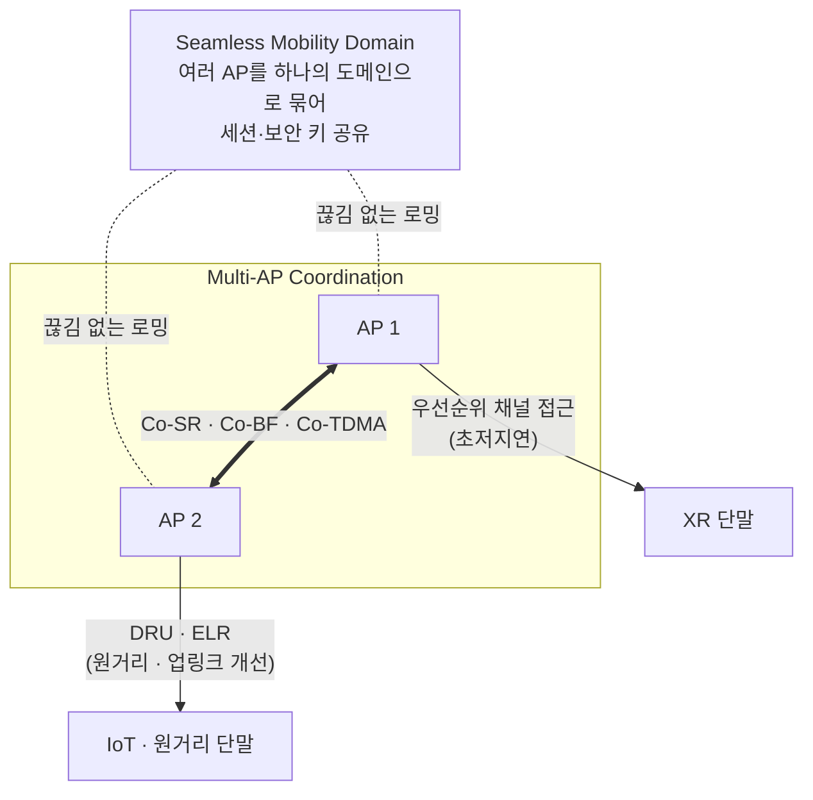

# Wi-Fi 8 (IEEE 802.11bn, UHR)

---

## I. 속도에서 신뢰성으로, Wi-Fi 8의 개요

### 가. 정의

- 최대 속도 경쟁 대신 **다중 AP 협력, 끊김 없는 로밍, 꼬리 지연 감소로 실제 환경의 신뢰성(UHR, Ultra High Reliability)을 높이는** 8세대 무선랜 표준 (IEEE 802.11bn)

### 나. 등장 배경 및 특징

| 구분 | 내용 |
| --- | --- |
| 패러다임 전환 | Wi-Fi 7(EHT)의 최대 속도 중심에서 체감 성능·안정성 중심으로 |
| 고밀도 환경 | 밀집 AP 간 간섭, 다수 IoT 기기 접속 문제 해소 |
| 지연 민감 서비스 | XR, 산업용 IoT, 원격 제어의 [[QoS]]와 지연 지터(Jitter) 보장 |
| 목표 지표 | 실효 [[처리량]]·95 퍼센타일 지연·로밍 패킷 손실을 각 25% 개선 |
| 물리 계층 승계 | 320MHz 채널, 4096-QAM, 최대 약 46Gbps는 [[Wi-Fi 7]]과 동일 |

---

## II. 구조 및 핵심 기술

### 가. 다중 AP 협력 구조

- 인접 AP가 전송 시점·출력·빔을 조율해 간섭을 줄이고, 단말은 AP 사이를 이동해도 재인증 없이 연결을 유지

### 나. 핵심 기술

| 구분 | 기술 | 설명 |
| --- | --- | --- |
| 다중 AP 협력 | Co-SR / Co-BF / Co-TDMA | 협력 공간 재사용(출력 조정), 협력 빔포밍(널링), 시간 분할로 AP 간 간섭 회피 |
| 이동성 | SMD (Seamless Mobility Domain) | 여러 AP를 단일 도메인으로 묶어 로밍 지연·패킷 손실 최소화 |
| 스펙트럼 효율 | DSO · NPCA | 단말 능력에 맞춘 동적 서브채널 운용, 주채널이 바쁠 때 비주채널 접근 |
| 커버리지 | DRU (Distributed-tone RU) | 부반송파를 넓게 분산 배치해 전력 스펙트럼 밀도 제한을 피하고 업링크 출력 향상 |
| | ELR (Enhanced Long Range) | 견고한 변조로 원거리 단말의 링크 버짓 확보 |
| 저지연 | 우선순위 EDCA · TXOP 선점 | 지연 민감 트래픽이 채널을 먼저 쓰도록 해 꼬리 지연 감소 |
| 링크 적응 | 신규 MCS 단계 | 기존 MCS 사이를 세분화해 채널 상태에 정밀 대응 |
| 표준화 일정 | IEEE 802.11bn | 2028년 표준 완료 목표, Wi-Fi Alliance 인증 후 상용화 |

---

## III. 비교 및 전망

### 가. Wi-Fi 7 vs Wi-Fi 8

| 비교 항목 | Wi-Fi 7 (802.11be) | Wi-Fi 8 (802.11bn) |
| --- | --- | --- |
| 목표 | EHT (Extremely High Throughput) | UHR (Ultra High Reliability) |
| 최대 속도 | 약 46Gbps | 약 46Gbps (속도 유지, 안정성 집중) |
| 핵심 기술 | 320MHz, 4K-QAM, MLO | Multi-AP 협력, SMD, DRU |
| AP 간 관계 | 개별 AP 독립 동작 | AP 간 협력 스케줄링 |
| 로밍 | 단말 주도 전환 | 도메인 기반 끊김 없는 전환 |
| 주요 활용 | 8K 스트리밍, 대용량 전송 | 산업용 IoT, 실시간 제어, XR |

### 나. 전망

- **미션 크리티컬 무선**: 스마트팩토리·원격 의료 등에서 유선에 가까운 확정적(Deterministic) 품질 제공
- **유무선 융합**: 5G·6G와 결합한 FMC로 [[Smart Car(자율주행)|자율주행]] V2X·스마트홈의 끊김 없는 연결 인프라

---

### 🔗 연관 토픽

- **소속 도메인**: [[00_네트워크_MOC|🌐 네트워크]]
- **세부 분류**: `4. 무선 및 차세대 이동통신 (5G/6G/Wi-Fi)`
- **핵심 연관 토픽**:
  - [[Wi-Fi 7|WI-FI 7 (IEEE 802.11be)]]
  - [[QoS|QoS (Quality of Service)]]
  - [[6G]]
  - [[처리량]]
  - [[신뢰성]]
