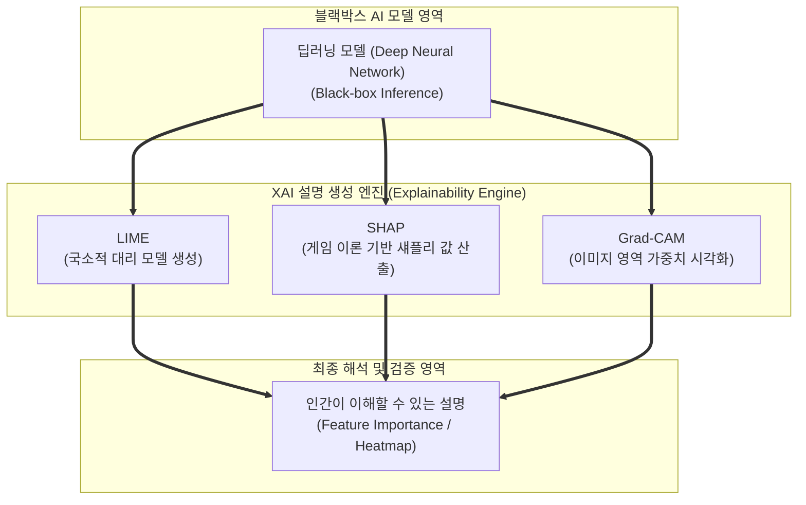

# XAI (Explainable Artificial Intelligence, 설명 가능한 인공지능)

---

## I. 블랙박스 AI의 한계 극복과 신뢰성 확보를 위한 투명한 인공지능 기술, XAI의 개요

### 가. XAI의 정의
- 복잡한 딥러닝 인공신경망의 불투명한 추론 및 의사결정 과정(블랙박스)을 인간이 직관적으로 이해하고 검증할 수 있도록 근거, 시각화, 국소 대리 모델 등을 통해 설명(Explanation)을 제공하는 신뢰성 중심 AI 기술이다.

### 나. XAI의 등장 배경 및 주요 특징

| 구분 | 주요 내용 |
| --- | --- |
| 블랙박스 극복 | 수억 개 이상의 파라미터로 동작하는 심층 신경망의 예측 사유 및 내부 의사결정 경로 추적 필요 |
| 규제 및 컴플라이언스 | EU AI Act, 금융/의료 고위험(High-Risk) AI 판정에 대한 거부권 및 설명 요구권(Right to Explanation) 대응 |
| 모델 디버깅/편향 개선 | 모델 학습 데이터의 내재적 편향(Bias), 지름길 학습(Shortcut Learning), 오작동 원인 규명 및 수정 |
| 사후 설명력(Post-hoc) | 모델 자체의 수학적 투명성(White-box) 모델뿐 아니라 블랙박스 모델에 사후 적용 가능한 해석 기법(LIME, SHAP 등) 제공 |

---

## II. XAI의 아키텍처 및 핵심 기술 요소

### 가. XAI의 분석 프로세스 및 동작 아키텍처

* 블랙박스 딥러닝 모델의 추론 결과와 입력 데이터를 LIME, SHAP, Grad-CAM 등의 XAI 엔진이 분석하여, 특성 중요도(Feature Importance)나 히트맵 형태의 직관적인 설명 결과로 도출하는 구조

### 나. XAI의 핵심 구성 요소 및 기술 요소

| 분류 | 요소기술(키워드) | 세부 설명 |
| --- | --- | --- |
| 국소적 대리 모델 | LIME (Local Interpretable Model-agnostic Explanations) | 개별 예측 주변에 선형 등 단순한 대리 모델을 국소적으로 적용하여 설명 |
| 게임 이론 기반 | SHAP (SHapley Additive exPlanations) | 협조 게임 이론을 활용해 각 입력 변수가 최종 예측값에 기여한 기여도(값) 산출 |
| 이미지 시각화 | Grad-CAM (Gradient-weighted Class Activation Mapping) | 합성곱 신경망([[CNN]])의 그래디언트를 활용해 이미지 내 중요 영역을 히트맵으로 시각화 |
| 고유 투명성 모델 | 선형 모델 / 의사결정 나무 (White-box) | [[알고리즘]] 구조 자체가 수학적으로 투명하여 별도의 설명 기법이 불필요한 모델 |
| 글로벌 설명 | PDP (Partial Dependence Plot) / ICE | 특정 특성이 전체 모델 예측 결과에 미치는 평균적 비선형 관계를 그래프로 표현 |
| 규제 대응 | EU AI Act 고위험 AI 규정 준수 | 의료, 금융, 인사 등 규제 영역에서 AI 판정 사유 및 오류 검증 수단으로 의무화 |
| 최신 트렌드 | [[초거대 언어 모델\|LLM]] 기반 자연어 설명 (Self-Explainable LLM) | 거대언어모델이 추론 과정과 근거를 체인오브소트([[COT\|CoT]]) 형태로 스스로 서술 |
| 평가 방법 | Faithfulness / Human Evaluation | 생성된 설명이 실제 블랙박스 모델의 내부 작동을 충실히 반영하는지 검증 |

---

## III. 전통적 블랙박스 모델 vs XAI 비교 및 최신 동향

### 가. 전통적 블랙박스 AI vs 설명 가능한 인공지능(XAI) 비교

| 비교 항목 | 전통적 블랙박스 AI (Black-box AI) | 설명 가능한 인공지능 (XAI) |
| --- | --- | --- |
| **의사결정 투명성** | 내부 연산 과정이 복잡하여 결과의 도출 근거를 추적하기 어려움 | 예측 결과에 대한 기여도, 근거 및 시각화 설명 제공 |
| **[[신뢰성]] 및 책임성** | 오작동(Hallucination 등) 발생 시 원인 규명 및 책임 소재 불분명 | 오류 분석, [[편향]](Bias) 검출 및 디버깅 용이 |
| **주요 활용 분야** | 단순 추천 시스템, 패턴 인식, 범용 콘텐츠 생성 | 의료 진단, 금융 대출 심사, 자율주행, 법률 및 공공 서비스 |
| **성능 대 설명력 트레이드오프** | 최고 수준의 예측 정확도 달성 가능하나 설명 불가 | 설명력을 확보하면서 모델 정확도 손실을 최소화하는 설계 필요 |

### 나. 한계 극복 및 최신 발전 동향
- **글로벌 규제 준수 의무화**: EU AI Act의 고위험 AI 규정, 금융권 신용평가 설명권 보장 등 법적·제도적 책임성 준수를 위한 필수 인증 체계로 통합
- **Self-Explainable LLM 부상**: 단순히 수치적 기여도(SHAP 등)를 산출하는 데 그치지 않고 거대 언어 모델이 추론 근거를 인간의 자연어 문장(CoT)으로 자가 서술하는 형태로 진화
- **설명의 충실도(Faithfulness) 검증**: XAI가 생성한 설명이 실제 신경망 내부 작동 원리와 부합하는지 검증하기 위한 섭동(Perturbation) 기반 정량 평가 지표 표준화 활발

---

### 🔗 연관 토픽

- **소속 도메인**: [[00_인공지능_MOC|🤖 인공지능]]
- **세부 분류**: `6. 설명가능한 AI (XAI) & AI 윤리 · 거버넌스`
- **핵심 연관 토픽**:
  - [[편향]]
  - [[LIME]]
  - [[딥러닝]]
  - [[인공지능]]
  - [[알고리즘]]
