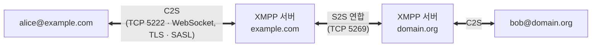

# XMPP (eXtensible Messaging and Presence Protocol)

---

## I. 개방형 메신저 표준, XMPP의 개요

### 가. 정의

- [[XML]] 스트림으로 **메시지·접속 상태(Presence)·연락처를 실시간 교환하고, 서로 다른 도메인 서버끼리 연합(Federation)할 수 있는 개방형 메시징 [[프로토콜]]** (IETF RFC 6120·6121, Jabber에서 출발)

### 나. 특징

| 구분 | 내용 |
| --- | --- |
| 개방성 | 누구나 서버를 운영하고 다른 도메인과 연합 (이메일과 유사한 구조) |
| 클라이언트-서버 | 클라이언트는 자기 서버에만 연결, 서버 간 S2S로 전달 |
| XML 스탠자 | message·presence·iq 세 가지 기본 단위 |
| 확장성 | XEP(XMPP Extension Protocol)로 그룹 채팅, 음성·영상, Pub/Sub 등 추가 |
| 보안 | TLS 전송 암호화, SASL 인증, OMEMO 종단 간 [[암호화]] |

---

## II. 구조 및 구성요소

### 가. 클라이언트-서버 및 연합 구조

- 클라이언트는 자신의 도메인 서버와 연결하고, 서버는 수신자 도메인의 서버를 DNS SRV로 찾아 스탠자를 전달

### 나. 구성요소

| 구분 | 요소 | 설명 |
| --- | --- | --- |
| 스탠자 | message | 채팅 메시지 푸시 전달 |
| | presence | 접속 상태(온라인·자리비움) 알림, 구독 관리 |
| | iq (Info/Query) | 요청-응답형 조회·설정 (연락처 목록 등) |
| 주소 | JID | `user@domain/resource`, resource로 기기 구분 |
| 보안 | TLS · SASL · OMEMO | 전송 암호화, 인증, 종단 간 암호화(XEP-0384) |
| 확장 | MUC · Jingle · PubSub | 그룹 채팅(XEP-0045), 음성·영상 세션(XEP-0166), 발행·구독(XEP-0060) |
| 바인딩 | BOSH · WebSocket | HTTP 롱폴링(XEP-0124), WebSocket(RFC 7395)으로 웹 지원 |

---

## III. 비교 및 동향

### 가. XMPP vs MQTT

| 비교 항목 | XMPP | [[MQTT (Message Queuing Telemetry Transport)\|MQTT]] |
| --- | --- | --- |
| 데이터 형식 | XML 텍스트 스트림 | 바이너리 |
| 통신 모델 | 클라이언트-서버 + 서버 연합 | 브로커 중심 발행·구독 |
| 오버헤드 | 큼 (XML 태그) | 작음 (헤더 최소 2바이트) |
| 강점 | 사람 간 메시징, 접속 상태, 연합 | 대량 기기 텔레메트리 |
| 활용 | 메신저, 협업 도구, 일부 게임 채팅 | IoT 센서, 스마트홈 |

### 나. 동향

- **메신저 기반**: 초기 Google Talk, WhatsApp(수정 버전) 등이 XMPP 계열에서 출발, 현재는 독자 프로토콜 전환 사례가 많음
- **IoT 영역**: XML 오버헤드로 경량 IoT에서는 MQTT·[[CoAP]]에 밀림
- **상호 운용 요구**: EU 디지털시장법(DMA)의 메신저 상호 운용 의무화로 개방형 프로토콜(XMPP, MLS 기반 MIMI) 논의 재부상

---

### 🔗 연관 토픽

- **소속 도메인**: [[00_네트워크_MOC|🌐 네트워크]]
- **세부 분류**: `1. OSI 7계층 & 데이터링크 계층 (L1/L2)`
- **핵심 연관 토픽**:
  - [[MQTT (Message Queuing Telemetry Transport)]]
  - [[CoAP|CoAP (Constrained Application Protocol)]]
  - [[XML]]
  - [[TCP]]
  - [[DNS(Domain Name System)]]
