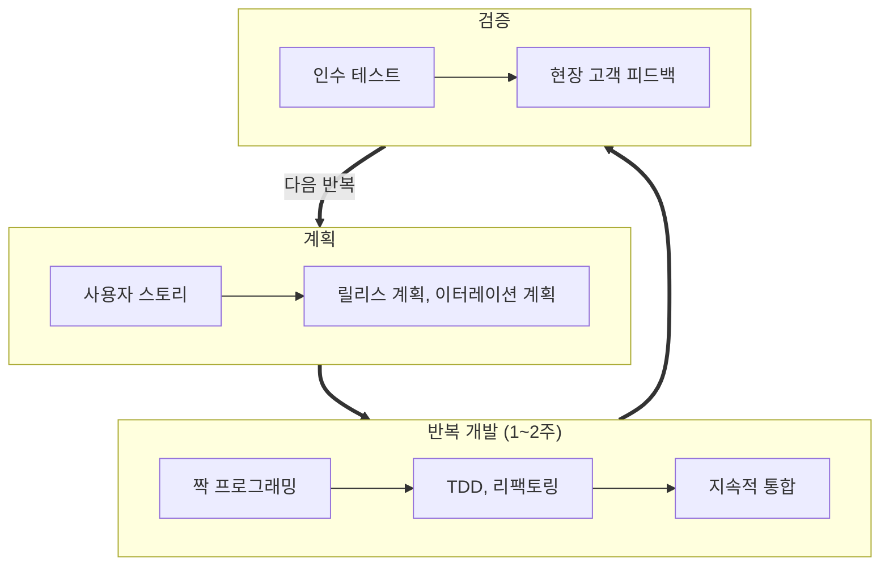

# XP (eXtreme Programming)

---

## I. 좋은 개발 관행을 극단까지, XP의 개요

### 가. 정의

- 짧은 반복과 빠른 피드백, **테스트·짝 프로그래밍·지속적 통합 등 기술적 실천법**으로 변화하는 요구에 대응하는 애자일 개발 방법론 (Kent Beck, 1999)

### 나. 특징

| 구분 | 내용 |
| --- | --- |
| 가치 | 의사소통, 단순성, 피드백, 용기 (1판 4가지) + 존중 (2판, 2004 추가) |
| 실천법 | 1판 12가지 실천법, 2판은 주요·파생 실천법으로 재구성 |
| 기술 중심 | 스크럼이 관리 프레임워크라면 XP는 엔지니어링 실천에 집중 |
| 적합 환경 | 요구 변경이 잦은 소규모 팀, 고객이 밀접하게 참여 가능한 환경 |

---

## II. 개발 흐름과 실천법

### 가. 개념도

- 고객의 사용자 스토리로 릴리스·이터레이션을 계획하고, 짝 프로그래밍·TDD로 구현해 지속적으로 통합한 뒤 인수 테스트와 고객 피드백을 다음 반복에 반영

### 나. 12가지 실천법 (1판)

| 구분 | 요소 | 설명 |
| --- | --- | --- |
| 계획·고객 | 계획 게임 (Planning Game) | 고객이 우선순위, 개발자가 추정을 맡아 반복 계획 |
| | 소규모 릴리스 | 짧은 주기로 동작하는 SW 출시 |
| | 현장 고객 (On-site Customer) | 고객이 팀과 함께하며 즉시 질의 응답·우선순위 결정 |
| 설계 | 메타포 (Metaphor) | 시스템 구조를 공유하는 쉬운 비유 |
| | 단순한 설계 | 현재 필요한 만큼만 설계 |
| | 리팩토링 | 외부 동작은 유지하고 내부 구조 개선 |
| 코딩·테스트 | 테스트 (TDD, 인수 테스트) | 테스트를 먼저 작성 ([[TDD]]) |
| | [[페어 프로그래밍]] | 두 명이 한 작업 환경에서 함께 코딩 |
| | 공동 코드 소유 | 누구나 어떤 코드든 개선 가능 |
| | 지속적 통합 | 하루에도 여러 번 통합·빌드·테스트 |
| | 코딩 표준 | 팀 공통 코딩 규칙 |
| 팀 | 주 40시간 (지속 가능한 속도) | 초과 근무를 지양해 생산성 유지 |

---

## III. 비교 및 동향

### 가. XP vs 스크럼

| 비교 항목 | XP | [[SCRUM\|스크럼]] |
| --- | --- | --- |
| 초점 | 엔지니어링 실천법 | 관리 프레임워크 |
| 반복 주기 | 1~2주 | 1개월 이하 스프린트 |
| 변경 수용 | 반복 중에도 같은 크기 항목으로 교체 가능 | 스프린트 중 목표 변경 지양 |
| 우선순위 | 고객 우선순위를 엄격히 따름 | PO가 백로그 우선순위 결정 |
| 결합 | 스크럼 관리 + XP 실천법 병행이 일반적 | |

### 나. 동향

- **DevOps의 기반**: TDD·CI·소규모 릴리스가 CI/CD 파이프라인 자동화로 확장 ([[DevOps]])
- **AI 페어링**: 생성형 AI 코딩 도구가 짝 프로그래밍·리팩토링을 보조

---

### 🔗 연관 토픽

- **소속 도메인**: [[00_프로젝트관리_MOC|📋 프로젝트관리]]
- **세부 분류**: `4. 품질 보증 · 위험 관리 & 정보시스템 감리`
- **핵심 연관 토픽**:
  - [[페어 프로그래밍|페어 프로그래밍 (Pair Programming)]]
  - [[TDD|TDD (Test Driven Development)]]
  - [[SCRUM]]
  - [[Agile]]
  - [[소프트웨어 개발 방법론]]
