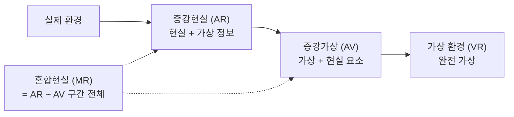

# XR (Extended Reality) 유형

---

## I. 현실과 가상의 연속체, XR 유형의 개요

### 가. 정의

- **VR·AR·MR 등 현실과 가상을 결합하는 실감 기술의 총칭**으로, 현실 환경과 가상 환경 사이 어디에 위치하는지(밀그램의 현실-가상 연속체, 1994)에 따라 유형 구분

### 나. 특징

| 구분 | 내용 |
| --- | --- |
| 분류 기준 | 현실 시야 유지 여부, 가상 객체와 현실 공간의 상호작용 수준 |
| 몰입감 | 시각·청각·촉각 자극으로 실재감 제공 |
| 공간 인식 | 사용자 위치와 주변 공간을 실시간 추적 |
| 활용 | [[메타버스]], 교육·훈련, 원격 협업, 의료, 제조 |

---

## II. 분류 구조 및 기술요소

### 가. 현실-가상 연속체

- 밀그램 모델에서 MR은 실제와 가상 사이 전 구간(AR + AV)을 의미하며, 업계에서는 가상 객체가 현실 공간과 상호작용하는 고도화된 AR을 MR로 부르기도 함

### 나. 기술요소

| 구분 | 요소 | 설명 |
| --- | --- | --- |
| 유형 | VR (가상현실) | 현실 시야를 차단하고 완전한 가상 공간 제공 |
| | AR (증강현실) | 현실 시야 위에 디지털 정보를 중첩 (스마트폰·글래스) |
| | MR (혼합현실) | 가상 객체가 현실 사물에 가려지고(Occlusion) 고정되는 등 공간과 상호작용 |
| 공간 인식 | SLAM | 카메라·IMU로 주변 3D 지도 작성과 기기 위치 추적 (6DoF) |
| 디스플레이 | OLEDoS · Micro LED | 실리콘 기판 초고해상도 마이크로 디스플레이 |
| 광학 | 팬케이크 렌즈 / 웨이브가이드 | VR 헤드셋 경량화 / AR 글래스 투과형 광학 |
| 시야 결합 | OST / VST | 광학 투과(Optical See-Through) / 카메라 영상 투과(Video See-Through) |
| 인터랙션 | 핸드·아이 트래킹 | 컨트롤러 없이 손동작·시선으로 조작, 시선 기반 렌더링 최적화 |
| 플랫폼 | OpenXR · WebXR | 기기 간 호환 XR API 표준 / 브라우저 XR API, visionOS·Android XR 등 공간 [[OS(운영체제)\|OS]] |

---

## III. 비교 및 동향

### 가. VR vs AR vs MR

| 비교 항목 | VR | AR | MR |
| --- | --- | --- | --- |
| 현실 시야 | 차단 | 유지 (OST 또는 화면) | 유지 (OST) 또는 VST로 재현 |
| 가상 객체 | 전부 가상 | 현실 위 단순 중첩 | 현실 공간에 고정·상호작용 |
| 몰입감 | 매우 높음 | 낮음~중간 | 높음 |
| 기기 예 | Meta Quest | 스마트폰 AR, 스마트 글래스 | HoloLens 2, Apple Vision Pro, Quest 3(패스스루) |
| 활용 | 게임, 훈련 시뮬레이션 | 길안내, 정보 표시 | 원격 협업, 설계 검토 |

### 나. 동향

- **AI 스마트 글래스**: 카메라·마이크로 주변을 인식하고 AI 비서가 답하는 경량 글래스 확산 (Ray-Ban Meta 등)
- **공간 컴퓨팅 플랫폼**: Apple Vision Pro(2024), Android XR 등 공간 OS 경쟁
- **표준화**: OpenXR 확산으로 기기 간 앱 호환성 향상, 국내 가상융합산업 진흥법(2024)으로 산업 지원 근거 마련

---

### 🔗 연관 토픽

- **소속 도메인**: [[00_디지털서비스_MOC|🚀 디지털서비스]]
- **세부 분류**: `3. 사물인터넷 (IoT) & 스마트 플랫폼 · 메타버스`
- **핵심 연관 토픽**:
  - [[메타버스|메타버스 (Metaverse)]]
  - [[디지털 트윈|디지털 트윈 (Digital Twin)]]
  - [[Web 4.0, 5.0|Web 4.0 5.0]]
  - [[측위기술|측위기술 (LDT Location Determination Technology)]]
  - [[Mobile Edge Computing|MEC]]
