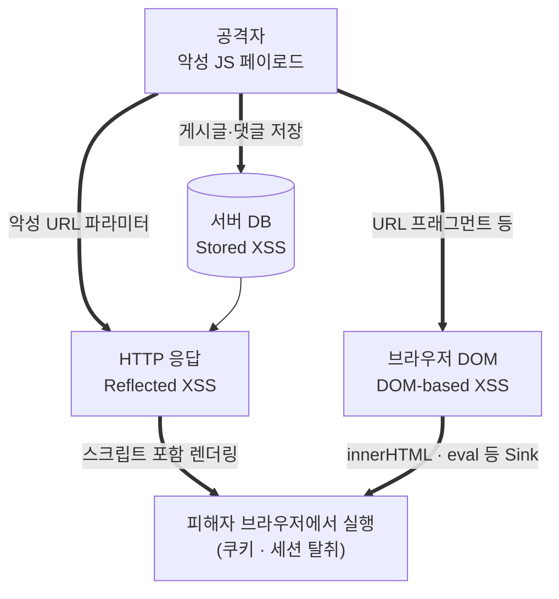

# XSS (Cross-Site Scripting, 크로스 사이트 스크립팅)

---

## I. 브라우저에서 실행되는 악성 스크립트 삽입 공격, XSS의 개요

### 가. XSS의 정의

- 입력값 검증과 출력 인코딩이 부족한 웹 페이지에 **악성 스크립트를 삽입해 방문자의 브라우저에서 실행**시킴으로써 [[세션]] 탈취, [[쿠키]] 유출, 피싱, 페이지 변조 등을 일으키는 웹 공격

### 나. 특징

| 구분 | 내용 |
| --- | --- |
| 클라이언트 측 실행 | 서버가 아닌 피해자 브라우저의 권한으로 스크립트 실행 |
| 원인 | 사용자 입력의 검증 부족, 컨텍스트별 출력 인코딩 부재 |
| 피해 | 쿠키·세션 하이재킹, 계정 도용, 악성코드 유포, 화면 변조 |
| 분류 | 저장 위치와 실행 경로에 따라 Stored, Reflected, DOM-based |

---

## II. 공격 유형 및 방어 기술

### 가. 유형별 공격 경로

### 나. 유형 비교

| 비교 항목 | Stored XSS (저장형) | Reflected XSS (반사형) | DOM-based XSS |
| --- | --- | --- | --- |
| 저장 위치 | 서버 DB·파일 (영구) | 저장 안 됨 (요청에 즉시 반사) | 서버를 거치지 않고 브라우저 DOM에서 처리 |
| 파급 범위 | 매우 큼 (페이지 방문자 전원) | 중간 (악성 링크 클릭 필요) | 중간~큼 (클라이언트 스크립트에 의존) |
| 근본 대책 | 입력 검증 + 출력 시 HTML 엔티티 인코딩 | 파라미터·에러 메시지 출력 인코딩 | 위험한 Sink 회피 (`innerHTML` 대신 `textContent`) |

### 다. 방어 기술

| 구분 | 기술 | 설명 |
| --- | --- | --- |
| 입력 검증 | Allow-list 검증 | 허용된 형식·문자만 통과 |
| 출력 처리 | 컨텍스트별 인코딩 | HTML·JS·URL 문맥에 맞게 특수문자를 엔티티로 변환 (`<` → `&lt;`, `>` → `&gt;`, `"` → `&quot;`) |
| 브라우저 정책 | CSP (Content Security Policy) | 스크립트 출처를 화이트리스트·Nonce·Hash로 제한 |
| | Trusted Types | 위험한 DOM Sink에 검증되지 않은 문자열 할당 차단 |
| 쿠키 보호 | HttpOnly / Secure | 스크립트에서 `document.cookie` 접근 차단 |
| 프레임워크 | 자동 이스케이프 | React(JSX), Angular 등 기본 이스케이프 활용 |
| 개발 프로세스 | [[SAST]] / [[DAST]] | [[DevSecOps]] 파이프라인에서 취약점 자동 탐지 ([[시큐어코딩]]) |

---

## III. CSRF와의 비교 및 동향

### 가. XSS vs CSRF

| 비교 항목 | XSS | [[CSRF]] |
| --- | --- | --- |
| 공격 대상 | 사용자 브라우저 | 사용자를 신뢰하는 웹 서버 |
| 목적 | 스크립트 실행, 정보 탈취 | 권한 도용으로 비인가 요청 실행 |
| 실행 주체 | 브라우저의 JS 엔진 | 브라우저가 쿠키를 실어 서버에 요청 |
| 대응 | 입출력 검증·인코딩, CSP | CSRF 토큰, SameSite 쿠키, 재인증 |

### 나. 동향

- **CSP 3.0 (Nonce/Hash 기반 Strict CSP)** 과 프레임워크 수준의 안전한 DOM 조작이 표준 대응으로 정착
- XSS가 있으면 CSRF 토큰도 탈취되므로, 입력 검증 · 출력 인코딩 · HttpOnly · CSP를 함께 적용하는 심층 방어 필수 ([[OWASP Top 10 2025]] Injection 범주)

---

### 🔗 연관 토픽

- **소속 도메인**: [[00_보안_MOC|🛡️ 보안]]
- **세부 분류**: `2. 현대 암호학 & 키 관리 · 전자서명`
- **핵심 연관 토픽**:
  - [[CSRF]]
  - [[세션]]
  - [[쿠키]]
  - [[시큐어코딩]]
  - [[DAST]]
