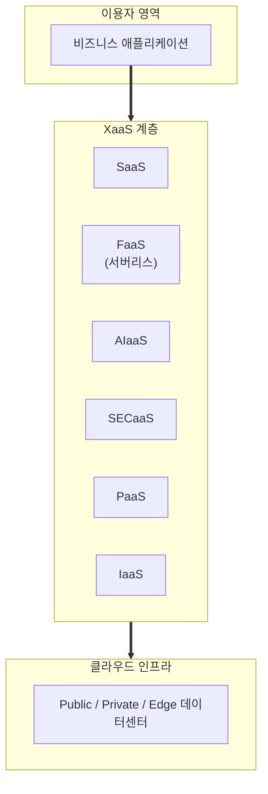

# XaaS (Everything as a Service)

---

## I. 모든 IT 자원의 서비스화, XaaS의 개요

### 가. 정의

- IaaS·PaaS·SaaS를 넘어 데이터·AI·보안·기능 실행 등 **모든 IT 자원과 기능을 네트워크를 통해 구독형 서비스로 제공**하는 클라우드 서비스 모델의 총칭

### 나. 특징

| 구분 | 내용 |
| --- | --- |
| 목적 | 소유에서 사용 중심으로 전환, 초기 투자 절감, 민첩성 확보 |
| 온디맨드 | 필요 시 즉시 확장·축소, 사용량 기반 과금 |
| API 중심 | 서비스 간 API로 조합·통합 |
| 기반 | [[클라우드 네이티브]] 아키텍처, 멀티테넌시 |

---

## II. 구조 및 구성요소

### 가. 계층 구조

- 인프라·플랫폼·소프트웨어 3대 모델 위에 AI·보안·데이터·함수 실행 등이 서비스로 계층화되어 API로 결합

### 나. 구성요소

| 구분 | 요소 | 설명 |
| --- | --- | --- |
| 기본 모델 | IaaS | 가상화된 컴퓨팅·스토리지·네트워크 제공 |
| | [[PaaS\|PaaS]] | 런타임·미들웨어·[[컨테이너]] 실행 환경 제공 |
| | SaaS | 완성된 애플리케이션 구독 (ERP, [[CRM]], 협업도구) |
| 확장 모델 | FaaS | 이벤트 발생 시 함수 단위 실행, 실행 시간만 과금 (AWS Lambda) |
| | AIaaS | [[초거대 언어 모델\|LLM]]·비전·음성 모델을 API로 호출 |
| | [[SecaaS (Security as a Service)\|SECaaS]] | [[WAAP]], ZTNA, [[SIEM]] 등 보안 기능 구독 |
| | DBaaS · DaaS | 관리형 데이터베이스 / Data as a Service(데이터 제공) 또는 Desktop as a Service(가상 데스크톱) |
| | CaaS | 관리형 컨테이너·쿠버네티스 서비스 |

---

## III. 비교 및 동향

### 가. 소유 모델 vs XaaS 구독 모델

| 비교 항목 | 소유 모델 (온프레미스) | XaaS 구독 모델 |
| --- | --- | --- |
| 비용 구조 | 초기 대규모 투자 (CapEx) | 사용량 기반 운영비 (OpEx) |
| 확장 속도 | 발주·구축에 수 주~수 개월 | 수 분 내 [[프로비저닝]] |
| [[유지보수]] | 내부 조직이 패치·장애 대응 | [[CSP]]가 서비스 계층까지 운영 (공동 책임) |
| 위험 | 과잉·과소 투자 | 벤더 종속, 비용 통제 어려움 |

### 나. 동향

- **AI 서비스화**: 모델 API뿐 아니라 GPU 클라우드(GPUaaS)·에이전트 플랫폼까지 서비스로 제공
- **하드웨어·장비의 서비스화**: HPE GreenLake, Dell APEX처럼 온프레미스 장비도 사용량 기반 구독으로 공급
- **FinOps**: 구독 서비스 파편화에 따른 비용 가시화·최적화 체계 필요

---

### 🔗 연관 토픽

- **소속 도메인**: [[00_디지털서비스_MOC|🚀 디지털서비스]]
- **세부 분류**: `1. 클라우드 컴퓨팅 & 가상화 인프라`
- **핵심 연관 토픽**:
  - [[PaaS|PaaS (Platform as a Service)]]
  - [[클라우드 컴퓨팅|클라우드 컴퓨팅 (Cloud Computing)]]
  - [[CSP|CSP (Cloud Service Provider)]]
  - [[SecaaS (Security as a Service)]]
  - [[디지털 전환|Digital Transformation]]
