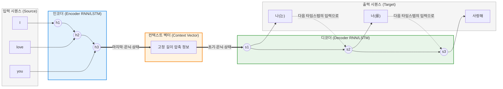

# Seq2Seq (Sequence-to-Sequence)

---

## I. 가변 길이 순차 데이터를 처리하는 기계 번역의 시초, Seq2Seq의 개요

### 가. Seq2Seq의 정의
- 입력된 가변 길이 데이터 시퀀스(원문 문장, 음성 등)를 고정 길이 컨텍스트 벡터로 인코딩한 후, 다른 도메인의 가변 길이 시퀀스(번역문, 요약문 등)로 디코딩하는 인코더-디코더 구조의 신경망 아키텍처이다.

### 나. Seq2Seq의 등장 배경 및 주요 특징

| 구분 | 주요 내용 |
| --- | --- |
| 가변 입출력 대응 | 입출력 길이가 고정되거나 동일해야 했던 기존 RNN의 구조적 제약을 극복하여 기계 번역 지원 |
| 인코더-디코더 분리 | 원문 문맥을 압축하는 인코더와 결과물을 순차 생성하는 디코더로 역할을 분리하여 번역 품질 개선 |
| 정보 병목 한계 | 입력 시퀀스의 전체 정보를 단 하나의 고정 크기 벡터에 압축하므로 장문 처리 시 정보 유실 발생 |
| 어텐션 발전 기반 | 고정 벡터 병목을 해소하기 위한 어텐션(Attention) 기법 및 현대 트랜스포머의 구조적 모태 제공 |

---

## II. Seq2Seq의 아키텍처 및 핵심 구성요소

### 가. Seq2Seq 기본 아키텍처 개념도

### 나. Seq2Seq의 3대 핵심 구성 요소

| 분류 | 요소명 (키워드) | 세부 설명 및 역할 |
| --- | --- | --- |
| **압축 (입력부)** | **인코더 (Encoder)** | 입력 시퀀스를 순차적으로 읽어 들여 정보를 처리하는 RNN/[[LSTM (Long Short-Term Memory)\|LSTM]] 계층. 입력이 끝난 후 생성되는 마지막 은닉 상태(Hidden State)를 디코더로 넘겨줌. |
| **매개체 (병목)** | **컨텍스트 벡터 (Context Vector)** | 인코더가 입력 시퀀스의 전체 의미를 요약하여 담아낸 고정 길이의 1차원 배열(숫자 벡터). 디코더의 '초기 상태'로 작용함. |
| **생성 (출력부)** | **디코더 (Decoder)** | 컨텍스트 벡터를 바탕으로 첫 단어를 예측하고, 예측한 단어를 다시 다음 타임스텝의 입력으로 사용하여 `<EOS>`(End of Sequence) 토큰이 나올 때까지 순차적으로 출력 시퀀스를 생성함. |

---

## III. Seq2Seq 모델의 진화 비교 및 최신 동향

### 가. 순차 데이터 모델의 진화 (Seq2Seq vs Transformer)

| 비교 항목 | Seq2Seq (Vanilla) | Seq2Seq + Attention | Transformer (현재 주류) |
| --- | --- | --- | --- |
| **기반 아키텍처** | RNN, LSTM, GRU | RNN, LSTM, GRU | **[[어텐션 메커니즘]] 전용 (RNN 제거)** |
| **정보 전달 방식** | 고정 길이 컨텍스트 벡터 | 출력마다 모든 입력 은닉 상태 참조 | **셀프 어텐션 (Self-Attention)** |
| **학습 방식** | 순차적 처리 (병렬화 불가, 느림) | 순차적 처리 (병렬화 불가, 느림) | **전체 시퀀스 동시 입력 (병렬 처리, 빠름)** |
| **문맥 파악 능력** | 문장이 길어질수록 급격히 저하 | 우수함 | **매우 우수함 (장기 의존성 완벽 해결)** |

### 나. 한계 극복 및 최신 발전 동향
- **고정 벡터 병목의 극복**: 초기 Seq2Seq는 단일 고정 길이 벡터에 전체 문맥을 압축하여 장기 의존성(Long-Term Dependency) 문제가 심각했으나 어텐션 메커니즘을 통해 입력 시퀀스 전체 은닉 상태를 동적 참조하며 돌파구 마련
- **티처 포싱(Teacher Forcing) 학습 기법**: 디코더 학습 시 이전 시점의 예측값 대신 실제 정답(Ground Truth)을 다음 입력으로 주입하여 훈련 수렴 속도를 향상시키는 훈련 표준 정립
- **트랜스포머 및 LLM으로의 패러다임 전환**: 인코더-디코더의 철학을 계승하면서 순환 연산을 배제하고 순수 셀프 어텐션과 병렬 연산으로 대규모 사전 학습을 가능하게 한 트랜스포머 및 초거대 언어 모델([[초거대 언어 모델|LLM]])로 전면 진화

---

### 🔗 연관 토픽

- **소속 도메인**: [[00_인공지능_MOC|🤖 인공지능]]
- **세부 분류**: `3. 딥러닝 핵심 아키텍처 & 신경망`
- **핵심 연관 토픽**:
  - [[트랜스포머|트랜스포머(Transformer)]]
  - [[어텐션 메커니즘|어텐션 메커니즘(Attention Mechanism)]]
  - [[RNN (Recurrent Neural Network)]]
  - [[초거대 언어 모델|초거대 언어 모델(Large Language Model)]]
  - [[딥러닝]]
