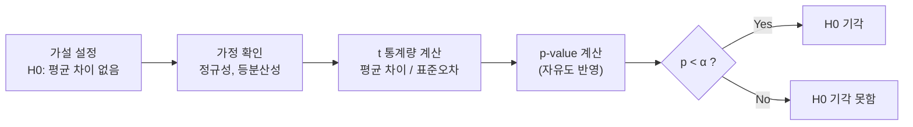

# t-검정 (t-test)

---

## I. 평균 차이를 t분포로 판단하는, t-검정의 개요

### 가. 정의

- 모분산을 모를 때 **표본 평균의 차이를 표준오차로 나눈 t 통계량과 t분포로 평균 차이의 유의성을 검정**하는 모수적 [[가설 검정]] 기법

### 나. 특징

| 구분 | 내용 |
| --- | --- |
| 적용 | 한 집단 평균과 기준값, 또는 두 집단 평균 비교 |
| 모분산 미지 | 표본 표준편차를 사용해 t분포(자유도 의존)로 판단 |
| 표본 크기 | 소표본에서도 사용 가능, 표본이 크면 t분포가 정규분포에 근접 ([[Z-검정]]과 결과 유사) |
| 가정 | 모집단 정규성(소표본일 때 중요), 독립성, 독립표본은 [[등분산성]] 여부 확인 |

---

## II. 수행 절차 및 구성요소

### 가. 수행 절차

- 가정 확인 결과에 따라 Student t-검정, Welch t-검정, 비모수 검정 중 선택

### 나. 구성요소

| 구분 | 요소 | 설명 |
| --- | --- | --- |
| 유형 | 단일표본 | 표본 평균과 기준값 비교, $t = \frac{\bar{x} - \mu_0}{s/\sqrt{n}}$, 자유도 $n-1$ |
| | 독립표본 | 서로 다른 두 집단 비교 (실험군 vs 대조군) |
| | 대응표본 | 같은 대상의 전후 차이 비교, 차이값의 단일표본 검정과 동일 |
| 통계량 | t 통계량 | 평균 차이 ÷ 표준오차 |
| 판정 | [[유의확률\|p-value]] | $H_0$ 하에서 관측값 이상으로 극단적일 확률, 유의수준 $\alpha$(예: 0.05)보다 작으면 기각 |
| 방향 | 단측·양측 | 대립가설 방향에 따라 선택 |
| 가정 점검 | 정규성 검정 | Shapiro-Wilk, Q-Q plot |
| | 등분산 검정 | Levene 검정 |
| 보정 | Welch t-검정 | 등분산 가정이 없을 때 자유도를 보정 |
| 대안 | 비모수 검정 | 맨-휘트니 U(독립), 윌콕슨 부호순위(대응) |

---

## III. 비교 및 동향

### 가. t-검정 vs ANOVA

| 비교 항목 | t-검정 | [[ANOVA(Analysis of variance)\|ANOVA]] |
| --- | --- | --- |
| 집단 수 | 1~2개 | 3개 이상 |
| 통계량 | t | F (두 집단이면 $F = t^2$) |
| 결과 | 두 집단 차이 방향·크기 | 차이 여부, 사후 검정 필요 |
| 활용 | A/B 테스트, 전후 비교 | A/B/n 테스트, 실험 설계 |

### 나. 동향

- **A/B 테스트 자동화**: 실험 플랫폼에서 Welch t-검정을 기본으로 쓰고, 분산 축소(CUPED)·순차 검정으로 판단 속도 향상
- **모델 성능 비교**: 같은 데이터 분할에서 두 모델 점수를 대응표본 t-검정·부트스트랩으로 비교 ([[AI 시스템 테스트]])

---

### 🔗 연관 토픽

- **소속 도메인**: [[00_인공지능_MOC|🤖 인공지능]]
- **세부 분류**: `1. 수학 · 통계학 & 데이터 전처리`
- **핵심 연관 토픽**:
  - [[가설 검정]]
  - [[Z-검정|Z-검정 (Z-test)]]
  - [[ANOVA(Analysis of variance)]]
  - [[등분산성|등분산성 (Homoscedasticity)]]
  - [[유의확률|유의확률 (p-value)]]
