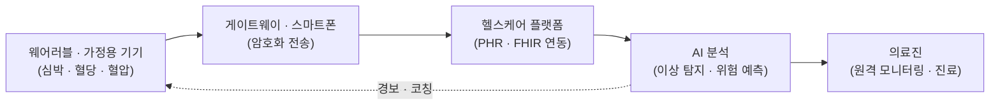

# u-Health · 스마트 헬스 (u-Health Smart Health)

---

## I. 언제 어디서나 건강 관리, u-Health·스마트 헬스의 개요

### 가. 정의

- 유비쿼터스 센서·ICT를 의료·건강 관리에 결합하여 **시간·장소 제약 없이 생체 정보를 모니터링하고 원격 진료·맞춤형 건강 관리**를 제공하는 서비스 (u-Health가 발전하여 AI·클라우드 기반 스마트 헬스케어로 확장)

### 나. 필요성 및 특징

| 구분 | 내용 |
| --- | --- |
| 필요성 | 고령화·만성질환 증가, 의료 접근성 격차 |
| 패러다임 전환 | 치료·병원 중심 → 예방·개인 중심 |
| 상시 모니터링 | 웨어러블로 생체신호 연속 수집 |
| 데이터 연계 | 병원 EMR과 개인 건강기록(PHR) 연동, 의료 [[마이데이터]] |
| 과제 | 의료법 규제, 민감정보 보호, 데이터 표준·정확도 검증 |

---

## II. 구조 및 기술요소

### 가. 서비스 구조

- 생체 신호를 수집·전송해 플랫폼에서 분석하고, 이상 시 의료진 개입과 사용자 알림으로 연결

### 나. 기술요소

| 구분 | 요소 | 설명 |
| --- | --- | --- |
| 수집 | 웨어러블 바이오 센서 | ECG, PPG(심박·산소포화도), 연속혈당측정(CGM) |
| 전송 | BLE · NB-IoT · [[MQTT (Message Queuing Telemetry Transport)\|MQTT]] | 저전력 근거리·광역 통신, 경량 메시징 [[프로토콜]] |
| 표준 | HL7 FHIR | REST API 기반 의료 정보 교환 표준 |
| 플랫폼 | PHR · 의료 클라우드 | 개인 건강기록 통합 저장·공유 |
| 분석 | AI 헬스케어 분석 | 시계열 생체 데이터로 악화 예측·조기 경보, AI 의료기기 판독 보조 |
| 보안 | [[암호화]] · 가명처리 · [[동형 암호]] | 민감 의료정보 보호, 분석 시 프라이버시 보존 |
| 서비스 | 원격 모니터링 · 비대면 진료 | 만성질환 관리, 응급 상황 자동 알림 |
| | 디지털 치료제 (DTx) | 임상으로 효과가 검증된 SW 기반 치료 (국내 2023년 첫 허가) |

---

## III. 비교 및 동향

### 가. u-Health vs 스마트 헬스케어

| 비교 항목 | u-Health (초기 원격 의료) | 스마트 헬스케어 |
| --- | --- | --- |
| 모니터링 | 내원·특정 시점 측정, 환자 보고 | 웨어러블 기반 연속 모니터링 |
| 데이터 | 병원별 분산, 수동 기록 | FHIR 표준·PHR 통합, AI 분석 |
| 초점 | 원격 상담·화상 진료 | 예방·맞춤형 관리, DTx 결합 |
| 주체 | 의료기관 | 의료기관 + 개인 + 플랫폼 기업 |

### 나. 동향

- **비대면 진료**: 국내는 시범사업 형태로 운영되며 제도화 논의 지속
- **의료 마이데이터**: '건강정보 고속도로'로 병원 진료기록을 개인 앱으로 연계
- **AI 의료기기**: 영상 판독 보조·심전도 분석 등 AI 기반 의료기기 허가 확대, 생성형 AI 건강 상담 서비스 등장

---

### 🔗 연관 토픽

- **소속 도메인**: [[00_디지털서비스_MOC|🚀 디지털서비스]]
- **세부 분류**: `3. 사물인터넷 (IoT) & 스마트 플랫폼 · 메타버스`
- **핵심 연관 토픽**:
  - [[마이데이터]]
  - [[MQTT (Message Queuing Telemetry Transport)]]
  - [[동형 암호|동형 암호 (Homomorphic Encryption)]]
  - [[CPS]]
  - [[인공지능]]
