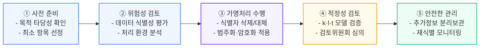

# 가명처리(Pseudonymization) 기법

---

## I. 데이터 활용과 프라이버시의 균형, 가명·익명처리의 개요

### 가. 정의
- 개인정보의 일부를 삭제하거나 대체하여 추가 정보(매핑 테이블, 복호화 키 등)의 결합 없이는 특정 개인을 알아볼 수 없도록 처리하여 데이터 활용성과 프라이버시 보호를 양립시키는 기법.

### 나. 등장 배경 및 특징

| 구분 | 내용 |
| --- | --- |
| 등장 배경 | 빅데이터·AI의 데이터 수요 급증, [[데이터 3법]] 개정으로 가명정보의 합법적 활용 근거 마련 |
| 목적 한정 | 통계 작성, 과학적 연구, 공익적 기록 보존 목적으로 정보주체 동의 없이 활용 |
| 분리 보관 | 재식별 방지를 위해 가명정보와 추가 정보를 물리적·논리적으로 분리 보관 |
| 안전조치 | 가명정보는 여전히 개인정보이므로 [[개인정보보호법]]상 안전조치 의무 적용 |

---

## II. 가명처리 절차 및 핵심 기법

### 가. 가명처리 절차

| 단계 | 주요 활동 |
| --- | --- |
| ① 사전 준비 | 처리 목적 확인, 필요 항목 선정 |
| ② 위험성 검토 | 데이터 자체·처리 환경의 재식별 위험 분석 |
| ③ 가명처리 | 식별자·준식별자에 가명처리 기법 적용 |
| ④ 적정성 검토 | k-익명성 등 프라이버시 모델로 처리 수준 검증 |
| ⑤ 안전한 관리 | 추가 정보 분리 보관, 재식별 모니터링, 처리 기록 관리 |

### 나. 데이터 변환 예시

<svg xmlns="http://www.w3.org/2000/svg" viewBox="0 0 740 375" width="100%" height="auto" style="max-width: 740px; width: 100%; height: auto; display: block; margin: 1.5rem auto;">
  <defs>
    <!-- 화살표 마커 정의 -->
    <marker id="arr-gray" markerWidth="6" markerHeight="6" refX="5" refY="3" orient="auto">
      <polygon points="0 0, 6 3, 0 6" fill="#64748B" />
    </marker>
    <marker id="arr-amber" markerWidth="6" markerHeight="6" refX="3" refY="5" orient="auto">
      <polygon points="0 0, 6 0, 3 6" fill="#D97706" />
    </marker>
  </defs>

  <!-- 전체 배경 카드 -->
  <rect width="740" height="375" fill="#F8FAFC" rx="10" stroke="#E2E8F0" stroke-width="1"/>

  <!-- 상단 메인 타이틀 바 -->
  <rect x="20" y="16" width="700" height="34" rx="6" fill="#EFF6FF" stroke="#BFDBFE" stroke-width="1.2"/>
  <text x="370" y="38" font-family="system-ui, -apple-system, sans-serif" font-size="14" font-weight="700" fill="#1E3A8A" text-anchor="middle">데이터 비식별화 및 프라이버시 보호 모델 흐름도</text>

  <!-- ================= 1. [ 원본 데이터 ] ================= -->
  <rect x="20" y="65" width="200" height="175" rx="6" fill="#FFFFFF" stroke="#93C5FD" stroke-width="1.2"/>
  <rect x="20" y="65" width="200" height="30" rx="6" fill="#EFF6FF"/>
  <text x="120" y="85" font-family="system-ui, -apple-system, sans-serif" font-size="12.5" font-weight="700" fill="#1E40AF" text-anchor="middle">[ 원본 데이터 ]</text>

  <!-- 원본 데이터 행 1 -->
  <rect x="30" y="105" width="180" height="36" rx="4" fill="#F8FAFC" stroke="#E2E8F0" stroke-width="1"/>
  <text x="40" y="128" font-family="system-ui, -apple-system, sans-serif" font-size="12" font-weight="600" fill="#334155">이름 : <tspan font-weight="700" fill="#0F172A">홍길동</tspan></text>

  <!-- 원본 데이터 행 2 -->
  <rect x="30" y="147" width="180" height="36" rx="4" fill="#F8FAFC" stroke="#E2E8F0" stroke-width="1"/>
  <text x="40" y="170" font-family="system-ui, -apple-system, sans-serif" font-size="12" font-weight="600" fill="#334155">나이 : <tspan font-weight="700" fill="#0F172A">35세</tspan></text>

  <!-- 원본 데이터 행 3 -->
  <rect x="30" y="189" width="180" height="36" rx="4" fill="#F8FAFC" stroke="#E2E8F0" stroke-width="1"/>
  <text x="40" y="212" font-family="system-ui, -apple-system, sans-serif" font-size="12" font-weight="600" fill="#334155">주소 : <tspan font-weight="700" fill="#0F172A">서울 종로</tspan></text>

  <!-- 원본 -> 처리과정 연결 화살표 -->
  <line x1="220" y1="132" x2="254" y2="132" stroke="#64748B" stroke-width="1.5" marker-end="url(#arr-gray)"/>
  <line x1="220" y1="196" x2="254" y2="196" stroke="#64748B" stroke-width="1.5" marker-end="url(#arr-gray)"/>

  <!-- ================= 2. [ 처리 과정 ] ================= -->
  <rect x="260" y="65" width="220" height="175" rx="6" fill="#FFFFFF" stroke="#C084FC" stroke-width="1.2"/>
  <rect x="260" y="65" width="220" height="30" rx="6" fill="#FAF5FF"/>
  <text x="370" y="85" font-family="system-ui, -apple-system, sans-serif" font-size="12.5" font-weight="700" fill="#6B21A8" text-anchor="middle">[ 처리 과정 ]</text>

  <!-- (1) 가명처리 -->
  <rect x="272" y="105" width="196" height="54" rx="5" fill="#F5F3FF" stroke="#DDD6FE" stroke-width="1"/>
  <text x="284" y="126" font-family="system-ui, -apple-system, sans-serif" font-size="12" font-weight="700" fill="#5B21B6">(1) 가명처리</text>
  <text x="284" y="145" font-family="system-ui, -apple-system, sans-serif" font-size="10.5" fill="#6D28D9">· 식별자 삭제 / 대체 / 마스킹</text>

  <!-- (2) 익명처리 -->
  <rect x="272" y="169" width="196" height="54" rx="5" fill="#F5F3FF" stroke="#DDD6FE" stroke-width="1"/>
  <text x="284" y="190" font-family="system-ui, -apple-system, sans-serif" font-size="12" font-weight="700" fill="#5B21B6">(2) 익명처리</text>
  <text x="284" y="209" font-family="system-ui, -apple-system, sans-serif" font-size="10.5" fill="#6D28D9">· 복원 불가능 조치 / 범주화</text>

  <!-- 처리과정 -> 결과데이터 연결 화살표 -->
  <line x1="480" y1="132" x2="514" y2="132" stroke="#64748B" stroke-width="1.5" marker-end="url(#arr-gray)"/>
  <line x1="480" y1="196" x2="514" y2="196" stroke="#64748B" stroke-width="1.5" marker-end="url(#arr-gray)"/>

  <!-- ================= 3. [ 결과 데이터 ] ================= -->
  <rect x="520" y="65" width="200" height="175" rx="6" fill="#FFFFFF" stroke="#6EE7B7" stroke-width="1.2"/>
  <rect x="520" y="65" width="200" height="30" rx="6" fill="#ECFDF5"/>
  <text x="620" y="85" font-family="system-ui, -apple-system, sans-serif" font-size="12.5" font-weight="700" fill="#065F46" text-anchor="middle">[ 결과 데이터 ]</text>

  <!-- 결과 데이터 행 1 -->
  <rect x="530" y="105" width="180" height="36" rx="4" fill="#F8FAFC" stroke="#E2E8F0" stroke-width="1"/>
  <text x="540" y="128" font-family="system-ui, -apple-system, sans-serif" font-size="12" font-weight="700" fill="#0F172A">이름 : 홍**</text>
  <rect x="632" y="113" width="68" height="20" rx="3" fill="#DCFCE7"/>
  <text x="666" y="127" font-family="system-ui, -apple-system, sans-serif" font-size="10" font-weight="700" fill="#15803D" text-anchor="middle">가명정보</text>

  <!-- 결과 데이터 행 2 -->
  <rect x="530" y="147" width="180" height="36" rx="4" fill="#F8FAFC" stroke="#E2E8F0" stroke-width="1"/>
  <text x="540" y="170" font-family="system-ui, -apple-system, sans-serif" font-size="12" font-weight="700" fill="#0F172A">나이 : 30대</text>
  <rect x="632" y="155" width="68" height="20" rx="3" fill="#DCFCE7"/>
  <text x="666" y="169" font-family="system-ui, -apple-system, sans-serif" font-size="10" font-weight="700" fill="#15803D" text-anchor="middle">범주화</text>

  <!-- 결과 데이터 행 3 -->
  <rect x="530" y="189" width="180" height="36" rx="4" fill="#F8FAFC" stroke="#E2E8F0" stroke-width="1"/>
  <text x="540" y="212" font-family="system-ui, -apple-system, sans-serif" font-size="12" font-weight="700" fill="#0F172A">주소 : 서울</text>
  <rect x="632" y="197" width="68" height="20" rx="3" fill="#DCFCE7"/>
  <text x="666" y="211" font-family="system-ui, -apple-system, sans-serif" font-size="10" font-weight="700" fill="#15803D" text-anchor="middle">총계/삭제</text>

  <!-- ================= 4. [ 프라이버시 모델 검증 ] ================= -->
  <!-- 하향 연결선 -->
  <line x1="370" y1="240" x2="370" y2="260" stroke="#D97706" stroke-width="1.5" marker-end="url(#arr-amber)"/>

  <rect x="160" y="266" width="420" height="92" rx="8" fill="#FFFBEB" stroke="#FCD34D" stroke-width="1.3"/>
  <text x="370" y="289" font-family="system-ui, -apple-system, sans-serif" font-size="12.5" font-weight="700" fill="#92400E" text-anchor="middle">[ 프라이버시 모델 검증 ]</text>

  <!-- 모델 칩 3개 -->
  <rect x="175" y="300" width="118" height="26" rx="4" fill="#FEF3C7" stroke="#F59E0B" stroke-width="1"/>
  <text x="234" y="317" font-family="system-ui, -apple-system, sans-serif" font-size="11" font-weight="700" fill="#B45309" text-anchor="middle">K-익명성</text>

  <rect x="311" y="300" width="118" height="26" rx="4" fill="#FEF3C7" stroke="#F59E0B" stroke-width="1"/>
  <text x="370" y="317" font-family="system-ui, -apple-system, sans-serif" font-size="11" font-weight="700" fill="#B45309" text-anchor="middle">L-다양성</text>

  <rect x="447" y="300" width="118" height="26" rx="4" fill="#FEF3C7" stroke="#F59E0B" stroke-width="1"/>
  <text x="506" y="317" font-family="system-ui, -apple-system, sans-serif" font-size="11" font-weight="700" fill="#B45309" text-anchor="middle">T-근접성</text>

  <!-- 부가 설명 텍스트 -->
  <text x="370" y="344" font-family="system-ui, -apple-system, sans-serif" font-size="10.5" fill="#92400E" text-anchor="middle">동일 속성 k개 군집화  ·  민감정보 L개 다양화  ·  전체 분포와의 거리 T 유지</text>
</svg>

### 다. 핵심 처리 기법

| 분류 | 기법 | 설명 | 예시 |
| --- | --- | --- | --- |
| 휴리스틱 | 가명 대체 | 식별자를 토큰·임의 값으로 대체, 매핑 테이블 별도 관리 | 홍길동 → A1029 |
| | 총계 처리 (Aggregation) | 개별 값을 합계·평균 등 통계값으로 대체 | 170cm, 180cm → 평균 175cm |
| | 부분 삭제 / 마스킹 | 식별 요소 일부를 삭제하거나 `*`로 치환 | 홍길동 → 홍*동 |
| | 범주화·라운딩 | 상세 값을 구간·범주로 변환 | 23세 → 20대, 강남구 → 서울 |
| | 데이터 교환 (Swapping) | 레코드 간 속성값을 교환해 개인–속성 연결 해체 | |
| 암호화 | 일방향 암호화 | SHA-256 등 해시 + 솔트(Salt)로 레인보우 테이블 공격 방지 ([[해시 솔트와 키 스트레칭]]) | |
| | 양방향 암호화 | [[AES]] 등 대칭키 암호, 키 보유자만 재식별 가능 | |
| | 형태보존 암호화 (FPE) | 길이·포맷을 유지해 DB [[스키마]] 변경 최소화 | |
| | 순서보존 암호화 (OPE) | 크기 순서를 유지해 암호문 상태로 범위 검색·정렬 | |

---

## III. 가명·익명 비교 및 프라이버시 보호 모델

### 가. 가명정보 vs 익명정보

| 비교 항목 | 가명정보 | 익명정보 |
| --- | --- | --- |
| 재식별 | 추가 정보 결합 시 가능 | 불가능 |
| 법 적용 | 개인정보보호법 적용 (안전조치 의무) | 적용 제외 |
| 활용 범위 | 통계·연구·공익 기록 보존 | 제한 없음 |
| 데이터 유용성 | 높음 | 낮음 (정보 손실 큼) |
| 결합 | 결합전문기관 경유 | - |

### 나. 재식별 방지 프라이버시 모델 (k·l·t)

| 모델 | 내용 | 방어 대상 |
| --- | --- | --- |
| k-익명성 | 동일 준식별자 조합이 최소 k개 이상 존재하도록 일반화·삭제 | 연결 공격 |
| l-다양성 | 동일 등가 집합 내 민감 속성이 최소 l가지 이상 | 동질성 공격, 배경지식 공격 |
| t-근접성 | 등가 집합의 민감 속성 분포와 전체 분포 차이를 t 이하로 제한 | 쏠림·유사성 공격 |
| [[차분 프라이버시]] | 질의 결과에 수학적으로 보정된 잡음 추가 (ε-DP) | 차분·재식별 공격 전반 |

### 다. 가명처리 기법의 발전 전망 및 최신 동향
- **비정형 데이터 가명처리 자동화**: 텍스트, 음성, 의료 영상, 대화 로그 내 개인식별정보(PII)를 거대 언어 모델([[초거대 언어 모델|LLM]]) 및 비전 AI로 자동 탐지·마스킹하여 AI 학습 데이터셋 정제.
- **차세대 PET(Privacy-Enhancing Technologies) 융합**: 단순 삭제/범주화 한계를 넘어 [[합성 데이터]], [[차분 프라이버시]], [[동형 암호]], 연합학습을 결합하여 데이터 분석 유용성과 프라이버시 완벽 양립.
- **데이터 안심구역 및 글로벌 규제 정합성**: 금융·의료 데이터의 안전한 분석을 위한 폐쇄형 [[데이터 안심구역]] 운영 및 EU GDPR의 연구 목적 가명처리 기준과의 상호 적정성 확보.

---

### 🔗 연관 토픽

- **소속 도메인**: [[00_보안_MOC|🛡️ 보안]]
- **세부 분류**: `2. 현대 암호학 & 키 관리 · 전자서명`
- **핵심 연관 토픽**:
  - [[데이터 3법|데이터 3법 (Data 3 Acts)]]
  - [[가명정보 처리 가이드라인]]
  - [[비식별화]]
  - [[동형 암호|동형 암호 (Homomorphic Encryption)]]
  - [[개인정보보호법]]
