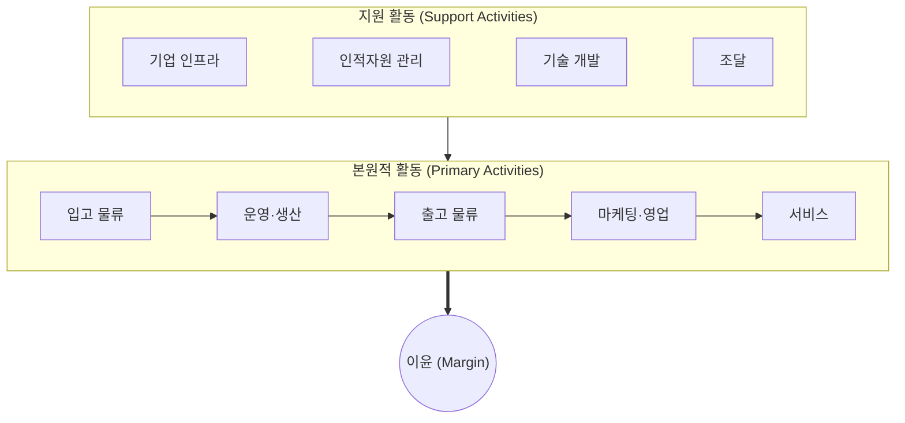

# 가치사슬(Value Chain)

---

## I. 경쟁 우위의 원천을 활동 단위로 분해, 가치사슬의 개요

### 가. 정의

- 기업 활동을 **본원적 활동(Primary)** 과 **지원 활동(Support)** 으로 나누어, 각 활동이 원가와 고객 가치(이윤, Margin)에 기여하는 정도를 분석하는 모형 (M. Porter, 1985 『경쟁 우위』)

### 나. 특징

| 구분 | 내용 |
| --- | --- |
| 경쟁 우위 식별 | 활동별 원가 동인·가치 동인 분석 → 원가 우위 또는 차별화 전략 도출 |
| 활동 단위 분석 | 기업을 하나의 덩어리가 아닌 9개 활동의 연결로 파악 |
| 연계(Linkage) 관리 | 활동 간 연결(예: 설계 개선 → A/S 비용 감소)이 경쟁 우위의 원천 |
| IT 적용 근거 | 활동별 정보시스템(ERP·[[SCM (Supply Chain Management)\|SCM]]·[[CRM]]) 도입 범위 결정에 활용 |

---

## II. 가치사슬의 구조 및 구성요소

### 가. 가치사슬 모형

- 지원 활동이 본원적 활동 전체를 받쳐 주며, 고객이 지불하는 가치와 총원가의 차이가 이윤(Margin)

### 나. 구성요소

| 구분 | 요소 | 설명 |
| --- | --- | --- |
| 본원적 활동 | 입고 물류 (Inbound Logistics) | 원자재 수령·보관·재고 관리 |
| | 운영 (Operations) | 투입물을 제품·서비스로 변환 (가공·조립·포장) |
| | 출고 물류 (Outbound Logistics) | 완제품 보관, 주문 처리, 배송 |
| | 마케팅·영업 (Marketing & Sales) | 가격 설정, 광고·판촉, 채널 관리 |
| | 서비스 (Service) | 설치, 수리, 부품 공급 등 판매 후 가치 유지 |
| 지원 활동 | 기업 인프라 (Firm Infrastructure) | 기획, 재무, 법무, 품질 관리 등 전사 관리 |
| | 인적자원 관리 (HRM) | 채용, 교육, 평가, 보상 |
| | 기술 개발 (Technology Development) | R&D, 공정 개선, 정보시스템 구축 |
| | 조달 (Procurement) | 원자재·설비·서비스 등 투입 자원 구매 |

---

## III. 가치사슬 비교 및 동향

### 가. 전통적 가치사슬 vs 디지털 가치사슬

| 구분 | 전통적 가치사슬 | 디지털 가치사슬 |
| --- | --- | --- |
| 가치 원천 | 물리적 자산, 노동, 설비 | 데이터, SW, AI 모델 |
| 구조 | 선형 파이프라인 | 비선형 생태계·플랫폼 (가치 네트워크) |
| 고객 관계 | 단방향 (생산자 → 소비자) | 양방향, 실시간 피드백 |
| 생산 방식 | 계획 기반 대량 생산 (Make to Stock) | 수요 기반 맞춤 생산 (On-Demand) |
| 핵심 기술 | 기계화·자동화 설비 | IoT, 클라우드, [[디지털 트윈]] |

### 나. 동향

- **그린 가치사슬**: 탄소 규제(EU CBAM 등)에 대응해 공급망 전 과정의 탄소 배출(Scope 3) 추적, [[ESG 경영]]과 통합
- **AI 기반 공급망**: 수요 예측·조달·물류 최적화에 AI·[[초거대 언어 모델|LLM]] 적용
- **가치 네트워크·플랫폼**: 선형 사슬 대신 플랫폼 중심의 다면 시장 구조로 확장 ([[디지털 전환|DX]])

---

### 🔗 연관 토픽

- **소속 도메인**: [[00_경영전략_MOC|📈 경영전략]]
- **세부 분류**: `1. 경영 환경 분석 & 전략 수립 프레임워크`
- **핵심 연관 토픽**:
  - [[ISP (Information Strategy Plan)]]
  - [[SCM (Supply Chain Management)]]
  - [[ESG 경영]]
  - [[CRM]]
  - [[디지털 전환|디지털 전환(DX)]]
