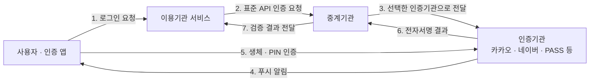

# 간편인증 인터페이스 가이드라인

---

## I. 여러 간편인증을 하나의 창구로, 간편인증 인터페이스 가이드라인의 개요

### 가. 정의

- 전자서명법 전부개정(2020.12 시행)으로 공인인증서 독점이 폐지된 뒤, **다양한 민간 간편인증 수단을 공공·민간 서비스에 일관된 방식으로 연동하기 위한 표준 연계 구조와 API 지침**

### 나. 필요성 및 특징

| 구분 | 내용 |
| --- | --- |
| N:N 연동 문제 | 이용기관마다 카카오·네이버·PASS 등 인증기관별 개별 연동 시 비용·복잡도 증가 |
| 중계 구조 | 중계기관을 두어 이용기관은 단일 표준 API만 연동 (Hub & Spoke) |
| 메시지 보안 | 서명·암호화된 JSON 메시지로 무결성·기밀성 확보 (예: JWS·JWE) |
| 사용자 편의 | 사용자가 보유한 인증 앱을 선택해 생체·PIN으로 인증 |

---

## II. 연동 구조 및 구성요소

### 가. 중계 기반 연동 흐름

- 이용기관은 중계기관의 표준 API만 호출하고, 중계기관이 사용자가 선택한 인증기관으로 요청을 분기해 결과를 돌려줌

### 나. 구성요소

| 구분 | 요소 | 설명 |
| --- | --- | --- |
| 참여 주체 | 이용기관 (SP) | 서비스 제공 기관, 중계 API 호출 |
| | 중계기관 | API 변환·라우팅·결과 검증 |
| | 인증기관 (IdP) | 본인 확인과 전자서명 수행 (전자서명인증사업자) |
| 표준 API | 인증 요청 | 인증기관·사용자 정보로 인증 요청 생성 |
| | 상태 조회 | 사용자의 앱 인증 진행 상태 확인 |
| | 결과 확인 | 서명 결과와 CI 등 식별 정보 수신 |
| 메시지 보안 | JWS | JSON 메시지 전자서명으로 [[무결성]]·출처 인증 |
| | JWE | JSON 메시지 [[암호화]]로 개인정보 보호 |
| 전송 보안 | TLS·상호 인증 | 기관 간 채널 보호 |

---

## III. 비교 및 동향

### 가. 개별 연동 vs 중계 연동

| 비교 항목 | 개별 연동 | 중계 기반 연동 |
| --- | --- | --- |
| 구조 | 이용기관 ↔ 각 인증기관 (Mesh) | 이용기관 ↔ 중계기관 ↔ 인증기관 |
| 인터페이스 | 인증기관별 규격 | 단일 표준 API |
| 유지보수 | 인증수단 추가 시 이용기관 수정 | 중계기관에서 흡수 |
| 확장성 | 신규 수단 도입 지연 | 빠른 수용 |
| 위험 | 연동 품질 편차 | 중계기관 장애가 단일 장애점 |

### 나. 동향

- **모바일 신분증 연계**: 모바일 운전면허증·주민등록증 등 DID 기반 신원증명과 통합
- **패스워드리스**: [[FIDO 2.0 (Fast IDentity Online 2.0)|FIDO2]]·[[패스키]] 기반 인증수단 수용 확대
- **지속 인증**: 로그인 이후에도 위험 기반 재인증을 적용하는 [[제로 트러스트 보안모델|제로 트러스트]] 연계

---

### 🔗 연관 토픽

- **소속 도메인**: [[00_보안_MOC|🛡️ 보안]]
- **세부 분류**: `2. 현대 암호학 & 키 관리 · 전자서명`
- **핵심 연관 토픽**:
  - [[FIDO]]
  - [[패스키|패스키(Passkey)]]
  - [[OAuth(Open Authorize) 2.0]]
  - [[생체 인증|생체 인증(텔레바이오 인증)]]
  - [[IAM]]
