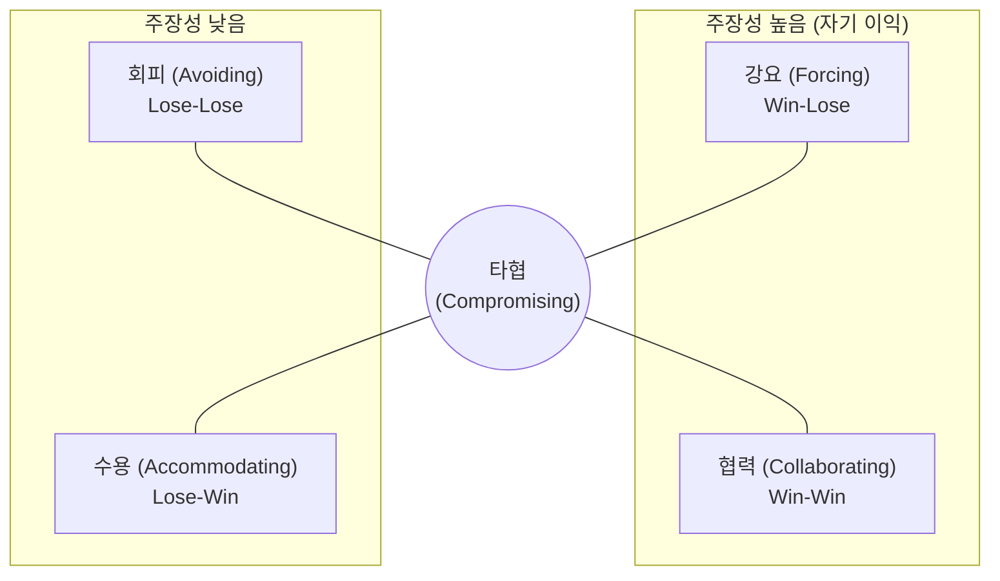

# 갈등관리 (Conflict Management)

---

## I. 갈등을 성과로 바꾸는 조율 활동, 갈등관리의 개요

### 가. 정의

- 프로젝트 이해관계자 간 **목표·자원·의견의 불일치**를 식별하고, 팀 성과에 유리한 방향으로 **조율·해소**하는 관리 활동 (PMBOK 6판 프로젝트 팀 관리 프로세스의 도구)

### 나. 원인 및 특징

| 구분 | 내용 |
| --- | --- |
| 주요 원인 | 희소 자원 경합, 일정 우선순위, 역할·책임 모호성, 기술적 이견, 개인 성향 |
| 양면성 | 방치 시 파괴적 갈등, 적절히 다루면 대안을 낳는 건설적 갈등 |
| 해결 원칙 | 사람이 아닌 문제에 집중, 과거가 아닌 현재·미래에 집중, 공개적 해결 |
| 상황 적합성 | 절대적으로 우수한 기법은 없음, 시간·중요도·관계에 따라 선택 |

---

## II. Thomas-Kilmann 갈등 해결 모형

### 가. 개념도

- 가로축 협력성(타인 이익), 세로축 주장성(자기 이익)의 강도에 따라 5가지 전략으로 분류. 왼쪽이 협력성 낮음, 오른쪽이 협력성 높음

### 나. 5대 해결 기법

| 구분 | 요소 | 설명 |
| --- | --- | --- |
| 강요/지시 (Force/Direct) | Win-Lose | 권한으로 한쪽 의견 관철, 긴급 위기·안전 문제에 적용 |
| 협력/문제해결 (Collaborate/Problem Solve) | Win-Win | 다양한 관점을 통합해 근본 원인 해결, 시간 여유와 신뢰가 있을 때. 가장 바람직한 기법으로 평가 |
| 회피/철회 (Withdraw/Avoid) | Lose-Lose | 갈등에서 물러나거나 연기, 사소한 사안·냉각기가 필요할 때 |
| 수용/원만 (Smooth/Accommodate) | Lose-Win | 합의점을 강조하고 차이를 덮음, 관계 유지가 중요할 때 |
| 타협/조정 (Compromise/Reconcile) | 부분 양보 | 양측이 일부씩 양보, 힘이 대등하고 잠정 합의가 필요할 때 |

---

## III. 비교 및 동향

### 가. 전통적 환경 vs 애자일 환경

| 비교 항목 | 전통적 (예측형) | 애자일 |
| --- | --- | --- |
| 갈등 인식 | 최소화·제거 대상 | 자연스러운 현상, 건설적 갈등 활용 |
| 해결 주체 | PM의 중재·지시 | 자기 조직화 팀의 자율 해결 |
| 해결 장치 | 규정, 에스컬레이션 | 데일리 스탠드업, 회고, 팀 규칙(Working Agreement) |
| 리더 역할 | 통제자 | 서번트 리더, 촉진자 |

### 나. 동향

- [[PMBOK 7판 (Project Management Body of Knowledge 7th Ed.)|PMBOK 7판]]은 팀 성과 영역에서 감성지능(EI)과 심리적 안전감을 강조
- 원격·하이브리드 근무 확산으로 협업 도구의 데이터(이슈 이력, 결정 로그)를 근거로 한 투명한 의사결정 중시

---

### 🔗 연관 토픽

- **소속 도메인**: [[00_프로젝트관리_MOC|📋 프로젝트관리]]
- **세부 분류**: `1. PMBOK 표준 & 프로젝트 거버넌스`
- **핵심 연관 토픽**:
  - [[PMBOK 7판 (Project Management Body of Knowledge 7th Ed.)]]
  - [[터크만 팀 개발 5단계]]
  - [[동기부여 이론]]
  - [[PMO|(E)PMO]]
  - [[애자일 선언문]]
