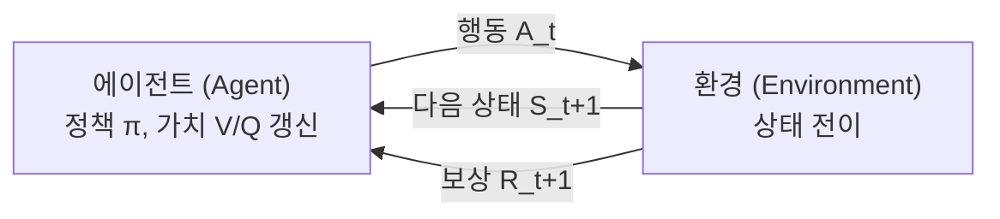

# 강화학습 (Reinforcement Learning)

---

## I. 시행착오로 최적 행동을 학습하는 기법, 강화학습의 개요

### 가. 강화학습의 정의
- 에이전트(Agent)가 주어진 환경(Environment)과 상호작용하며 시행착오를 통해 누적 보상(Cumulative Reward)을 최대화하는 최적의 행동 정책(Policy)을 스스로 학습하는 기계학습 패러다임이다.

### 나. 강화학습의 등장 배경 및 주요 특징

| 구분 | 주요 내용 |
| --- | --- |
| 수학적 기반 | 마르코프 성질을 만족하는 이산 시간 확률 제어 과정인 MDP([[마르코프 결정 프로세스]])로 의사결정 모델링 |
| 탐험 대 활용 | 새로운 행동 경로를 탐색하는 탐험(Exploration)과 기학습된 최적 경로를 쓰는 활용(Exploitation) 간의 균형 |
| 지연된 보상 | 즉각적인 정답 레이블 대신 미래 시점의 지연된 보상을 할인율($\gamma$)을 적용한 기대 가치로 산출 |
| 능동적 상호작용 | 정적 데이터셋 의존을 벗어나 에이전트의 현재 행동이 다음 상태와 향후 수집 데이터에 직접 영향을 미침 |

---

## II. 강화학습의 구조 및 핵심 요소

### 가. 에이전트–환경 상호작용 구조

- 상태 $S_t$에서 행동 $A_t$를 하면 환경이 다음 상태 $S_{t+1}$과 보상 $R_{t+1}$을 돌려주고, 에이전트는 이를 바탕으로 정책을 개선

### 나. 핵심 기술 요소

| 분류 | 요소 | 설명 |
| --- | --- | --- |
| 이론 | MDP | 상태(S)·행동(A)·전이확률(P)·보상(R)·할인율(γ)로 의사결정 모델링 |
| 학습 대상 | 정책 ($\pi$) | 상태별로 어떤 행동을 할지 정하는 확률 분포·함수 |
| 학습 대상 | 가치 함수 (V / Q) | 상태(V) 또는 상태–행동 쌍(Q)의 기대 누적 보상 |
| 학습 기법 | TD (Temporal Difference) | 에피소드 종료 전, 매 스텝 현재·다음 상태 가치 차이로 갱신 |
| 학습 기법 | [[Q러닝\|Q-Learning]] | 최적 Q값을 반복 갱신하는 대표적 오프-폴리시 기법 |
| 탐험 전략 | $\epsilon$-greedy | 확률 $\epsilon$으로 무작위 행동하여 탐험 |
| [[딥러닝]] 융합 | DQN | Q-Table 대신 심층신경망 + 경험 리플레이로 고차원 상태 처리 ([[심화강화학습]]) |
| [[딥러닝]] 융합 | PPO | 정책 변화폭을 클리핑하여 학습을 안정화한 Actor-Critic 알고리즘 |
| 응용 | RLHF | 인간 선호 피드백으로 보상 모델을 학습해 [[초거대 언어 모델\|LLM]]을 정렬(Alignment) |

---

## III. 학습 패러다임 비교 및 동향

### 가. 지도·비지도·강화학습 비교

| 비교 항목 | [[지도학습]] | [[비지도 학습]] | 강화학습 |
| --- | --- | --- | --- |
| 목적 | 정답 예측·분류 | 숨은 패턴·구조 발견 | 최적 행동 정책 학습 |
| 데이터 | 입력 + 정답 레이블 | 레이블 없는 입력 | 상태·행동·보상의 상호작용 |
| 피드백 | 정답과의 오차 (즉시) | 없음 | 지연된 스칼라 보상 |
| 알고리즘 | [[CNN]], [[서포트 벡터 머신\|SVM]], Transformer | K-Means, [[PCA(Principal Component Analysis)\|PCA]] | Q-Learning, DQN, PPO |
| 활용 | 이미지 인식, 번역 | 고객 세분화, 이상 탐지 | 자율주행, 로봇 제어, LLM 정렬 |

### 나. 최신 동향

- **오프라인 강화학습**: 실시간 상호작용 없이 수집된 데이터만으로 학습하여 로봇·[[Smart Car(자율주행)\|자율주행]]의 안전 문제 완화
- **RLAIF**: 인간 대신 AI가 피드백을 제공해 RLHF의 확장성 한계 극복
- **[[멀티에이전트 강화학습]] (MARL)**: 군집 [[드론]], 스마트팩토리 등 다수 에이전트의 협력·경쟁 최적화

---

### 🔗 연관 토픽

- **소속 도메인**: [[00_인공지능_MOC|🤖 인공지능]]
- **세부 분류**: `2. 머신러닝 기초 & 핵심 알고리즘`
- **핵심 연관 토픽**:
  - [[지도학습]]
  - [[Q러닝]]
  - [[마르코프 결정 프로세스]]
  - [[심화강화학습]]
  - [[초거대 언어 모델|초거대 언어 모델(Large Language Model)]]
