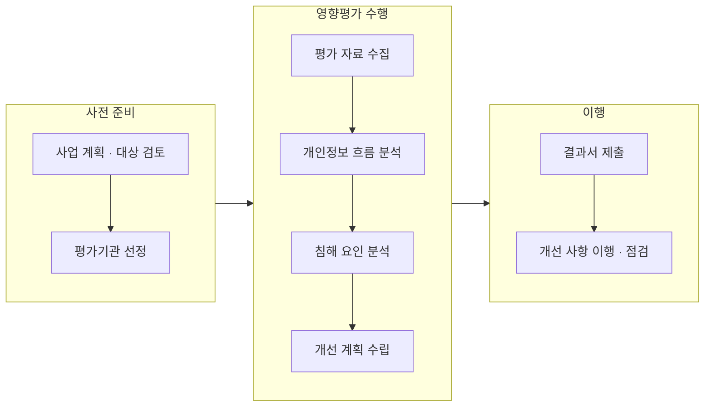

# 개인정보 영향평가 (PIA)

---

## I. 구축 전에 침해 위험을 걸러내는, 개인정보 영향평가의 개요

### 가. 정의

- 공공기관이 **일정 규모 이상의 개인정보파일을 처리하는 시스템을 구축·변경할 때, 침해 위험을 사전에 분석하고 개선 방안을 도출**하는 평가 제도 ([[개인정보보호법]] 제33조)

### 나. 특징

| 구분 | 내용 |
| --- | --- |
| 사전 예방 | 설계 단계에서 위험 제거 ([[개인정보보호 중심 설계\|Privacy by Design]]) |
| 의무 대상 | 공공기관 (민간은 자율 수행 권고) |
| 수행 주체 | 개인정보보호위원회가 지정한 영향평가기관 |
| 결과 제출 | 평가 결과를 개인정보보호위원회에 제출 |
| 이행 확인 | 개선 사항을 개발·감리 단계에서 반영 확인 |

---

## II. 수행 절차 및 평가 요소

### 가. 수행 절차

- 시스템 설계 완료 전에 평가를 수행하고, 도출된 개선 사항을 개발 단계에 반영한 뒤 이행 여부를 점검

### 나. 평가 요소

| 구분 | 요소 | 설명 |
| --- | --- | --- |
| 의무 대상 | 5만 명 이상 | 민감정보·고유식별정보 처리 파일 |
| | 50만 명 이상 | 다른 개인정보파일과 연계·결합 |
| | 100만 명 이상 | 개인정보파일 구축·운용 |
| 평가 영역 | 대상기관 보호체계 | 정책, 조직, 교육, 위탁 관리 |
| | 대상 시스템 보호조치 | 접근 통제, [[암호화]], 접속기록 관리 |
| | 처리 단계별 보호조치 | 수집·보유·이용·제공·파기 단계 적정성 |
| | 특정 기술 적용 | CCTV, RFID, 바이오정보, 가명정보, AI 등 |
| 결과물 | 영향평가서 | 위험도 산정과 개선 계획 |

---

## III. 비교 및 동향

### 가. 개인정보 영향평가 vs ISMS-P

| 비교 항목 | 개인정보 영향평가 | [[ISMS-P]] |
| --- | --- | --- |
| 목적 | 특정 시스템의 사전 침해 위험 제거 | 조직 관리체계 인증 |
| 대상 | 개별 개인정보처리시스템 | 조직의 서비스·인프라 범위 |
| 시기 | 구축·변경 시 (설계 단계) | 운영 중 정기 (최초·사후·갱신 심사) |
| 의무 | 공공기관 (규모 기준) | ISMS는 일정 규모 이상 의무, ISMS-P는 자율 |
| 결과 | 개선 계획 | 인증서 (3년) |

### 나. 동향

- **AI 시스템 평가**: AI 학습 데이터 적법성, 자동화된 결정의 설명 가능성·재식별 위험을 평가 항목에 반영
- **민간 확산**: 고위험 처리(대규모 프로파일링 등)에 대한 자율 영향평가 확대, GDPR DPIA와 유사한 방향
- **위협 모델링 결합**: 개발 단계에서 [[STRIDE]]·LINDDUN 같은 위협 모델링으로 프라이버시 위험 식별

---

### 🔗 연관 토픽

- **소속 도메인**: [[00_보안_MOC|🛡️ 보안]]
- **세부 분류**: `2. 현대 암호학 & 키 관리 · 전자서명`
- **핵심 연관 토픽**:
  - [[개인정보보호법]]
  - [[개인정보보호 중심 설계|개인정보보호 중심 설계(Privacy by Design)]]
  - [[ISMS-P]]
  - [[위협 모델링|위협 모델링(Threat Modeling) - Secure SDLC]]
  - [[개인정보 프라이버시 8원칙]]
